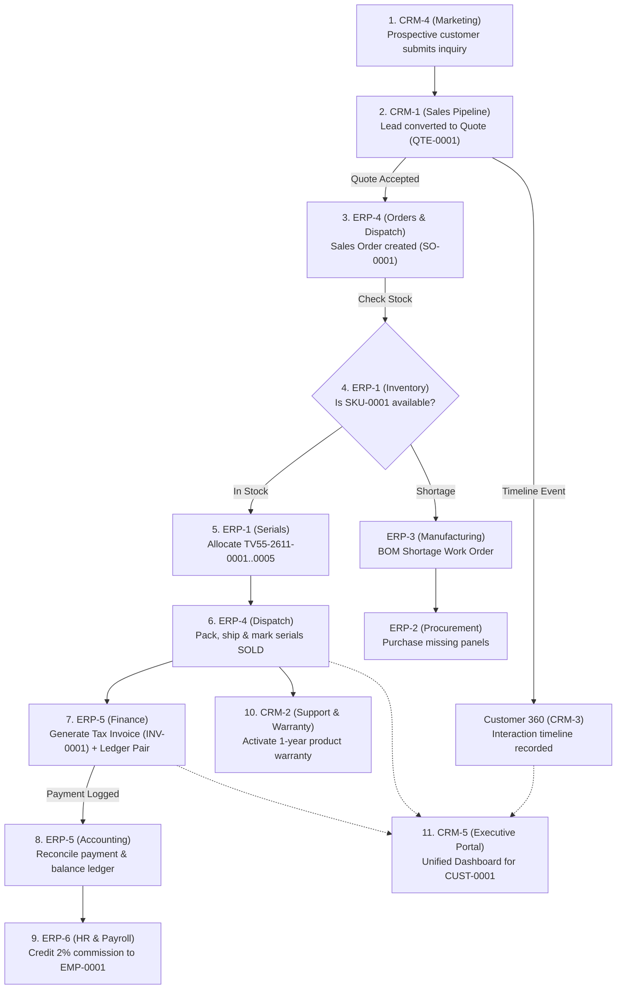

# ⚡ Electro App · Enterprise CRM + ERP Monorepo

[](https://github.com/SAM-ALTMAN-ERP-CRM/electro-app/actions)
[](https://github.com/SAM-ALTMAN-ERP-CRM/electro-app)
[](https://github.com/SAM-ALTMAN-ERP-CRM/electro-app/issues)
[](https://nodejs.org/)
[](https://www.postgresql.org/)

Welcome to **Electro App**, the unified, end-to-end Enterprise Resource Planning (ERP) and Customer Relationship Management (CRM) platform for a consumer electronics company manufacturing and distributing smart televisions, accessories, and replacement components across India.

This application is built collaboratively by **11 student engineering teams (44 developers)** and a **4-person PMO technical leadership team** in a single integrated monorepo. When fully compiled, `npm run dev` starts the entire enterprise platform: one unified login screen, one dynamic navigation shell, and eleven seamlessly interconnected microservices.

---

## 📑 Table of Contents
1. [System Architecture](#-system-architecture)
2. [Team Directory & Port Mapping](#-team-directory--port-mapping)
3. [The End-to-End Business Workflow (Order-to-Cash)](#-the-end-to-end-business-workflow-order-to-cash)
4. [Quick Start Guide](#-quick-start-guide)
5. [Monorepo Rules for All Developers](#-monorepo-rules-for-all-developers)
6. [Team Roles & Individual Responsibilities](#-team-roles--individual-responsibilities)
7. [The 14-Day Roadmap & Milestones](#-the-14-day-roadmap--milestones)
8. [Available npm Commands](#-available-npm-commands)
9. [Documentation Directory](#-documentation-directory)

---

## 🏛 System Architecture

Electro App uses a decoupled, event-tolerant **microservice architecture** paired with a modular **Single Page Application (SPA)** frontend shell:

```
┌─────────────────────────────────────────────────────────────────────────────┐
│                       PORT 3000: UNIFIED FRONTEND SHELL                     │
│               React 18 + Vite + Dynamic Module Loader + Plain CSS           │
│    [Login / Session] ──► [Navigation Sidebar] ──► [Dynamic Team Module SPA] │
└──────────────────────────────────────┬──────────────────────────────────────┘
                                       │ Shared API Client api('team', path)
                                       ▼
┌─────────────────────────────────────────────────────────────────────────────┐
│                 PORTS 5101..5105 & 5201..5206: 11 BACKEND SERVICES          │
│               Node.js 20 + Express + Route Auto-Mounting under /api         │
├──────────────────────────────────────┬──────────────────────────────────────┤
│ 📂 CRM BACKENDS (5101..5105)         │ 📂 ERP BACKENDS (5201..5206)         │
│ • CRM-1: Sales Pipeline (5101)       │ • ERP-1: Inventory & Stock (5201)    │
│ • CRM-2: Support & Warranty (5102)   │ • ERP-2: Procurement & POs (5202)    │
│ • CRM-3: Customer 360 (5103)         │ • ERP-3: Manufacturing & BOM (5203)  │
│ • CRM-4: Marketing Campaigns (5104)  │ • ERP-4: Orders & Dispatch (5204)    │
│ • CRM-5: Portal & Analytics (5105)   │ • ERP-5: Finance & Invoicing (5205)  │
│                                      │ • ERP-6: HR & Payroll (5206)         │
└──────────────────────────────────────┴──────────────────────────────────────┘
                                       │ callService(team, path) + Mock Fallback
                                       ▼
┌─────────────────────────────────────────────────────────────────────────────┐
│                       POSTGRESQL 16: ISOLATED DATABASES                     │
│       crm1_db, crm2_db, crm3_db, crm4_db, crm5_db, erp1_db ... erp6_db      │
└─────────────────────────────────────────────────────────────────────────────┘
```

### Core Architectural Decisions
- **Zero Shared File Mutations**: Team developers write code **exclusively** inside their assigned folders (`services/<team>/` and `frontend/src/modules/<team>/`). The backend `server.js` and frontend `App.jsx` dynamically discover and mount routes at runtime without manual edits.
- **Resilient Inter-Service Calls (`callService`)**: Services communicate over HTTP. If a downstream service is temporarily unavailable, `callService(team, path, { mock: 'name' })` automatically falls back to realistic seed data in `services/<team>/mocks/` when `USE_MOCKS=true`.
- **Stateless Authentication & Role-Based Access Control**: Standard Bearer JWT authentication with shared development bypass (`AUTH_REQUIRED=false`). Admin role (`admin`) grants full platform access; role-specific views apply to `sales`, `support`, `warehouse`, `finance`, and `hr`.

---

## 🗺 Team Directory & Port Mapping

| Subsystem | Team Slug | Port | Database | Sprint Board | Key Domain Responsibilities |
| :--- | :--- | :---: | :--- | :---: | :--- |
| **Frontend** | `frontend` | `3000` | N/A | [Master Board](https://github.com/orgs/SAM-ALTMAN-ERP-CRM/projects/3) | App shell, navigation, universal `api()` client, theme |
| **CRM-1** | `crm1` | `5101` | `crm1_db` | [CRM-1 Board](https://github.com/orgs/SAM-ALTMAN-ERP-CRM/projects/4) | Leads management, opportunities pipeline, 18% GST quotations |
| **CRM-2** | `crm2` | `5102` | `crm2_db` | [CRM-2 Board](https://github.com/orgs/SAM-ALTMAN-ERP-CRM/projects/5) | Helpdesk ticketing, warranty lookups, RMA defect replacements |
| **CRM-3** | `crm3` | `5103` | `crm3_db` | [CRM-3 Board](https://github.com/orgs/SAM-ALTMAN-ERP-CRM/projects/6) | Customer master (`CUST-0001..0010`), 360-degree interaction timeline |
| **CRM-4** | `crm4` | `5104` | `crm4_db` | [CRM-4 Board](https://github.com/orgs/SAM-ALTMAN-ERP-CRM/projects/7) | Marketing campaigns, audience segmentation, web lead capture forms |
| **CRM-5** | `crm5` | `5105` | `crm5_db` | [CRM-5 Board](https://github.com/orgs/SAM-ALTMAN-ERP-CRM/projects/8) | Customer self-service portal, executive business analytics |
| **ERP-1** | `erp1` | `5201` | `erp1_db` | [ERP-1 Board](https://github.com/orgs/SAM-ALTMAN-ERP-CRM/projects/9) | Product catalog (`SKU-0001..0015`), warehouse inventory, TV serial tracking |
| **ERP-2** | `erp2` | `5202` | `erp2_db` | [ERP-2 Board](https://github.com/orgs/SAM-ALTMAN-ERP-CRM/projects/10) | Supplier management, purchase requests, Goods Receipt Notes (GRN) |
| **ERP-3** | `erp3` | `5203` | `erp3_db` | [ERP-3 Board](https://github.com/orgs/SAM-ALTMAN-ERP-CRM/projects/11) | Bill of Materials (BOM), production work orders, quality control |
| **ERP-4** | `erp4` | `5204` | `erp4_db` | [ERP-4 Board](https://github.com/orgs/SAM-ALTMAN-ERP-CRM/projects/12) | Sales orders, inventory allocation, shipment dispatch & tracking |
| **ERP-5** | `erp5` | `5205` | `erp5_db` | [ERP-5 Board](https://github.com/orgs/SAM-ALTMAN-ERP-CRM/projects/13) | GST tax invoicing, double-entry general ledger, payment gateway |
| **ERP-6** | `erp6` | `5206` | `erp6_db` | [ERP-6 Board](https://github.com/orgs/SAM-ALTMAN-ERP-CRM/projects/14) | Employee directory (`EMP-0001..0012`), attendance, sales commissions |
| **PMO** | `pmo` | N/A | N/A | [Master Backlog](https://github.com/orgs/SAM-ALTMAN-ERP-CRM/projects/3) | Program management, CI automation, code reviews, verification harness |

---

## 🔄 The End-to-End Business Workflow (Order-to-Cash)

Electro App connects every team through a unified 9-step business transaction chain:



1. **Lead Generation**: A prospect submits an inquiry form on the website (CRM-4). CRM-4 calls CRM-1 (`POST /api/leads`) to register `LEAD-0001`.
2. **Deal Qualification & Quote**: Sales Rep `EMP-0001` calls the customer, negotiates pricing, and generates Quote `QTE-0001` with 18% GST (9% CGST + 9% SGST). Customer accepts.
3. **Sales Order & Timeline**: Accepting the quote triggers ERP-4 to create Sales Order `SO-0001`. CRM-3 records the order event on the customer's 360-degree timeline.
4. **Stock Reservation & Shortage**: ERP-4 calls ERP-1 (`/api/stock/check`). If units exist, stock is reserved. If a shortfall occurs (e.g., 65" OLED TV has only 3 units in stock, order wants 5), ERP-4 triggers ERP-3 to generate a Work Order from the Bill of Materials (BOM), alerting ERP-2 to purchase missing components.
5. **Physical Unit Serialization & Dispatch**: Warehouse staff select `SO-0001` in ERP-4, allocate individual serial numbers (`TV55-2611-0001` to `0005`), and print courier shipping manifests. Clicking "Ship" transitions serials from `reserved` to `sold` and deducts inventory.
6. **Automated Tax Invoicing**: Upon dispatch, ERP-5 automatically generates Tax Invoice `INV-0001` incorporating the customer's 15-character GSTIN and logs a balanced double-entry General Ledger pair.
7. **Payment & Sales Commission**: Finance logs receipt of payment (`₹41,300`). ERP-6 automatically syncs paid invoices and credits a 2% sales commission (or 3% for deals $>₹1,00,000$) to the sales rep's monthly salary slip.
8. **Customer Support & RMA Returns**: When a customer calls support for warranty claims, CRM-2 verifies coverage and issues an RMA. Returned units restock in ERP-1, and ERP-5 issues a Credit Note (`CRN-0001`) adjusting the ledger.
9. **Executive Analytics**: Management opens CRM-5 to view company revenue, inventory turnover, support ticket resolution velocity, and employee performance in real time.

---

## 🚀 Quick Start Guide

### 1. Prerequisites
- **Node.js**: `v20.0.0` or higher (tested on Node 20 LTS)
- **npm**: `v9.0.0` or higher
- **PostgreSQL**: Version 15 or 16 running locally (or via Docker)

### 2. Clone and Setup
```bash
# 1. Clone the repository
git clone https://github.com/SAM-ALTMAN-ERP-CRM/electro-app.git
cd electro-app

# 2. Copy the environment template
cp .env.example .env

# 3. Install all monorepo dependencies
npm install

# 4. Run the preflight smoke check
npm run smoke
```

### 3. Start the Platform
```bash
# Launches all 11 Express microservices and the Vite React frontend concurrently
npm run dev
```

- **Frontend Application**: [http://localhost:3000](http://localhost:3000)
- **Backend Health Check**:
  ```bash
  curl http://localhost:5101/api/health # CRM-1 Sales
  curl http://localhost:5201/api/health # ERP-1 Inventory
  curl http://localhost:5205/api/health # ERP-5 Finance
  ```

---

## 📐 Monorepo Rules for All Developers

To ensure 44 developers can push code simultaneously without collisions or broken builds, automated GitHub Actions robots enforce these strict policies on every Pull Request:

### 1. One Issue = One Branch
- Every unit of work must branch from fresh `main`.
- **Branch Naming Pattern (Required by CI)**:
  `^(crm[1-5]|erp[1-6])/([a-d][1-5]|r[1-4])-[a-z0-9-]+$`
  - ✅ *Valid*: `crm1/a1-leads-table`, `erp4/c1-dispatch-service`, `erp6/r1-readme`
  - ❌ *Invalid*: `fix-leads`, `crm1-a1`, `feature/inventory`, `main`

### 2. PR Title and Body Format
- **PR Title**: Must start with your exact issue key in square brackets:
  - `[<KEY>] <Description>` (e.g. `[CRM1-A1] Leads table and API`)
- **PR Body**: Must explicitly reference your issue number:
  - `Closes #<issue-number>` (e.g. `Closes #14`)

### 3. Strict Folder Boundaries
You may **ONLY** create and edit files inside your own assigned folders:
- Backend: `services/<team>/`
- Frontend: `frontend/src/modules/<team>/`
- Documentation: `docs/<team>/`
- 🚫 **NEVER touch**: `services/_shared/`, `frontend/src/App.jsx`, `frontend/src/api.js`, root `package.json`, or `.github/`. CI will reject your PR immediately!

### 4. Zero Hardcoded `localhost`
- **Frontend**: Always use the shared API client:
  ```javascript
  import { api } from '../../../api';
  const data = await api('crm1', '/api/leads');
  ```
- **Backend**: Always use `callService`:
  ```javascript
  const { callService } = require('../_shared/callService');
  const products = await callService('erp1', '/api/products', { mock: 'products' });
  ```

### 5. Standard Master Data IDs (Section 5)
Never invent random IDs. Always point foreign keys to standard seeded entities:
- **Customers**: `CUST-0001` to `CUST-0010`
- **Products**: `SKU-0001` to `SKU-0015` (Finished TVs) & `SKU-0101` to `SKU-0105` (Components)
- **Employees**: Sales Reps `EMP-0001..0004`, Service Engineers `EMP-0005..0007`, Admin up to `EMP-0012`
- **Warehouses**: `WH-01` to `WH-03`
- **Dealers**: `DLR-0001` (linked to `CUST-0004`), `DLR-0002` (linked to `CUST-0008`)

### 6. Currency, Tax & Dates
- **Currency**: Indian Rupees (`INR`), stored as `NUMERIC(12, 2)` and formatted as `₹35,000.00`.
- **GST Rate**: Exactly **18%** (split into 9% CGST + 9% SGST). Catalog and quotation prices are *excluding* GST.
- **Dates**: Standard ISO date format `YYYY-MM-DD`.

### 7. The WAIT vs MOCK Rule (Never Sit Blocked!)
- If your issue says `(MOCK: <name>)`, create `services/<team>/mocks/<name>.json` with 3 realistic rows. Wrap cross-team calls in `try/catch` and log `[integration-error]`.
- If your issue says `(WAIT: ...)`, work on your other independent issues first. Never stop development waiting for another team.

### 8. PMO Code Review & Merging
- **Students DO NOT merge.**
- When your PR has all 5 green CI checks, request review from `@SAM-ALTMAN-ERP-CRM/pmo`.
- A PMO reviewer will audit your changes against the PMO review checklist and perform the **Squash and merge** within **8 hours**.

---

## 👥 Team Roles & Individual Responsibilities

Every team of 4 divides responsibilities across 4 specialized roles:

| Role | Role Title | Key Deliverables & Responsibilities |
| :---: | :--- | :--- |
| **R1** | **Team Lead** | Weekly status reports, daily stand-up, PR code reviews, demo script, and final viva presentation walkthrough. |
| **R2** | **Data Lead** | ER diagram in 3NF (`docs/<team>/er-diagram.md`), schema migrations (`schema.sql`), seed data (`seed.sql`), and data dictionary. |
| **R3** | **UI/UX Lead** | Responsive user interface, component layout, status badge colors, error banners, and money formatting (`₹`). |
| **R4** | **QA & Testing Lead** | Unit test cases, Postman collections (`docs/<team>/tests.md`), integration tests, and edge-case validation. |

---

## 🗓 The 14-Day Roadmap & Milestones

```
Day 1 ──► Day 2 ──► Day 3 ──► Day 4 ──► Day 7 ──► Day 10 ──► Day 11 ──► Day 14
[Init]   [Wave 0]  [Wave 1]   [G1]      [G2]      [G3]       [G4/RC]   [Final]
         Found.    Kickoff    Design    Core Flow Live Int.  Freeze    Demo &
         Merged               Freeze    Complete  Mocks Off  QA Test   Viva
```

- **Wave 0: Foundation (Day 1–2) — [PASSED]**: Monorepo skeleton, shared helpers, CI robots, 11 health check routes, and dynamic frontend shell merged into `main`.
- **Gate 1: Design Freeze (Day 3–4)**: Master tables created, 3NF ER diagrams documented, seed data populated adhering to Section 5 IDs, contracts frozen.
- **Gate 2: Core Flow (Day 5–7)**: Every team demonstrates its primary CRUD workflow against its isolated database using mock APIs for external dependencies.
- **Gate 3: Integration (Day 8–10)**: Mocks replaced with live inter-service calls (`USE_MOCKS=false`); order-to-invoice end-to-end chain fully functioning.
- **Gate 4: Release Candidate (Day 11–13)**: Feature freeze, comprehensive QA testing, demo rehearsals, and video recordings.
- **Day 14: Final Delivery**: 15-minute complete golden-path live walkthrough from fresh database reset.

---

## 🛠 Available npm Commands

| Command | Action |
| :--- | :--- |
| `npm run dev` | Concurrently starts all 11 Express microservices and Vite frontend on port 3000. |
| `npm run build` | Compiles the production frontend bundle into `frontend/dist/`. |
| `npm run smoke` | Audits JavaScript syntax across all 11 backends and verifies module index files. |
| `npm run db:setup` | Idempotently executes `schema.sql` and `seed.sql` for all teams. |
| `npm run reset` | Drops existing tables, re-applies schemas, and reseeds initial master data. |
| `npm test` | Executes the automated PMO verification suite (`tests/pmo/`). |

---

## 📚 Documentation Directory

- 📖 [Contributing Guidelines (CONTRIBUTING.md)](./CONTRIBUTING.md) — Comprehensive developer guide and CI rules.
- 📋 [Master Issues Pack (docs/issues-pack.md)](./docs/issues-pack.md) — Full specification of all 180 issues and acceptance criteria.
- 🚦 [Project Workflow & Guidelines (docs/workflow.md)](./docs/workflow.md) — 14-day roadmap, team coordination, and review rules.
- 🛡 [PMO Runbook (docs/PMO-RUNBOOK.md)](./docs/PMO-RUNBOOK.md) — PMO operational procedures, SLA targets, and merge checklist.
- 🤖 [Agent & AI Guidelines (AGENTS.md)](./AGENTS.md) — Pairing instructions for developer AI coding assistants.
- 📊 [Per-Team Issues & Specs (`docs/<team>/issues.md`)](./docs/) — Individual issue breakdowns for teams CRM-1 through ERP-6.

---

*Electro App is built with pride by the 44 engineers of the 2026 ERP+CRM Development Cohort and the PMO Technical Leadership Team.*
