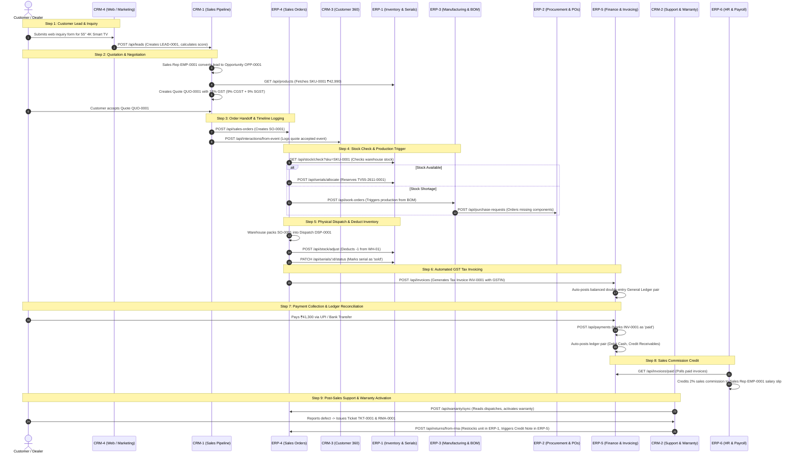

# 🔄 Electro App: Master Business Workflow & Cross-Team Integration Specification

> **Target Audience**: All 11 Engineering Teams (44 Developers) + PMO  
> **Core Objective**: Deliver a production-grade, end-to-end integrated ERP + CRM system where every single team connects into a seamless **Order-to-Cash (O2C)** and **Procure-to-Pay (P2P)** electronics company platform.

---

## 🏛 The 9-Step End-to-End Business Workflow (The "Golden Path")

The entire project represents the real-world operational lifecycle of an Indian consumer electronics brand (manufacturing and retailing 4K Smart TVs, OLED displays, home audio, and appliances).

---

## 📑 The 29 Cross-Team API Contracts (The Golden Integration Matrix)

Every inter-service HTTP request between teams is pre-defined below. 
When developing before the other team merges, use `callService(team, path, { mock: '<mock-name>' })`.

| Row # | Calling Team & Issue | Receiving Team & Issue | Method & Endpoint | Purpose in Workflow | Mock File Path |
| :---: | :--- | :--- | :--- | :--- | :--- |
| **1** | CRM1-A2 | ERP6-A1 | `GET /api/employees?role_title=Sales Rep` | Populate sales rep dropdown | `services/crm1/mocks/employees-sales.json` |
| **2** | CRM1-C2, CRM4-B4 | ERP1-A1 | `GET /api/products` | Load product catalog & pricing | `services/crm1/mocks/products.json` |
| **3** | CRM1-C3 | ERP4-A1 | `POST /api/sales-orders` | Handoff accepted quote as order | `services/crm1/mocks/sales-orders.json` |
| **4** | CRM1-C3, CRM2-A1, CRM2-C3, CRM4-A3, ERP4-C3 | CRM3-B3 | `POST /api/interactions/from-event` | Log event on Customer 360 timeline | `services/<team>/mocks/timeline-event.json` |
| **5** | CRM2-A2 | ERP6-A1 | `GET /api/employees?role_title=Service Engineer` | Assign ticket to service engineer | `services/crm2/mocks/employees-engineers.json` |
| **6** | CRM2-B3 | ERP4-C1 | `GET /api/dispatches` | Fetch dispatched serials for warranty | `services/crm2/mocks/dispatches.json` |
| **7** | CRM2-C3 | ERP4-D1 | `POST /api/returns/from-rma` | Return defective product to warehouse | `services/crm2/mocks/rma-returns.json` |
| **8** | CRM4-A2, A3, B3 | CRM3-C1 | `GET /api/segments`, `GET /api/segments/:id/customers` | Target marketing campaign audience | `services/crm4/mocks/segments.json` |
| **9** | CRM4-B4 | CRM1-A1 | `POST /api/leads` | Convert web inquiry form to lead | `services/crm4/mocks/leads.json` |
| **10** | CRM5-A1, A3 | CRM3-A1, ERP4-A1, CRM2-A1, ERP5-A1 | Reads customers, orders, tickets, invoices | Unified customer self-service portal | `services/crm5/mocks/portal-*.json` |
| **11** | CRM5-B1, B3, C1, C3, D1 | CRM1-A1, B1, C1 | Reads leads, opportunities, quotes | Executive sales analytics dashboards | `services/crm5/mocks/analytics-sales.json` |
| **12** | CRM5-D1 | CRM2-A1, CRM3-A1 | Reads tickets, customers | Executive support & customer KPI dashboard | `services/crm5/mocks/analytics-support.json` |
| **13** | ERP1-D3 | ERP2-B1 | `POST /api/purchase-requests` | Low stock alert triggers purchase request | `services/erp1/mocks/purchase-requests.json` |
| **14** | ERP2-D1 | ERP1-B1 | `POST /api/stock/adjust` | Receiving goods (GRN) increments stock | `services/erp2/mocks/stock-adjust.json` |
| **15** | ERP2-D1 | ERP5-D1 | `POST /api/ledger/auto` (`type: 'purchase'`) | Auto-post purchase bill to ledger | `services/erp2/mocks/ledger-purchase.json` |
| **16** | ERP3-A3 | ERP1-B3 | `GET /api/stock/check` | Check BOM component stock before assembly | `services/erp3/mocks/stock-check.json` |
| **17** | ERP3-A3 | ERP2-B1 | `POST /api/purchase-requests` | Auto-purchase components with shortage | `services/erp3/mocks/purchase-requests.json` |
| **18** | ERP3-C1, C3 | ERP1-B1, C1 | `POST /api/stock/adjust`, `POST /api/serials/bulk` | Finished goods restock & register serials | `services/erp3/mocks/serials-bulk.json` |
| **19** | ERP4-A3, ERP5-A1 | CRM3-A1 | `GET /api/customers/:id` | Fetch customer GSTIN & billing address | `services/erp4/mocks/customer.json` |
| **20** | ERP4-B1 | ERP1-B3 | `GET /api/stock/check` | Verify inventory before order reservation | `services/erp4/mocks/stock-check.json` |
| **21** | ERP4-B3 | ERP3-B3 | `POST /api/work-orders` | Shortage triggers production work order | `services/erp4/mocks/work-orders.json` |
| **22** | ERP4-C1 | ERP1-C3 | `POST /api/serials/allocate` | Allocate serial number to dispatch | `services/erp4/mocks/serials-allocate.json` |
| **23** | ERP4-C3 | ERP1-B1, C3 | `POST /api/stock/adjust` (-), `PATCH /api/serials/:id/status` ('sold') | Deduct stock & mark serial sold on ship | `services/erp4/mocks/serials-sold.json` |
| **24** | ERP4-C3 | ERP5-A1 | `POST /api/invoices` | Auto-generate Tax Invoice on dispatch | `services/erp4/mocks/invoices.json` |
| **25** | ERP4-D3 | ERP1-C3, B1 | `PATCH /api/serials/:id/status`, `POST /api/stock/adjust` (+1) | RMA return restocks item in warehouse | `services/erp4/mocks/returns-restock.json` |
| **26** | ERP4-D3 | ERP5-A4 | `POST /api/creditnotes` | Issue Credit Note adjusting ledger & invoice | `services/erp4/mocks/credit-notes.json` |
| **27** | ERP6-C3 | ERP5-D1 | `POST /api/ledger/auto` (`type: 'salary'`) | Monthly payroll auto-posts to ledger | `services/erp6/mocks/ledger-salary.json` |
| **28** | ERP6-D1 | ERP5-B3 | `GET /api/invoices/paid` | Feed paid invoices for sales commission | `services/erp6/mocks/invoices-paid.json` |
| **29** | ALL TEAMS | ERP5-C1, C2, C3 | `POST /api/auth/login`, `requireAuth` | JWT authentication and route protection | Handled by `services/_shared/auth.js` |

---

## 🔒 Master Seed Data Contract (Mandatory IDs)

Every database table and seed file must conform to these exact shared identifiers:

### 1. Customers (`CUST-0001` .. `CUST-0008` in CRM-3)
- `CUST-0001`: Aarav Mehta (Retail, Mumbai, Maharashtra)
- `CUST-0002`: Sunrise Electronics Pvt Ltd (Corporate, Mumbai, GSTIN: `27AABCS1234F1Z5`)
- `CUST-0003`: Priya Nair (Retail, Kochi, Kerala)
- `CUST-0004`: BrightHome Retail LLP (Dealer, Pune, GSTIN: `27AABCB9876G1Z2`)
- `CUST-0005`: Kiran Patel (Retail, Ahmedabad, Gujarat)
- `CUST-0006`: Metro Offices Ltd (Corporate, Delhi, GSTIN: `07AABCM5432H1Z8`)
- `CUST-0007`: Sneha Iyer (Retail, Chennai, Tamil Nadu)
- `CUST-0008`: Gadget Hub (Dealer, Bengaluru, GSTIN: `29AABCG3344J1Z1`)

### 2. Products & Components (`SKU-0001` .. `SKU-0015`, `SKU-0101` .. `SKU-0105` in ERP-1)
- **Televisions**:
  - `SKU-0001`: 55-inch 4K Smart TV — ₹42,990.00
  - `SKU-0002`: 43-inch Full HD TV — ₹24,990.00
  - `SKU-0003`: 65-inch OLED TV — ₹94,990.00 (Demo stock: 3 units $\rightarrow$ low stock alert)
- **Audio Equipment**:
  - `SKU-0004`: Soundbar 2.1 — ₹8,990.00
  - `SKU-0005`: Soundbar 5.1 — ₹17,990.00
  - `SKU-0006`: Wireless Headphones — ₹3,499.00
  - `SKU-0007`: Bluetooth Earbuds — ₹2,299.00
  - `SKU-0010`: Bluetooth Speaker — ₹4,999.00
  - `SKU-0011`: Party Speaker — ₹14,999.00
- **Appliances & Accessories**:
  - `SKU-0008`: 20W Fast Charger — ₹899.00
  - `SKU-0009`: Power Bank 20000mAh — ₹1,799.00
  - `SKU-0012`: Mixer-Grinder 750W — ₹3,999.00
  - `SKU-0013`: Air Fryer 4L — ₹6,499.00
  - `SKU-0014`: Microwave Oven 25L — ₹9,999.00
  - `SKU-0015`: Induction Cooktop — ₹2,999.00
- **Assembly Components**:
  - `SKU-0101`: 55-inch Display Panel
  - `SKU-0102`: Mainboard Controller (Demo stock: 4 units $\rightarrow$ triggers purchase request)
  - `SKU-0103`: SMPS Power Supply Board
  - `SKU-0104`: Smart Remote Unit
  - `SKU-0105`: Protective Packaging Box

### 3. Employees & Roles (`EMP-0001` .. `EMP-0012` in ERP-6)
- **Sales Representatives**:
  - `EMP-0001`: Rohan Kulkarni (`DEP-01` Sales) — linked to demo login `sales@demo.com`
  - `EMP-0002`: Neha Sharma (`DEP-01` Sales)
  - `EMP-0003`: Vikram Singh (`DEP-01` Sales)
  - `EMP-0004`: Anjali Rao (`DEP-01` Sales)
- **Service Engineers**:
  - `EMP-0005`: Imran Qureshi (`DEP-02` Support)
  - `EMP-0006`: Deepa Menon (`DEP-02` Support)
  - `EMP-0007`: Suresh Kumar (`DEP-02` Support)
- **Management**:
  - `EMP-0008`: Meera Joshi (HR Manager, `DEP-03`)
  - `EMP-0009`: Arjun Das (Warehouse Manager, `DEP-04`)
  - `EMP-0010`: Kavita Shah (Finance Manager, `DEP-05`)
  - `EMP-0011`: Manoj Pillai (Production Supervisor, `DEP-04`)
  - `EMP-0012`: Rahul Verma (System Admin, `admin@demo.com`)

### 4. Warehouses & Physical Serialization
- **Warehouses**:
  - `WH-01`: Mumbai Central Distribution Hub (Primary)
  - `WH-02`: Delhi NCR Logistics Park
  - `WH-03`: Bengaluru South Fulfillment Center
- **Serial Numbers (ERP-1 & CRM-2)**:
  - `TV55-2611-0001` to `TV55-2611-0005`: Dispatched & Sold to `CUST-0001`..`CUST-0005` on `SO-0001`..`SO-0005`.
  - `TV55-2611-0006` to `TV55-2611-0030`: In Stock across `WH-01`..`WH-03`.

---

## 🚦 PMO Milestone & Merge Schedule

| Wave | Timeline | Teams & Issues | Goal |
| :---: | :---: | :--- | :--- |
| **Gate 0** | Day 1–2 | `ERP5-C1` *(Completed & Merged)* | Skeleton, monorepo foundation, shared auth, DB pool, Vite shell |
| **Wave 1** | Week 1 | `ERP5-C2`, `ERP5-C3`, `CRM3-A1`, `ERP6-A1`, `ERP1-A1`, `ERP1-A3`, `ERP1-B1`, `CRM1-A1`, `ERP2-B1`, `ERP4-A1`, `ERP5-D1` | Core database tables, seed schemas, and root Provider endpoints |
| **Wave 2** | Weeks 2–3 | `ERP1-B3`, `ERP1-C1`, `ERP1-C3`, `CRM3-B3`, `CRM3-C1`, `CRM1-B1`, `CRM1-C1`, `ERP3-A1`, `ERP3-B3`, `ERP4-B1`, `ERP4-C1`, `ERP5-A1`, `ERP5-A4`, `ERP5-B1`, `ERP5-B3` | Inter-service APIs (stocks, serials, dispatches, orders, invoices) |
| **Wave 3** | Week 4 | `CRM1-C3`, `CRM2-C3`, `ERP4-C3`, `ERP4-D3`, `ERP3-A3`, `ERP2-D1`, `ERP6-C3`, `ERP6-D1`, `CRM4-B4` | Real calls replace mocks; live inter-service events flowing |
| **Gate 4** | Week 5 | All 11 Teams (`USE_MOCKS=false`) | Full end-to-end integration test (`npm run e2e`) passing clean |
