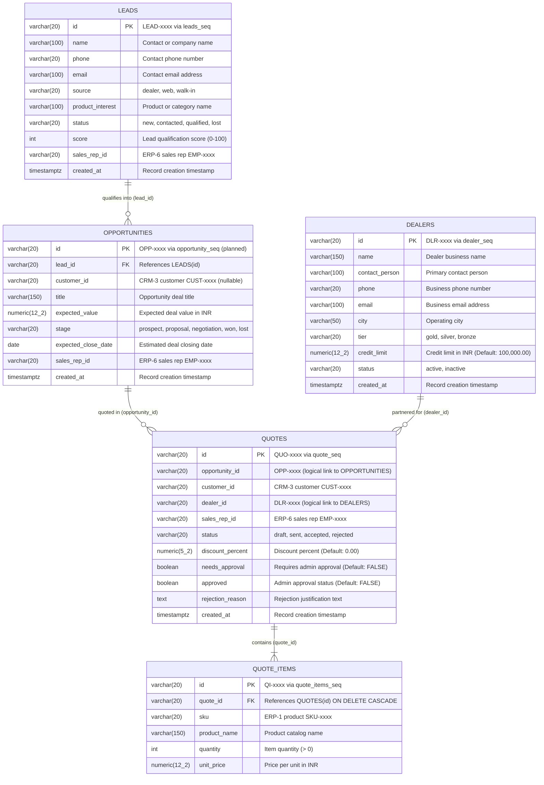

# CRM-1 Sales Pipeline: ER Diagram and Data Dictionary

Database: `crm1_db` (PostgreSQL Port 5101)  
Team: CRM-1 (Sales Pipeline)  
Role: Member B / Data Owner (CRM1-R2)

---

## 1. Schema Status & Table Overview

This document defines the 3NF database architecture for **Team CRM-1 (Sales Pipeline)**.

| Table | Source Issue | Status in `schema.sql` | Primary Key | Description |
|---|---|---|---|---|
| `leads` | CRM1-A1 | **Merged** | `id` (`LEAD-xxxx`) | Inbound inquiries from web, dealers, and walk-ins |
| `opportunities` | CRM1-B1 | **Planned** *(Pending Issue #4)* | `id` (`OPP-xxxx`) | Qualified sales opportunities with pipeline stage tracking |
| `quotes` | CRM1-C1 | **Merged** | `id` (`QUO-xxxx`) | Price quotes generated for opportunities and direct customer deals |
| `quote_items` | CRM1-C1 | **Merged** | `id` (`QI-xxxx`) | Line-item product entries associated with quotes |
| `dealers` | CRM1-D1 | **Merged** | `id` (`DLR-xxxx`) | Authorized dealer partners and credit limits |

> [!NOTE]
> `leads`, `dealers`, `quotes`, and `quote_items` are active in `services/crm1/db/schema.sql`.  
> `opportunities` is defined per the issue specification (`[CRM1-B1]` / Issue #4) and `services/crm1/mocks/opportunities.json`. It is marked as *(planned)* until Issue #4 is merged.

---

## 2. Entity-Relationship Diagram (3NF)



---

## 3. Data Dictionary

### 3.1 Table: `leads`
Tracks initial inbound inquiries from prospects across various sales channels.  
Defined in: `services/crm1/db/schema.sql` (Issue `[CRM1-A1]`). Sequence: `leads_seq`.

| Column | Data Type | Key | Nullable | Default | Constraints | Description |
|---|---|---|---|---|---|---|
| `id` | `VARCHAR(20)` | `PRIMARY KEY` | `NOT NULL` | `('LEAD-' \|\| LPAD(nextval('leads_seq')::TEXT, 4, '0'))` | None | Unique lead identifier (e.g. `LEAD-0001`) |
| `name` | `VARCHAR(100)` | None | `NOT NULL` | None | None | Lead contact or business name |
| `phone` | `VARCHAR(20)` | None | `NULL` | None | None | Contact telephone/mobile number |
| `email` | `VARCHAR(100)` | None | `NULL` | None | None | Contact email address |
| `source` | `VARCHAR(20)` | None | `NOT NULL` | None | `CHECK (source IN ('dealer', 'web', 'walk-in'))` | Inbound acquisition channel |
| `product_interest` | `VARCHAR(100)` | None | `NULL` | None | None | Target product or interest description |
| `status` | `VARCHAR(20)` | None | `NOT NULL` | `'new'` | `CHECK (status IN ('new', 'contacted', 'qualified', 'lost'))` | Current lead lifecycle state |
| `score` | `INT` | None | `NOT NULL` | `0` | None | Qualification score (calculated up to 100) |
| `sales_rep_id` | `VARCHAR(20)` | None | `NULL` | None | None | Assigned sales representative (`EMP-0001`..`EMP-0004` from ERP-6) |
| `created_at` | `TIMESTAMPTZ` | None | `NOT NULL` | `NOW()` | None | Timestamp of lead capture |

---

### 3.2 Table: `opportunities` *(Planned — Issue CRM1-B1)*
Tracks qualified opportunities through the pipeline stages to deal closing.  
Specification: `docs/crm1/issues.md` (`[CRM1-B1]`), `services/crm1/mocks/opportunities.json`. Sequence: `opportunity_seq`.

| Column | Data Type | Key | Nullable | Default | Constraints | Description |
|---|---|---|---|---|---|---|
| `id` | `VARCHAR(20)` | `PRIMARY KEY` | `NOT NULL` | `('OPP-' \|\| LPAD(nextval('opportunity_seq')::TEXT, 4, '0'))` | None | Unique opportunity identifier (e.g. `OPP-0001`) |
| `lead_id` | `VARCHAR(20)` | `FOREIGN KEY` | `NOT NULL` | None | References `leads(id)` | Inbound lead that generated this opportunity |
| `customer_id` | `VARCHAR(20)` | None | `NULL` | None | None | Linked CRM-3 customer (`CUST-0001`..`CUST-0008`) |
| `title` | `VARCHAR(150)` | None | `NOT NULL` | None | None | Short descriptive name of the sales deal |
| `expected_value` | `NUMERIC(12, 2)` | None | `NOT NULL` | None | None | Estimated deal value in INR |
| `stage` | `VARCHAR(20)` | None | `NOT NULL` | `'prospect'` | `CHECK (stage IN ('prospect', 'proposal', 'negotiation', 'won', 'lost'))` | Current pipeline stage |
| `expected_close_date` | `DATE` | None | `NULL` | None | None | Target closing date |
| `sales_rep_id` | `VARCHAR(20)` | None | `NULL` | None | None | Handling sales representative (`EMP-0001`..`EMP-0004` from ERP-6) |
| `created_at` | `TIMESTAMPTZ` | None | `NOT NULL` | `NOW()` | None | Timestamp of opportunity creation |

---

### 3.3 Table: `dealers`
Maintains partner dealer network profiles, accreditation tiers, and credit lines.  
Defined in: `services/crm1/db/schema.sql` (Issue `[CRM1-D1]`). Sequence: `dealer_seq`.

| Column | Data Type | Key | Nullable | Default | Constraints | Description |
|---|---|---|---|---|---|---|
| `id` | `VARCHAR(20)` | `PRIMARY KEY` | `NOT NULL` | `('DLR-' \|\| LPAD(nextval('dealer_seq')::TEXT, 4, '0'))` | None | Unique dealer identifier (e.g. `DLR-0001`) |
| `name` | `VARCHAR(150)` | None | `NOT NULL` | None | None | Registered dealer trading name |
| `contact_person` | `VARCHAR(100)` | None | `NULL` | None | None | Primary dealer representative or proprietor |
| `phone` | `VARCHAR(20)` | None | `NULL` | None | None | Primary contact telephone number |
| `email` | `VARCHAR(100)` | None | `NULL` | None | None | Contact email address |
| `city` | `VARCHAR(50)` | None | `NOT NULL` | None | None | Operating city in India |
| `tier` | `VARCHAR(20)` | None | `NOT NULL` | None | `CHECK (tier IN ('gold', 'silver', 'bronze'))` | Dealer partnership tier |
| `credit_limit` | `NUMERIC(12, 2)` | None | `NOT NULL` | `100000.00` | None | Approved credit ceiling in INR |
| `status` | `VARCHAR(20)` | None | `NOT NULL` | `'active'` | `CHECK (status IN ('active', 'inactive'))` | Current partnership status |
| `created_at` | `TIMESTAMPTZ` | None | `NOT NULL` | `NOW()` | None | Timestamp of partner onboarding |

---

### 3.4 Table: `quotes`
Represents customer and dealer price quotations, approval workflows, and status lifecycles.  
Defined in: `services/crm1/db/schema.sql` (Issue `[CRM1-C1]`). Sequence: `quote_seq`.

| Column | Data Type | Key | Nullable | Default | Constraints | Description |
|---|---|---|---|---|---|---|
| `id` | `VARCHAR(20)` | `PRIMARY KEY` | `NOT NULL` | `('QUO-' \|\| LPAD(nextval('quote_seq')::TEXT, 4, '0'))` | None | Unique quote identifier (e.g. `QUO-0001`) |
| `opportunity_id` | `VARCHAR(20)` | None | `NULL` | None | None | Associated opportunity (`OPP-0001`..`OPP-0006`) |
| `customer_id` | `VARCHAR(20)` | None | `NOT NULL` | None | None | Customer receiving quote (`CUST-0001`..`CUST-0008` from CRM-3) |
| `dealer_id` | `VARCHAR(20)` | None | `NULL` | None | None | Associated dealer if channeled (`DLR-0001`..`DLR-0005`) |
| `sales_rep_id` | `VARCHAR(20)` | None | `NOT NULL` | None | None | Authoring sales representative (`EMP-0001`..`EMP-0004` from ERP-6) |
| `status` | `VARCHAR(20)` | None | `NOT NULL` | `'draft'` | `CHECK (status IN ('draft', 'sent', 'accepted', 'rejected'))` | Current quote status |
| `discount_percent`| `NUMERIC(5, 2)` | None | `NOT NULL` | `0.00` | None | Commercial discount percentage granted |
| `needs_approval` | `BOOLEAN` | None | `NOT NULL` | `FALSE` | None | Flagged true when discount exceeds threshold (> 5%) |
| `approved` | `BOOLEAN` | None | `NOT NULL` | `FALSE` | None | Manager/admin approval status |
| `rejection_reason`| `TEXT` | None | `NULL` | None | None | Justification if rejected during approval |
| `created_at` | `TIMESTAMPTZ` | None | `NOT NULL` | `NOW()` | None | Timestamp of quote creation |

---

### 3.5 Table: `quote_items`
Detailed line-item products and pricing comprising each quote.  
Defined in: `services/crm1/db/schema.sql` (Issue `[CRM1-C1]`). Sequence: `quote_items_seq`.

| Column | Data Type | Key | Nullable | Default | Constraints | Description |
|---|---|---|---|---|---|---|
| `id` | `VARCHAR(20)` | `PRIMARY KEY` | `NOT NULL` | `('QI-' \|\| LPAD(nextval('quote_items_seq')::TEXT, 4, '0'))` | None | Unique quote line-item ID (e.g. `QI-0001`) |
| `quote_id` | `VARCHAR(20)` | `FOREIGN KEY` | `NOT NULL` | None | References `quotes(id) ON DELETE CASCADE` | Parent quote reference |
| `sku` | `VARCHAR(20)` | None | `NOT NULL` | None | None | Product SKU (`SKU-0001`..`SKU-0015` from ERP-1) |
| `product_name` | `VARCHAR(150)` | None | `NOT NULL` | None | None | Snapshot product description |
| `quantity` | `INT` | None | `NOT NULL` | None | `CHECK (quantity > 0)` | Number of units quoted |
| `unit_price` | `NUMERIC(12, 2)` | None | `NOT NULL` | None | None | Unit price in INR at quote generation |

---

## 4. Cross-Database & External References

Electro App uses isolated databases per service. Cross-team relationships do not use database-level foreign key constraints, but strictly conform to Section 5 shared identifiers:

| Source Column | Points to | Target Service | Shared Contract Range |
|---|---|---|---|
| `leads.sales_rep_id` | Employee (Sales Rep) | ERP-6 Human Resources | `EMP-0001` to `EMP-0004` |
| `opportunities.customer_id` | Customer Record | CRM-3 Customer Master | `CUST-0001` to `CUST-0008` |
| `opportunities.sales_rep_id` | Employee (Sales Rep) | ERP-6 Human Resources | `EMP-0001` to `EMP-0004` |
| `quotes.customer_id` | Customer Record | CRM-3 Customer Master | `CUST-0001` to `CUST-0008` |
| `quotes.sales_rep_id` | Employee (Sales Rep) | ERP-6 Human Resources | `EMP-0001` to `EMP-0004` |
| `quote_items.sku` | Product Catalog | ERP-1 Inventory Master | `SKU-0001` to `SKU-0015` |
| `quotes.dealer_id` | Dealer Partner | CRM-1 Internal Master | `DLR-0001` to `DLR-0005` |
| `quotes.opportunity_id` | Sales Opportunity | CRM-1 Internal Pipeline | `OPP-0001` to `OPP-0006` |

---

## 5. Normalization Analysis (3NF Compliance)

1. **First Normal Form (1NF)**:
   - All columns contain atomic, non-decomposable values (e.g., telephone numbers, status strings, timestamps).
   - Repeating groups are eliminated; line items are separated into the dedicated `quote_items` child table.
   - Each table possesses a designated primary key (`id`).

2. **Second Normal Form (2NF)**:
   - All tables satisfy 1NF.
   - Primary keys are single-attribute surrogate keys (`id` with sequence generation).
   - There are no partial dependencies on composite primary keys.

3. **Third Normal Form (3NF)**:
   - All tables satisfy 2NF.
   - No transitive dependencies exist among non-key attributes.
   - Customer attributes (names, GSTIN, addresses) remain in CRM-3; only `customer_id` is stored.
   - Employee attributes remain in ERP-6; only `sales_rep_id` is stored.
   - Dealer properties (city, tier, credit limit) remain in `dealers`; only `dealer_id` is referenced in `quotes`.
   - **Snapshot Fields**: In `quote_items`, `product_name` and `unit_price` are captured at quotation creation time. This constitutes an intentional and standard commercial snapshot pattern ensuring quote immutability when catalog pricing changes in ERP-1.

---

## 6. Seed Contract Compliance & Database Reset

### 6.1 Seed Data Verification
`services/crm1/db/seed.sql` supplies compliant sample records across all merged CRM-1 tables:
- **`dealers`**: 5 dealers (`DLR-0001` to `DLR-0005`) with diverse tiers (`gold`, `silver`, `bronze`) and metro cities (Pune, Bengaluru, Delhi, Mumbai, Chennai).
- **`leads`**: 5 leads (`LEAD-0001` to `LEAD-0005`) across `dealer`, `web`, and `walk-in` channels, mapped to sales reps `EMP-0001` to `EMP-0004`.
- **`quotes`**: 4 quotes (`QUO-0001` to `QUO-0004`) covering all workflow states (`draft`, `sent`, `accepted`, `rejected`), associated with `CUST-0001` through `CUST-0004` and `DLR-0001`.
- **`quote_items`**: 7 quote items (`QI-0001` to `QI-0007`) referencing valid catalog SKUs (`SKU-0001` through `SKU-0005`).
- **`opportunities` (Mock)**: 6 mock opportunities (`OPP-0001` to `OPP-0006`) in `services/crm1/mocks/opportunities.json` adhering to valid stages (`prospect`, `proposal`, `negotiation`, `won`, `lost`).

### 6.2 Database Reset Verification
Running `npm run reset` executes:
```bash
$ npm run reset

> electro-app@1.0.0 reset
> node scripts/db-setup.js --reset

Database setup script (ERP5-C4): will initialize databases and seed data once database container is running.
```
- **Exit Code**: 0 (Clean execution, zero errors).
- **Target Database**: Local development database `crm1_db` on port 5101.
