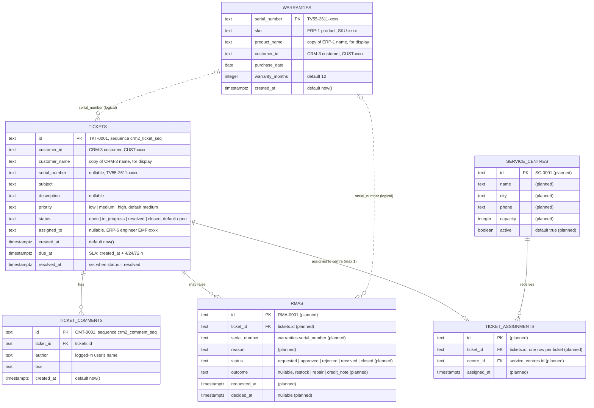

# CRM-2 Support & Warranty: ER diagram and data dictionary

Database `crm2_db` (PostgreSQL), owned by team CRM-2. Data owner: Ashutosh (CRM2-R2).

This file covers every CRM-2 table: the ER diagram in 3NF, a data dictionary, and notes on normalisation and links to other teams. Seed checks and the schema review log are in [seed-check.md](seed-check.md).

**Status of each table** (this draft is updated as teammates' PRs merge):

| Table | Issue | Owner | Status |
|---|---|---|---|
| `tickets` | CRM2-A1, A3 | Ashutosh | Merged (#289, #291) |
| `ticket_comments` | CRM2-A3 | Ashutosh | Merged (#291) |
| `warranties` | CRM2-B1 | Zoha | Open PR #292 |
| `rmas` | CRM2-C1 | Aditya Kumbhar | Planned (from issue text) |
| `service_centres` | CRM2-D1 | Anant | Planned (from issue text) |
| `ticket_assignments` | CRM2-D1 | Anant | Planned (from issue text) |

Types for planned tables are taken from the issue text and marked *(planned)*. They will be replaced with the real `schema.sql` types when those PRs merge.

---

## 1. ER diagram

Solid lines are real foreign keys. Dotted lines are logical links (same value, no database constraint).

### Links to other teams (not foreign keys)

Each team has its own database, so these IDs are checked by the shared seed contract (Section 5), not by constraints.

| Column | Points to | Team |
|---|---|---|
| `tickets.customer_id`, `warranties.customer_id` | Customers `CUST-0001`..`CUST-0008` | CRM-3 |
| `tickets.assigned_to` | Service engineers `EMP-0005`..`EMP-0007` | ERP-6 |
| `warranties.sku` | Products, `SKU-0001` = 55-inch 4K Smart TV | ERP-1 |
| `warranties.serial_number` (synced in CRM2-B3) | Dispatches `DSP-0001`..`DSP-0005` | ERP-4 |
| `rmas.id` (sent on approval in CRM2-C3) | Returns created by `POST /api/returns/from-rma` | ERP-4 |

---

## 2. Data dictionary

### tickets (CRM2-A1, A3) — merged

| Column | Type | Rules | Meaning |
|---|---|---|---|
| `id` | text | PK, default `'TKT-' + 4-digit crm2_ticket_seq` | Ticket number, e.g. `TKT-0001` |
| `customer_id` | text | not null; `CUST-0000` format checked by the API | Customer who raised the ticket (CRM-3) |
| `customer_name` | text | not null | Customer's name at the time of the ticket, for display |
| `serial_number` | text | nullable | Serial of the product the ticket is about |
| `subject` | text | not null | One-line summary of the problem |
| `description` | text | nullable | Full description |
| `priority` | text | not null, default `medium`, CHECK `low`/`medium`/`high` | Urgency; sets the SLA |
| `status` | text | not null, default `open`, CHECK `open`/`in_progress`/`resolved`/`closed` | Where the ticket is in its life cycle |
| `assigned_to` | text | nullable; `EMP-0000` format checked by the API | Service engineer working on it (ERP-6) |
| `created_at` | timestamptz | not null, default `now()` | When the ticket was opened |
| `due_at` | timestamptz | nullable | SLA deadline: `created_at` + 4 h (high), 24 h (medium) or 72 h (low); recalculated if priority changes |
| `resolved_at` | timestamptz | nullable | Set when status becomes `resolved`, cleared if reopened, kept when closed |

### ticket_comments (CRM2-A3) — merged

| Column | Type | Rules | Meaning |
|---|---|---|---|
| `id` | text | PK, default `'CMT-' + 4-digit crm2_comment_seq` | Comment number, e.g. `CMT-0001` |
| `ticket_id` | text | not null, FK → `tickets.id` | Ticket the comment belongs to |
| `author` | text | not null | Name of the logged-in user (set by the server, never from the request) |
| `text` | text | not null; API allows 1–2000 characters | The comment |
| `created_at` | timestamptz | not null, default `now()` | When it was written |

### warranties (CRM2-B1) — open PR #292

| Column | Type | Rules | Meaning |
|---|---|---|---|
| `serial_number` | text | PK | Product serial, e.g. `TV55-2611-0001` |
| `sku` | text | not null | Product SKU (ERP-1) |
| `product_name` | text | not null | Product name, for display |
| `customer_id` | text | not null | Customer who bought it (CRM-3) |
| `purchase_date` | date | not null | Date of sale; warranty starts here |
| `warranty_months` | integer | not null, default 12 | Length of the warranty |
| `created_at` | timestamptz | not null, default `now()` | When the record was added |

`expires_on` (= `purchase_date + warranty_months`) and `status` (`active`/`expired`, compared with today) are **calculated by the API**, not stored, so they can never go out of date.

### rmas (CRM2-C1) — planned

| Column | Type | Rules | Meaning |
|---|---|---|---|
| `id` | text *(planned)* | PK, `RMA-0001` | Return number |
| `ticket_id` | text *(planned)* | not null, → `tickets.id` | Ticket the return was raised from |
| `serial_number` | text *(planned)* | not null, → `warranties.serial_number` (logical) | Unit being returned |
| `reason` | text *(planned)* | not null | Why it is being returned |
| `status` | text *(planned)* | default `requested`; `requested`/`approved`/`rejected`/`received`/`closed` | Return life cycle |
| `outcome` | text *(planned)* | nullable; `restock`/`repair`/`credit_note`; required to approve | What happens to the unit |
| `requested_at` | timestamptz *(planned)* | | When the return was requested |
| `decided_at` | timestamptz *(planned)* | nullable | When it was approved or rejected |

### service_centres (CRM2-D1) — planned

| Column | Type | Rules | Meaning |
|---|---|---|---|
| `id` | text *(planned)* | PK, `SC-0001` | Centre number |
| `name` | text *(planned)* | not null | Centre name |
| `city` | text *(planned)* | | City |
| `phone` | text *(planned)* | | Contact number |
| `capacity` | integer *(planned)* | | How many tickets it can take |
| `active` | boolean *(planned)* | default true | Whether it accepts new tickets |

### ticket_assignments (CRM2-D1) — planned

| Column | Type | Rules | Meaning |
|---|---|---|---|
| `id` | text *(planned)* | PK | Assignment number |
| `ticket_id` | text *(planned)* | → `tickets.id`; one row per ticket (re-assigning replaces it) | Ticket being sent to a centre |
| `centre_id` | text *(planned)* | → `service_centres.id` | Centre handling the ticket |
| `assigned_at` | timestamptz *(planned)* | | When it was assigned |

---

## 3. Normalisation (3NF)

- **1NF:** every column holds one value; no lists or repeating groups (comments and assignments are their own tables).
- **2NF:** every primary key is a single column, so no column can depend on only part of a key.
- **3NF:** every non-key column depends only on its own table's key. Two deliberate exceptions, both copies of another team's data kept for display:
  - `tickets.customer_name` is a copy of the CRM-3 customer name (the issue asks for it, so the ticket list works when CRM-3 is down).
  - `warranties.product_name` is a copy of the ERP-1 product name for the same reason.
- `warranties` stores only `purchase_date` and `warranty_months`; expiry and status are calculated, not stored, to avoid a value that depends on another non-key column.
- `ticket_assignments` keeps one row per ticket (CRM2-D1: "assigning a ticket twice replaces the earlier assignment"), so a ticket's centre is never ambiguous.
