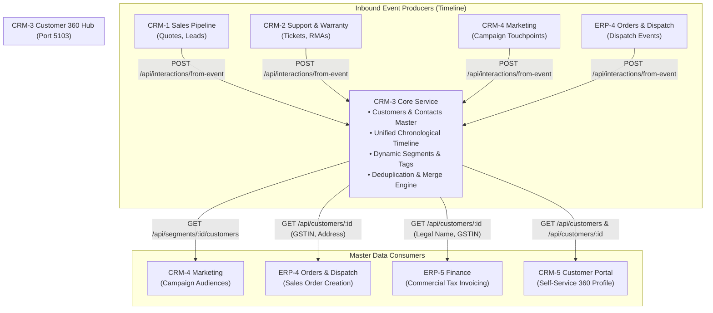
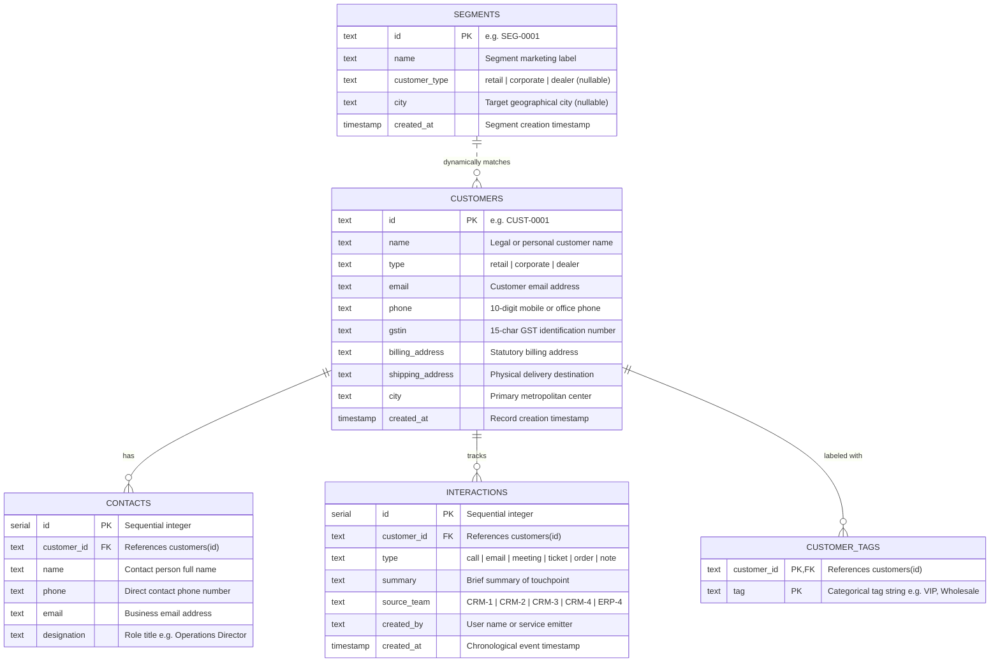

# CRM-3 Customer 360 — Customer Master Directory & Unified Timeline

> **Module**: CRM-3 Customer 360  
> **Backend Service**: `services/crm3` (Express on Port `5103`)  
> **Database**: PostgreSQL `crm3_db`  
> **Frontend Module**: `frontend/src/modules/crm3` (Roles: `["admin", "sales", "support"]`)  
> **Workflow Position**: Step 3 of 9 (Customer Master Directory, Contacts & Unified Event Timeline)

---

## 1. Module Overview & Domain Responsibilities

Team **CRM-3 Customer 360** owns and maintains the single, authoritative **Customer Master Directory** across the entire Electro App enterprise monorepo. Every downstream order, support ticket, invoice, delivery dispatch, quotation, and marketing campaign references the customer records managed by CRM-3.

### Core Capabilities
1. **Single Customer Master Directory**: Comprehensive customer records supporting three core customer archetypes (`retail`, `corporate`, `dealer`), multiple addresses (billing and shipping), GSTIN registration numbers, and contact designations.
2. **Unified Interaction Timeline**: A single, chronological audit trail recording all touchpoints across sales, support, marketing, and operations with icons, timestamps, and source attribution badges.
3. **Cross-Team Event Ingestion**: An open endpoint (`POST /api/interactions/from-event`) that enables other CRM and ERP services to push timeline events with automatic sliding-window duplicate suppression (within the same minute).
4. **Dynamic Customer Segmentation**: Dynamic audience segment definitions by customer type and city, enabling live customer evaluation and CSV audience exports for marketing and field sales.
5. **Customer Tagging**: Flexible multi-tag categorization (chips) for account tiering, VIP tagging, and promotional eligibility.
6. **Data Quality & Duplicate Merge Engine**: Automated duplicate cluster identification (matching duplicate phone numbers or email addresses) coupled with atomic PostgreSQL multi-table transaction merges (re-parenting contacts, timeline events, and unique tags before deleting the redundant record).
7. **High-Volume CSV Onboarding**: Browser-native CSV ingestion with client-side parsing, interactive validation previews, batch deduplication, and atomic error reporting.

---

## 2. Architecture & Cross-Team Contracts

CRM-3 operates as an upstream foundation service in the Order-to-Cash workflow:



### Inbound Integrations (Who Calls CRM-3)
| Caller Issue | Caller Service | Method & Path | Cross-Team Contract (Section 7) | Purpose |
|---|---|---|---|---|
| **CRM1-C3** | CRM-1 Sales | `POST /api/interactions/from-event` | Contract Row 4 | Records quote generation and conversion milestones on the customer timeline. |
| **CRM2-A1, CRM2-C3** | CRM-2 Support | `POST /api/interactions/from-event` | Contract Row 4 | Records support ticket creation, status updates, and RMA filings. |
| **CRM4-A3** | CRM-4 Marketing | `POST /api/interactions/from-event` | Contract Row 4 | Records marketing campaign deliveries and customer engagement responses. |
| **ERP4-C3** | ERP-4 Orders | `POST /api/interactions/from-event` | Contract Row 4 | Records goods dispatch milestones and serial allocation on the timeline. |
| **CRM4-A2, A3, B3** | CRM-4 Marketing | `GET /api/segments`, `GET /api/segments/:id/customers` | Contract Row 8 | Retrieves dynamic target audience segments for marketing campaign runs. |
| **CRM5-A1, A3, D1** | CRM-5 Portal | `GET /api/customers`, `GET /api/customers/:id` | Contract Rows 10, 12 | Displays customer 360 account profile on customer self-service portal. |
| **ERP4-A3** | ERP-4 Orders | `GET /api/customers/:id` | Contract Row 19 | Fetches customer shipping and billing addresses to validate sales orders. |
| **ERP5-A1** | ERP-5 Finance | `GET /api/customers/:id` | Contract Row 19 | Resolves customer trade name and 15-character GSTIN for commercial tax invoices. |

### Outbound Integrations (Who CRM-3 Calls)
CRM-3 is designed as a foundational upstream data provider and event aggregator. It owns its domain tables in `crm3_db` and does not make synchronous outbound HTTP calls to other services during runtime.

---

## 3. API Reference & Endpoint Specifications

All endpoints are hosted on port `5103` under the `/api` prefix and require JWT Bearer authentication (`requireAuth`) via the `Authorization: Bearer <token>` header.

### 3.1 Customers Master API

#### `GET /api/customers`
Returns a paginated or filtered list of customer master records.
- **Query Parameters**:
  - `q` (string, optional): Case-insensitive search on `name`, `city`, `phone`, or `email`.
  - `type` (string, optional): Filter by archetype (`retail`, `corporate`, `dealer`).
- **Response `200 OK`**:
```json
{
  "data": [
    {
      "id": "CUST-0002",
      "name": "Sunrise Electronics Pvt Ltd",
      "type": "corporate",
      "email": "contact@sunrise.com",
      "phone": "9820234567",
      "gstin": "27AABCS1234F1Z5",
      "billing_address": "101 Nariman Point, Marine Lines",
      "shipping_address": "Plot 42, MIDC Industrial Area, Andheri East",
      "city": "Mumbai",
      "created_at": "2026-11-01T10:00:00.000Z"
    }
  ]
}
```

#### `GET /api/customers/:id`
Retrieves a single customer record by ID, including its associated contacts, tags, and GSTIN.
- **Parameters**: `id` (e.g. `CUST-0002`)
- **Responses**:
  - `200 OK`: Customer object with `gstin`, `contacts`, and `tags`.
  - `404 Not Found`: `{ "error": "Customer CUST-9999 not found" }`

#### `POST /api/customers`
Creates a new customer master record with full validation rules.
- **Request Body**:
```json
{
  "name": "Metro Offices Ltd",
  "type": "corporate",
  "email": "procurement@metrooffices.com",
  "phone": "9810123456",
  "gstin": "07AABCM5678P1Z3",
  "billing_address": "Barakhamba Road, Connaught Place",
  "shipping_address": "Okhla Industrial Area Phase III",
  "city": "Delhi"
}
```
- **Validation Rules**:
  - `name`: Required, non-empty.
  - `type`: Must be one of `retail`, `corporate`, `dealer`.
  - `phone`: Must be exactly 10 digits (`/^\d{10}$/`).
  - `email`: Must be a valid email format; must be unique across non-duplicate customers (returns `409 Conflict` on duplicate).
  - `gstin`: Required and must be exactly 15 alphanumeric characters for `corporate` and `dealer`; optional for `retail`.
- **Responses**:
  - `201 Created`: `{ "data": { "id": "CUST-0011", ... } }`
  - `400 Bad Request`: `{ "error": "Phone number must be exactly 10 digits" }`
  - `409 Conflict`: `{ "error": "Customer with email 'procurement@metrooffices.com' already exists" }`

#### `PUT /api/customers/:id`
Updates an existing customer record adhering to the same validation rules.

#### `DELETE /api/customers/:id`
Deletes an unreferenced customer record.

---

### 3.2 Contacts API

#### `GET /api/customers/:id/contacts`
Lists all contacts linked to a customer.
- **Response `200 OK`**:
```json
{
  "data": [
    {
      "id": 1,
      "customer_id": "CUST-0002",
      "name": "Rajesh Sharma",
      "phone": "9820234568",
      "email": "rajesh@sunrise.com",
      "designation": "Operations Director"
    }
  ]
}
```

#### `POST /api/customers/:id/contacts`
Adds a contact person to the customer master.
- **Request Body**:
```json
{
  "name": "Pooja Mehta",
  "phone": "9820234569",
  "email": "pooja@sunrise.com",
  "designation": "Procurement Lead"
}
```
- **Response `201 Created`**: Returns inserted contact object.

---

### 3.3 Interactions & Timeline API

#### `GET /api/customers/:id/interactions`
Returns chronological interaction records for a customer, sorted newest first.
- **Query Parameters**:
  - `type` (optional): Filter by `call`, `email`, `meeting`, `ticket`, `order`, `note`.
  - `from` and `to` (optional): Date range (`YYYY-MM-DD`).
- **Response `200 OK`**:
```json
{
  "data": [
    {
      "id": 14,
      "customer_id": "CUST-0002",
      "type": "ticket",
      "summary": "Ticket TKT-0001: 55-inch TV panel flicker reported",
      "source_team": "CRM-2",
      "created_by": "Deepa Menon",
      "created_at": "2026-11-06T14:30:00.000Z"
    }
  ]
}
```

#### `POST /api/interactions`
Adds an internal interaction or note from sales, support, or management.
- **Request Body**:
```json
{
  "customer_id": "CUST-0002",
  "type": "meeting",
  "summary": "Quarterly account review with Rajesh Sharma",
  "source_team": "CRM-3",
  "created_by": "Rohan Kulkarni"
}
```
- **Response `201 Created`**: `{ "data": { "id": 15, ... } }`

---

### 3.4 Cross-Team Event Ingestion Endpoint

#### `POST /api/interactions/from-event`
Universal webhook endpoint called by external CRM and ERP teams (CRM-1, CRM-2, CRM-4, ERP-4) to record lifecycle events onto the customer's timeline.
- **Request Body**:
```json
{
  "customer_id": "CUST-0002",
  "type": "ticket",
  "summary": "Ticket TKT-0001: TV display flicker under investigation",
  "source_team": "CRM-2"
}
```
- **Deduplication Logic**:
  - Checks if an interaction with the identical `(customer_id, type, summary, source_team)` was inserted within the past 60 seconds.
  - If a duplicate is received within the same minute, the service ignores the duplicate write and immediately returns `201 Created` with `{ "data": existingRecord, "duplicate": true }`.
- **Responses**:
  - `201 Created`: Event saved or duplicate gracefully ignored.
  - `400 Bad Request`: Missing `customer_id` or `summary`.

---

### 3.5 Dynamic Segments & Audience Export API

#### `GET /api/segments`
Lists all segment definitions.
- **Response `200 OK`**:
```json
{
  "data": [
    {
      "id": "SEG-0001",
      "name": "Corporate in Mumbai",
      "customer_type": "corporate",
      "city": "Mumbai",
      "created_at": "2026-11-01T10:00:00.000Z"
    }
  ]
}
```

#### `POST /api/segments`
Creates a new dynamic segment filter rule.
- **Request Body**:
```json
{
  "name": "Dealers in Western Region",
  "customer_type": "dealer",
  "city": "Pune"
}
```

#### `GET /api/segments/:id/customers`
Evaluates dynamic matching rules against the active `customers` table (blank fields match any).
- **Response `200 OK`**:
```json
{
  "data": {
    "segment": { "id": "SEG-0001", "name": "Corporate in Mumbai" },
    "count": 1,
    "customers": [
      {
        "id": "CUST-0002",
        "name": "Sunrise Electronics Pvt Ltd",
        "type": "corporate",
        "city": "Mumbai",
        "email": "contact@sunrise.com",
        "phone": "9820234567"
      }
    ]
  }
}
```

#### `GET /api/segments/:id/export.csv`
Streams a standard CSV file of matching customers for marketing campaigns and spreadsheets.
- **Response Headers**: `Content-Type: text/csv`, `Content-Disposition: attachment; filename="segment-SEG-0001.csv"`
- **Columns**: `name,email,phone,city`

---

### 3.6 Tags API

#### `POST /api/customers/:id/tags`
Adds a tag chip to a customer.
- **Request Body**: `{ "tag": "VIP" }`
- **Response `201 Created`**: `{ "data": { "customer_id": "CUST-0002", "tag": "VIP" } }`

#### `DELETE /api/customers/:id/tags/:tag`
Removes a tag from a customer.
- **Response `200 OK`**: `{ "message": "Tag deleted successfully" }`

---

### 3.7 Deduplication & Atomic Merge API

#### `GET /api/customers/duplicates`
Scans the customer master and returns clusters of records sharing either identical phone numbers or identical email addresses.
- **Response `200 OK`**:
```json
{
  "data": [
    {
      "match_type": "phone",
      "match_value": "9820123456",
      "records": [
        { "id": "CUST-0001", "name": "Aarav Mehta", "phone": "9820123456", "email": "aarav@gmail.com" },
        { "id": "CUST-0009", "name": "Aarav Mehta (Duplicate)", "phone": "9820123456", "email": "aarav.work@gmail.com" }
      ]
    },
    {
      "match_type": "email",
      "match_value": "contact@sunrise.com",
      "records": [
        { "id": "CUST-0002", "name": "Sunrise Electronics Pvt Ltd", "email": "contact@sunrise.com" },
        { "id": "CUST-0010", "name": "Sunrise Electronics Alternate", "email": "contact@sunrise.com" }
      ]
    }
  ]
}
```

#### `POST /api/customers/merge`
Executes an atomic multi-table transaction merging `remove_id` into `keep_id`.
- **Request Body**:
```json
{
  "keep_id": "CUST-0002",
  "remove_id": "CUST-0010"
}
```
- **Transaction Steps**:
  1. Re-parents all rows in `contacts` where `customer_id = remove_id` to `keep_id`.
  2. Re-parents all rows in `interactions` where `customer_id = remove_id` to `keep_id`.
  3. Copies non-duplicate `customer_tags` from `remove_id` to `keep_id` (skips duplicate tags).
  4. Deletes remaining tag entries of `remove_id`.
  5. Deletes `remove_id` from `customers`.
- **Responses**:
  - `200 OK`: `{ "status": "success", "message": "Customer CUST-0010 merged into CUST-0002" }`
  - `400 Bad Request`: Missing IDs or attempt to merge a record with itself.
  - `404 Not Found`: Either customer ID does not exist.

---

### 3.8 CSV Bulk Import API

#### `POST /api/customers/import`
Ingests an array of customer objects (e.g. parsed from CSV upload in the browser).
- **Request Body**: Array of customer objects `[ { name, type, email, phone, gstin, billing_address, shipping_address, city }, ... ]`
- **Processing Logic**:
  - Applies CRM3-A3 validation rules to each row.
  - Suppresses intra-batch duplicates and database email conflicts.
  - Inserts valid rows with monotonic sequential IDs (`CUST-0011`, `CUST-0012`...).
  - Collects detailed row-by-row error reasons for skipped records.
- **Response `200 OK`**:
```json
{
  "status": "success",
  "inserted": 8,
  "skipped": 2,
  "total": 10,
  "errors": [
    { "row": 3, "name": "Invalid Customer", "error": "Phone number must be exactly 10 digits" },
    { "row": 6, "name": "Missing GSTIN Corp", "error": "GSTIN is required for corporate customer type" }
  ]
}
```

---

## 4. Frontend Module & UI Shell Integration

The CRM-3 frontend module is registered in `frontend/src/modules/crm3/index.jsx` and mounts under the `/crm3/*` prefix in the unified Vite application shell.

### Access Control
- **Module ID**: `crm3`
- **Display Title**: `Customers`
- **Authorized Roles**: `["admin", "sales", "support"]`

### Registered Pages & Navigation Catalog
| Path | Component | Description & User Capabilities |
|---|---|---|
| `/crm3/customers` | `CustomersPage.jsx` | Master directory table with live search (`?q=`), type filter dropdown (`retail`, `corporate`, `dealer`), "+ New Customer" creation modal with "Same as billing address" checkbox, and responsive pagination. |
| `/crm3/customers/:id` | `CustomerDetailPage.jsx` | Full Customer 360 profile view displaying customer metadata, GSTIN verification badge, interactive contact persons table, add contact modal, and tag chip manager. |
| `/crm3/customers/:id/timeline` | `CustomerTimeline.jsx` | Vertical chronological audit timeline with colored icon per event type (`call`, `email`, `meeting`, `ticket`, `order`), team source badges, date range filter, and an "Add Note" quick submission form. |
| `/crm3/segments` | `SegmentsPage.jsx` | Dynamic segment directory showing segment names, target customer type, and city rules, with an interactive segment creation form. |
| `/crm3/segments/:id` | `SegmentDetailPage.jsx` | Segment evaluation screen displaying real-time matching customer count, interactive member table, and one-click "Download CSV" export. |
| `/crm3/duplicates` | `DuplicatesPage.jsx` | Side-by-side comparison screen for flagged duplicate clusters (matching email or phone), complete with "Keep this one" action button and confirmation modal before executing merge. |
| `/crm3/import` | `CustomerImportPage.jsx` | Zero-dependency CSV upload wizard: reads local files via browser FileReader, renders client-side validation preview table, and submits batch payload with visual progress and error breakdown. |

---

## 5. Database Schema & Data Dictionary

The `crm3_db` database adheres strictly to Third Normal Form (3NF) principles:



### Shared Seed Contract Compliance (Section 5)
`services/crm3/db/seed.sql` seeds exactly the 10 pinned customer records defined in Section 5:
- `CUST-0001`: Aarav Mehta (retail, Mumbai)
- `CUST-0002`: Sunrise Electronics Pvt Ltd (corporate, Mumbai, GSTIN: `27AABCS1234F1Z5`)
- `CUST-0003`: Priya Nair (retail, Kochi)
- `CUST-0004`: BrightHome Retail LLP (dealer, Pune, GSTIN: `27AAACB5678G1Z2`)
- `CUST-0005`: Kiran Patel (retail, Ahmedabad)
- `CUST-0006`: Metro Offices Ltd (corporate, Delhi, GSTIN: `07AABCM5678P1Z3`)
- `CUST-0007`: Sneha Iyer (retail, Chennai)
- `CUST-0008`: Gadget Hub (dealer, Bengaluru, GSTIN: `29AABCG9012Q1Z4`)
- `CUST-0009`: Duplicate of `CUST-0001` (shares same phone `9820123456`)
- `CUST-0010`: Duplicate of `CUST-0002` (shares same email `contact@sunrise.com`)

> [!NOTE]
> `CUST-0009` and `CUST-0010` are intentionally seeded to demonstrate and verify the duplicate detection and merge engine.

---

## 6. How to Run, Test & Verify

### Step 1: Database Setup
```bash
# Ensure PostgreSQL is running and initialize crm3_db
psql -U postgres -c "CREATE DATABASE crm3_db;" || true
psql -U postgres -d crm3_db -f services/crm3/db/schema.sql
psql -U postgres -d crm3_db -f services/crm3/db/seed.sql
```

### Step 2: Start Backend Service
```bash
# Runs Express on http://localhost:5103
npm --workspace=services/crm3 run dev
```

### Step 3: Start Unified Frontend
```bash
# Runs Vite development server on http://localhost:3000
npm --workspace=frontend run dev
```

### Step 4: Run Monorepo Validation & Test Suite
```bash
# 1. Monorepo smoke check (validates syntax across services and modules)
npm run smoke

# 2. Production frontend build check
npm run build

# 3. CRM-3 unit and integration tests
npm --workspace=services/crm3 test
```

---

## 7. Team Lead Governance & Standup Runbook

As part of the Team Lead (R1) responsibilities, execute the following 10-minute check daily during morning standup:

### 1. Folder Boundaries Check
Ensure no merged PR touches files outside CRM-3's designated directories:
```bash
git diff --name-only origin/main...HEAD | while read file; do
  if [[ ! "$file" =~ ^(services/crm3/|frontend/src/modules/crm3/|docs/crm3/) ]]; then
    echo "VIOLATION: $file is outside CRM-3 folder boundaries!"
    exit 1
  fi
done
```

### 2. Frontend Route Integrity Check
Verify that `frontend/src/modules/crm3/index.jsx` registers all team pages:
- [x] Customers directory (`/crm3/customers` or `/crm3/`)
- [x] Customer 360 detail (`/crm3/customers/:id`)
- [x] Timeline view (`/crm3/customers/:id/timeline`)
- [x] Dynamic segments (`/crm3/segments`)
- [x] Segment detail & CSV export (`/crm3/segments/:id`)
- [x] Duplicates comparison & merge (`/crm3/duplicates`)
- [x] Bulk CSV import (`/crm3/import`)

### 3. Cross-Team Dependency Tracking
Actively monitor and coordinate with linked teams using Section 7 contracts:
- Chase **CRM-1**, **CRM-2**, **CRM-4**, and **ERP-4** to ensure they call `POST /api/interactions/from-event` using the exact JSON body specification.
- Chase **ERP-4** and **ERP-5** to ensure their invoice and order creation pipelines fetch customer records via `GET /api/customers/:id`.
- Support **CRM-4** for audience segment pulls via `GET /api/segments/:id/customers`.
