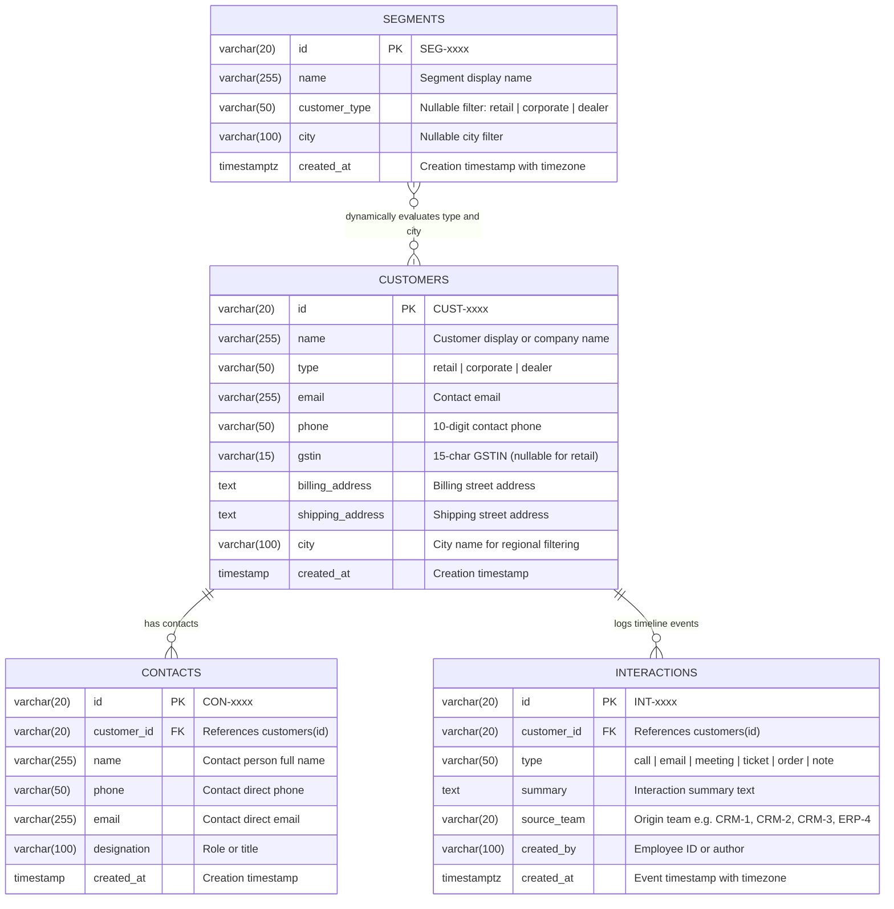

# CRM-3 Customer 360 — ER Diagram, Data Dictionary & Seed Verification

> **Team**: CRM-3 Customer 360 | **Service**: `services/crm3` (Port `5103`) | **Database**: `crm3_db`  
> **Frontend Module**: `frontend/src/modules/crm3` (`roles: ["admin", "sales", "support"]`)  
> **Order-to-Cash Workflow**: Step 3 of 9 (Customer Master Directory, Contacts & Unified Event Timeline)  
> **Issue**: `[CRM3-R2]` Data owner: ER diagram, data dictionary and seed verification

---

## 1. Entity-Relationship Diagram (3NF)



---

## 2. Third Normal Form (3NF) Design Notes

All tables in `services/crm3/db/schema.sql` adhere to **Third Normal Form (3NF)**:

1. **1NF (Atomic Values & Primary Keys)**:
   - Every table has an explicit single-column primary key (`customers.id`, `contacts.id`, `interactions.id`, `segments.id`) backed by a dedicated PostgreSQL sequence (`customers_seq`, `contacts_seq`, `interactions_seq`, `segment_id_seq`).
   - All columns hold scalar values (no comma-separated lists or nested JSON blobs).
2. **2NF (Full Functional Dependency)**:
   - Every table uses a single-column surrogate key (`id`), so no partial key dependencies can occur.
3. **3NF (No Transitive Dependencies)**:
   - Individual contact persons are stored in `contacts` (referencing `customers(id) ON DELETE CASCADE`) rather than inside `customers`, preventing repeated contact attributes and update anomalies.
   - Chronological customer events from CRM-3 and upstream services (`CRM-1`, `CRM-2`, `CRM-4`, `ERP-4`, `ERP-5`) are normalized into `interactions` (`customer_id REFERENCES customers(id) ON DELETE CASCADE`).
   - `segments` stores reusable filter predicates (`customer_type`, `city`) evaluated dynamically against `customers`, avoiding duplicated segment-membership snapshots.
   - `customers.email` uniqueness is enforced in the validation layer (`customerValidator.js`) rather than a strict SQL `UNIQUE` constraint so intentional duplicate seed rows (`CUST-0009` sharing `CUST-0001` phone, `CUST-0010` sharing `CUST-0002` email) remain loadable for duplicate-detection and merge workflows.

---

## 3. Data Dictionary

| Table | Column | Type | Meaning |
|---|---|---|---|
| `customers` | `id` | `VARCHAR(20)` | Primary key with prefix `CUST-xxxx` (Section 5 shared ID). |
| `customers` | `name` | `VARCHAR(255)` | Required full name or legal business name of the customer. |
| `customers` | `type` | `VARCHAR(50)` | Required customer category (`retail`, `corporate`, or `dealer`). |
| `customers` | `email` | `VARCHAR(255)` | Required customer email address (API-validated for uniqueness). |
| `customers` | `phone` | `VARCHAR(50)` | Required 10-digit primary contact phone number. |
| `customers` | `gstin` | `VARCHAR(15)` | 15-character GSTIN required for `corporate`/`dealer`, nullable for `retail`. |
| `customers` | `billing_address` | `TEXT` | Customer billing street address. |
| `customers` | `shipping_address` | `TEXT` | Customer delivery/shipping address. |
| `customers` | `city` | `VARCHAR(100)` | Customer city used by regional filters and dynamic segments. |
| `customers` | `created_at` | `TIMESTAMP` | Record creation timestamp (`DEFAULT CURRENT_TIMESTAMP`). |
| `contacts` | `id` | `VARCHAR(20)` | Primary key with prefix `CON-xxxx`. |
| `contacts` | `customer_id` | `VARCHAR(20)` | Required foreign key referencing `customers(id)` with `ON DELETE CASCADE`. |
| `contacts` | `name` | `VARCHAR(255)` | Required full name of the contact person. |
| `contacts` | `phone` | `VARCHAR(50)` | Direct phone number of the contact person. |
| `contacts` | `email` | `VARCHAR(255)` | Direct email address of the contact person. |
| `contacts` | `designation` | `VARCHAR(100)` | Job title or relationship role (e.g., `Procurement Manager`). |
| `contacts` | `created_at` | `TIMESTAMP` | Record creation timestamp (`DEFAULT CURRENT_TIMESTAMP`). |
| `interactions` | `id` | `VARCHAR(20)` | Primary key with prefix `INT-xxxx` generated via `interactions_seq`. |
| `interactions` | `customer_id` | `VARCHAR(20)` | Required foreign key referencing `customers(id)` with `ON DELETE CASCADE`. |
| `interactions` | `type` | `VARCHAR(50)` | Required event kind: `call`, `email`, `meeting`, `ticket`, `order`, or `note`. |
| `interactions` | `summary` | `TEXT` | Required human-readable description of the interaction or external event. |
| `interactions` | `source_team` | `VARCHAR(20)` | Originating module identifier (`CRM-1`, `CRM-2`, `CRM-3`, `CRM-4`, `ERP-4`, `ERP-5`). |
| `interactions` | `created_by` | `VARCHAR(100)` | Author employee ID (`EMP-xxxx`) or originating service principal. |
| `interactions` | `created_at` | `TIMESTAMP WITH TIME ZONE` | UTC-aware event timestamp used to sort timelines newest first. |
| `segments` | `id` | `VARCHAR(20)` | Primary key with prefix `SEG-xxxx` generated via `segment_id_seq`. |
| `segments` | `name` | `VARCHAR(255)` | Required segment title (e.g., `Corporate in Mumbai`). |
| `segments` | `customer_type` | `VARCHAR(50)` | Nullable type predicate (`retail`, `corporate`, or `dealer`). |
| `segments` | `city` | `VARCHAR(100)` | Nullable city predicate used when dynamically matching customers. |
| `segments` | `created_at` | `TIMESTAMP WITH TIME ZONE` | UTC-aware segment creation timestamp. |

---

## 4. Section 5 Shared Seed Contract & Sequence Verification

### Seed Coverage Audit (`services/crm3/db/seed.sql`)

| Entity | Seeded IDs | Count | Section 5 Contract Notes |
|---|---|---|---|
| `customers` | `CUST-0001` .. `CUST-0010` | 10 | Shared customer directory; `CUST-0009` shares phone `9820112345` with `CUST-0001`, and `CUST-0010` shares email `purchase@sunrise.com` with `CUST-0002` for duplicate detection/merge flows. |
| `contacts` | `CON-0001` .. `CON-0011` | 11 | 1–2 contacts per customer across `CUST-0001` .. `CUST-0010`. |
| `segments` | `SEG-0001` .. `SEG-0004` | 4 | Includes `SEG-0001` (`Corporate in Mumbai`: `customer_type='corporate'`, `city='Mumbai'`), which evaluates dynamically to `CUST-0002` only. |
| `interactions` | `INT-0001` .. `INT-0010` | 10 | Covers `CUST-0001` .. `CUST-0003` across `order`, `call`, `ticket`, `email`, `meeting` referencing Section 5 IDs (`SKU-0001..0003`, `SO-0001..0002`, `EMP-0001..0006`, `EMP-0012`). |

### Idempotency & Sequence Alignment
- Every `INSERT` in `seed.sql` uses `ON CONFLICT (id) DO UPDATE SET ...`, allowing repeated execution without duplicate-key errors.
- All four sequences are synchronized at the bottom of `seed.sql`:
  - `customers_seq`: `SUBSTRING(id FROM 6)` (`CUST-0010` -> `10`)
  - `contacts_seq`: `SUBSTRING(id FROM 5)` (`CON-0011` -> `11`)
  - `segment_id_seq`: `SUBSTRING(id FROM 5)` (`SEG-0004` -> `4`)
  - `interactions_seq`: `SUBSTRING(id FROM 5)` (`INT-0010` -> `10`)

### Verification Commands
- Load schema + idempotent double seed into PostgreSQL `crm3_db`:
  ```bash
  psql -v ON_ERROR_STOP=1 -d crm3_db -f services/crm3/db/schema.sql -f services/crm3/db/seed.sql -f services/crm3/db/seed.sql
  ```
- Run service tests (includes `tests/r2-data-owner.test.js`):
  ```bash
  npm --workspace=services/crm3 test
  ```
- Run root reset entrypoint (currently delegates to `scripts/db-setup.js --reset` stub pending `ERP5-C4`):
  ```bash
  npm run reset
  ```
