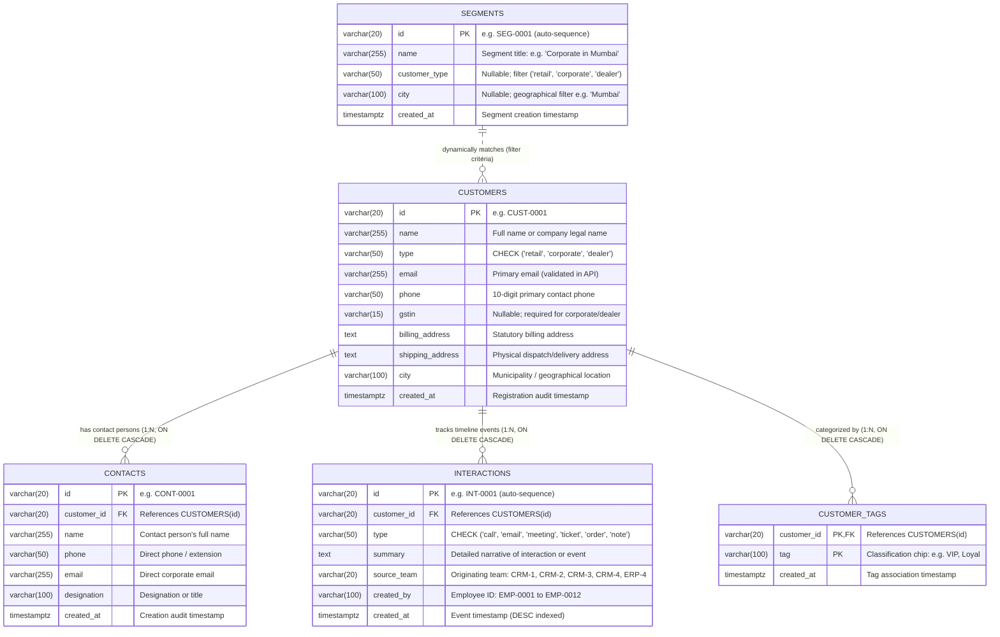

# Team CRM-3 (Customer 360) — Entity-Relationship (ER) Diagram & Data Dictionary

> **Team**: CRM-3 Customer 360 | **Service**: `services/crm3` (Port 5103) | **Database**: `crm3_db`  
> **Order-to-Cash Workflow**: Step 3 of 9 (Customer Master Directory, Contacts & Unified Event Timeline)  
> **Frontend Module**: `frontend/src/modules/crm3` (`roles: ["admin", "sales", "support"]`)  
> **Issue**: [CRM3-R2] Data owner: ER diagram, data dictionary and seed verification (Closes #146)

---

## 1. Executive Summary & Architectural Context

Team **CRM-3 (Customer 360)** acts as the **central authority and single source of truth** for all customer data across the 11 monorepo services in the electronics CRM + ERP platform. Under the **Order-to-Cash Workflow (Step 3 of 9)**, CRM-3 maintains:
1. **The Customer Master Directory (`customers`)**: The master customer entity consumed across teams by Sales (CRM-1), Support (CRM-2), Marketing (CRM-4), Customer Portal (CRM-5), Orders/Dispatch (ERP-4), and Invoicing/Finance (ERP-5).
2. **Customer Contacts (`contacts`)**: Multi-contact directory capturing procurement managers, accounts executives, facility leads, and primary representatives for corporate, dealer, and retail customers.
3. **Unified Event Timeline (`interactions`)**: Centralized chronological event ledger aggregating customer touches from CRM-3 (notes/calls) and external upstream services:
   - **CRM-1**: Quotation acceptance and lead qualification events (`Quote QUO-xxxx accepted`)
   - **CRM-2**: Support ticket opening and warranty RMA returns (`Ticket TKT-xxxx`, RMA handoffs)
   - **CRM-4**: Campaign dispatch touches (`Campaign CMP-xxxx sent`)
   - **ERP-4**: Sales order fulfillment and dispatch notes (`Order SO-xxxx dispatched`)
4. **Audience Segments (`segments`)**: Dynamic filtering criteria grouping customers by archetype (`customer_type`) and geographical region (`city`) for targeted campaign execution in CRM-4.
5. **Customer Tags (`customer_tags`)**: Multi-valued classification chips (`VIP`, `Corporate Account`, `Tier 1 Dealer`, `High Value`) supporting ad-hoc categorization and filtering.

---

## 2. Third Normal Form (3NF) Justification & Proof

The relational schema for `crm3_db` is designed to strictly satisfy **Third Normal Form (3NF)** to eliminate redundancy, avoid update/delete anomalies, and ensure relational integrity:

```
┌─────────────────────────────────────────────────────────────────────────────┐
│                       3NF NORMALIZATION PROOF                               │
├─────────────────────────────────────────────────────────────────────────────┤
│ 1NF (Atomicity & Keys):                                                     │
│   • Every attribute contains only atomic (scalar) values.                   │
│   • No repeating groups, arrays, or comma-separated lists in any table.     │
│   • Every table has an unambiguous Primary Key (PK).                        │
│                                                                             │
│ 2NF (Full Functional Dependency):                                           │
│   • Meets 1NF.                                                              │
│   • Every non-key attribute is fully functionally dependent on the entire   │
│     candidate key (no partial dependencies on a subset of any key).         │
│   • Composite key customer_tags(customer_id, tag): created_at depends on    │
│     the entire pair (customer_id, tag), not on customer_id or tag alone.    │
│   • All other tables have single-attribute surrogate keys (id), making       │
│     partial dependencies mathematically impossible.                         │
│                                                                             │
│ 3NF (Transitive Dependency Elimination):                                    │
│   • Meets 2NF.                                                              │
│   • No non-prime attribute is transitively dependent on any candidate key    │
│     (no X -> Y -> Z where X is PK and Y is a non-prime attribute).          │
│   • Contact persons are separated into `contacts` so contact details do not │
│     transitively depend on customer identity.                               │
│   • Event notes and logs are factored out into `interactions`.              │
│   • Segments define dynamic query criteria rather than duplicated customer  │
│     rosters, preserving 3NF dynamically.                                    │
│   • Customer tags are normalized into `customer_tags` junction entity.      │
└─────────────────────────────────────────────────────────────────────────────┘
```

### Specific Application-Layer Design Choice: Email Uniqueness
In accordance with specification **CRM3-A3** and the **Section 5 Shared Seed Contract**:
- Customer email uniqueness is enforced at the **API application layer** (`services/crm3/validators/customerValidator.js`) rather than via a database-level `UNIQUE` constraint on `customers(email)`.
- **Reason**: The Section 5 shared seed contract deliberately includes two intentional duplicate customer records (`CUST-0009` duplicating `CUST-0001`'s phone number `9820011111`, and `CUST-0010` duplicating `CUST-0002`'s email address `contact@sunrise.com`).
- A hard database unique constraint would reject the seed contract and break the **CRM3-D1 duplicate detection and merge feature**, which relies on these deliberate duplicates to verify deduplication workflows.

---

## 3. Entity-Relationship (ER) Diagram

The following Mermaid diagram represents the complete 3NF entity-relationship model implemented in `services/crm3/db/schema.sql`:



---

## 4. Comprehensive Data Dictionary

### 4.1 Table: `customers`
- **Domain Purpose**: Central master directory for individual consumers, corporate clients, and authorized retail dealers across India.
- **Primary Key**: `id` (`VARCHAR(20)`), e.g. `CUST-0001`.
- **Sequence**: `customers_seq` (monotonically incremented, format: `'CUST-' || LPAD(nextval('customers_seq')::TEXT, 4, '0')`).
- **Indexes**:
  - `idx_customers_type` on `(type)`
  - `idx_customers_city` on `(city)`
  - `idx_customers_phone` on `(phone)`
  - `idx_customers_email` on `(email)`

| Column Name | Data Type | Nullable | Default | Constraints & References | Business Description & Validation Rules |
| :--- | :--- | :---: | :---: | :--- | :--- |
| `id` | `VARCHAR(20)` | **NO** | — | **PRIMARY KEY** | Monotonic identifier formatted as `CUST-xxxx`. Seeded from `CUST-0001` to `CUST-0010`. |
| `name` | `VARCHAR(255)` | **NO** | — | — | Customer individual legal name or commercial enterprise title. Minimum 2 characters. |
| `type` | `VARCHAR(50)` | **NO** | — | `CHECK (type IN ('retail', 'corporate', 'dealer'))` | Customer classification category determining statutory tax and discount rules. |
| `email` | `VARCHAR(255)` | **NO** | — | API Uniqueness Check | Official email address. Validated by RFC 5322 regex (`/^[^\s@]+@[^\s@]+\.[^\s@]+$/`). Unique constraint enforced in code to allow duplicate seed rows. |
| `phone` | `VARCHAR(50)` | **NO** | — | — | Primary mobile or corporate contact number. Validated to exactly 10 numeric digits (`/^\d{10}$/`). |
| `gstin` | `VARCHAR(15)` | YES | `NULL` | Statutory format (15 chars) | Goods and Services Tax Identification Number. Mandatory for `corporate` and `dealer` customer archetypes. Format: `^[0-9]{2}[A-Z]{5}[0-9]{4}[A-Z]{1}[1-9A-Z]{1}Z[0-9A-Z]{1}$`. |
| `billing_address` | `TEXT` | YES | `NULL` | — | Statutory registered billing street address used on tax invoices (ERP-5). |
| `shipping_address` | `TEXT` | YES | `NULL` | — | Physical delivery location for dispatch orders and warehouse logistics (ERP-4). |
| `city` | `VARCHAR(100)` | YES | `NULL` | — | Operational city / municipality (e.g. Mumbai, Kochi, Pune, Ahmedabad, Delhi, Chennai, Bengaluru). Used in segment matching. |
| `created_at` | `TIMESTAMPTZ` | YES | `CURRENT_TIMESTAMP` | — | UTC timestamp of initial customer onboarding. |

---

### 4.2 Table: `contacts`
- **Domain Purpose**: Directory of direct contact representatives and department personnel associated with a customer account.
- **Primary Key**: `id` (`VARCHAR(20)`), e.g. `CONT-0001`.
- **Sequence**: `contacts_seq`.
- **Foreign Key**: `customer_id` referencing `customers(id)` with `ON DELETE CASCADE`.
- **Indexes**: `idx_contacts_customer_id` on `(customer_id)`.

| Column Name | Data Type | Nullable | Default | Constraints & References | Business Description & Validation Rules |
| :--- | :--- | :---: | :---: | :--- | :--- |
| `id` | `VARCHAR(20)` | **NO** | — | **PRIMARY KEY** | Monotonic contact identifier formatted as `CONT-xxxx`. Seeded `CONT-0001` through `CONT-0015`. |
| `customer_id` | `VARCHAR(20)` | **NO** | — | **FOREIGN KEY** `REFERENCES customers(id) ON DELETE CASCADE` | Parent customer identifier linking contact to customer master. Cascades on customer merge/deletion. |
| `name` | `VARCHAR(255)` | **NO** | — | — | Full name of the representative (e.g. Rajesh Sharma, Vikram Joshi). |
| `phone` | `VARCHAR(50)` | YES | `NULL` | — | Direct phone number or corporate mobile line. |
| `email` | `VARCHAR(255)` | YES | `NULL` | — | Direct corporate email address for operational communication. |
| `designation` | `VARCHAR(100)` | YES | `NULL` | — | Official title or organizational role (e.g. Procurement Head, Store Manager, Accounts Lead). |
| `created_at` | `TIMESTAMPTZ` | YES | `CURRENT_TIMESTAMP` | — | UTC timestamp when contact record was added. |

---

### 4.3 Table: `interactions`
- **Domain Purpose**: Unified chronologically ordered activity log recording manual agent notes, phone calls, meetings, and cross-team webhook events.
- **Primary Key**: `id` (`VARCHAR(20)`), e.g. `INT-0001`.
- **Sequence**: `interactions_seq`.
- **Foreign Key**: `customer_id` referencing `customers(id)` with `ON DELETE CASCADE`.
- **Indexes**:
  - `idx_interactions_customer_id` on `(customer_id)`
  - `idx_interactions_created_at` on `(created_at DESC)`
  - `idx_interactions_type` on `(type)`

| Column Name | Data Type | Nullable | Default | Constraints & References | Business Description & Validation Rules |
| :--- | :--- | :---: | :---: | :--- | :--- |
| `id` | `VARCHAR(20)` | **NO** | `'INT-' \|\| LPAD(...)` | **PRIMARY KEY** | Monotonic interaction identifier generated via sequence. |
| `customer_id` | `VARCHAR(20)` | **NO** | — | **FOREIGN KEY** `REFERENCES customers(id) ON DELETE CASCADE` | Target customer record for timeline entry. Automatically re-parented on customer merge. |
| `type` | `VARCHAR(50)` | **NO** | — | `CHECK (type IN ('call', 'email', 'meeting', 'ticket', 'order', 'note'))` | Categorical classification of the interaction. |
| `summary` | `TEXT` | **NO** | — | — | Descriptive log message, order summary, ticket description, or agent notes. |
| `source_team` | `VARCHAR(20)` | **NO** | `'CRM-3'` | Cross-team Origin | Originating team code (`CRM-1`, `CRM-2`, `CRM-3`, `CRM-4`, `ERP-4`, `ERP-5`). |
| `created_by` | `VARCHAR(100)` | YES | `'EMP-0001'` | Section 5 Employee | Employee ID of creator (`EMP-0001` to `EMP-0004` Sales, `EMP-0005` to `EMP-0007` Service, `EMP-0012` Admin). |
| `created_at` | `TIMESTAMPTZ` | YES | `CURRENT_TIMESTAMP` | — | Timestamp of event occurrence. Timeline displays events newest first (`DESC`). |

---

### 4.4 Table: `segments`
- **Domain Purpose**: Declarative audience segment filter criteria matching customer cohorts for sales campaigns and marketing exports (CRM-4).
- **Primary Key**: `id` (`VARCHAR(20)`), e.g. `SEG-0001`.
- **Sequence**: `segment_id_seq`.
- **Indexes**:
  - `idx_segments_customer_type` on `(customer_type)`
  - `idx_segments_city` on `(city)`

| Column Name | Data Type | Nullable | Default | Constraints & References | Business Description & Validation Rules |
| :--- | :--- | :---: | :---: | :--- | :--- |
| `id` | `VARCHAR(20)` | **NO** | `'SEG-' \|\| LPAD(...)` | **PRIMARY KEY** | Monotonic segment identifier formatted as `SEG-xxxx`. |
| `name` | `VARCHAR(255)` | **NO** | — | — | Human-readable segment title (e.g. `'Corporate in Mumbai'`, `'All Retail Customers'`). |
| `customer_type` | `VARCHAR(50)` | YES | `NULL` | Filter Match | Archetype filter (`retail`, `corporate`, `dealer`). If `NULL`, matches any customer type. |
| `city` | `VARCHAR(100)` | YES | `NULL` | Filter Match | Geographical filter (e.g. `'Mumbai'`, `'Pune'`). If `NULL`, matches any city. |
| `created_at` | `TIMESTAMPTZ` | YES | `CURRENT_TIMESTAMP` | — | UTC timestamp when segment definition was created. |

---

### 4.5 Table: `customer_tags`
- **Domain Purpose**: Associative relation attaching multi-valued category badges/chips to customer master records.
- **Composite Primary Key**: `(customer_id, tag)`.
- **Foreign Key**: `customer_id` referencing `customers(id)` with `ON DELETE CASCADE`.
- **Indexes**:
  - `idx_customer_tags_customer_id` on `(customer_id)`
  - `idx_customer_tags_tag` on `(tag)`

| Column Name | Data Type | Nullable | Default | Constraints & References | Business Description & Validation Rules |
| :--- | :--- | :---: | :---: | :--- | :--- |
| `customer_id` | `VARCHAR(20)` | **NO** | — | **COMPOSITE PK**, **FOREIGN KEY** `REFERENCES customers(id) ON DELETE CASCADE` | Associated customer entity identifier. |
| `tag` | `VARCHAR(100)` | **NO** | — | **COMPOSITE PK** | Classification keyword chip (e.g. `VIP`, `Corporate Account`, `High Value`, `Tier 1 Dealer`). |
| `created_at` | `TIMESTAMPTZ` | YES | `CURRENT_TIMESTAMP` | — | Timestamp when tag was applied to customer. |

---

## 5. Section 5 Shared Seed Contract Compliance

The shared seed contract defines universal entities that all 11 monorepo services must strictly adhere to. Below is the verified mapping implemented in `services/crm3/db/seed.sql`:

### 5.1 Shared Customers Directory (`CUST-0001` through `CUST-0010`)

| ID | Name | Type | City | Phone | Email | GSTIN | Duplicate Note |
| :--- | :--- | :--- | :--- | :--- | :--- | :--- | :--- |
| `CUST-0001` | Aarav Mehta | `retail` | Mumbai | `9820011111` | `aarav.mehta@example.com` | `NULL` | Master retail customer in Mumbai |
| `CUST-0002` | Sunrise Electronics Pvt Ltd | `corporate` | Mumbai | `9820022222` | `contact@sunrise.com` | `27AABCS1234F1Z5` | Master corporate customer in Mumbai |
| `CUST-0003` | Priya Nair | `retail` | Kochi | `9847012345` | `priya.nair@example.com` | `NULL` | Retail customer in Kochi |
| `CUST-0004` | BrightHome Retail LLP | `dealer` | Pune | `9822098765` | `sales@brighthome.com` | `27AABCB9876E1Z2` | Dealer (DLR-0001 in CRM-1) |
| `CUST-0005` | Kiran Patel | `retail` | Ahmedabad | `9825012345` | `kiran.patel@example.com` | `NULL` | Retail customer in Ahmedabad |
| `CUST-0006` | Metro Offices Ltd | `corporate` | Delhi | `9811054321` | `admin@metrooffices.com` | `07AABCM5432D1Z9` | Corporate customer in Delhi |
| `CUST-0007` | Sneha Iyer | `retail` | Chennai | `9840012345` | `sneha.iyer@example.com` | `NULL` | Retail customer in Chennai |
| `CUST-0008` | Gadget Hub | `dealer` | Bengaluru | `9845012345` | `info@gadgethub.com` | `29AABCG1234H1Z1` | Dealer (DLR-0002 in CRM-1) |
| `CUST-0009` | Aarav Mehta (Duplicate) | `retail` | Mumbai | `9820011111` | `aarav.duplicate@example.com` | `NULL` | **Intentional Phone Duplicate** of `CUST-0001` |
| `CUST-0010` | Sunrise Electronics (Branch) | `corporate` | Pune | `9820033333` | `contact@sunrise.com` | `27AABCS1234F1Z5` | **Intentional Email Duplicate** of `CUST-0002` |

### 5.2 Cross-Team Contractual Identifiers Verified in Seed

1. **Employee IDs (`created_by`)**:
   - `EMP-0001` (Rohan Kulkarni — Sales Rep): Created notes and outbound calls on `CUST-0001`, `CUST-0009`.
   - `EMP-0002` (Neha Sharma — Sales Rep): Dispatched marketing brochure to `CUST-0001`, `CUST-0010`.
   - `EMP-0003` (Vikram Singh — Sales Rep): Conducted quarterly review on `CUST-0002`.
   - `EMP-0004` (Anjali Rao — Sales Rep): Reconciled GST credit terms for `CUST-0002`.
   - `EMP-0005` (Imran Qureshi — Service Engineer): Logged warranty enquiry for `CUST-0001`.
   - `EMP-0006` (Deepa Menon — Service Engineer): Resolved OLED installation ticket for `CUST-0003`.
   - `EMP-0012` (Rahul Verma — Admin): Generated onboarding welcome record for `CUST-0003`.

2. **Product SKUs (`summary`)**:
   - `SKU-0001` (55-inch 4K Smart TV ₹42,990): Order `SO-0001` placed for `CUST-0001`.
   - `SKU-0002` (43-inch Full HD TV ₹24,990): Bulk purchase order `SO-0002` for `CUST-0002`.
   - `SKU-0003` (65-inch OLED TV ₹94,990): Installation ticket for `CUST-0003`.

3. **Orders & Dispatches**:
   - `SO-0001` placed by `CUST-0001` (dispatched via `DSP-0001` with serial `TV55-2611-0001`).
   - `SO-0002` placed by `CUST-0002` (procurement agreement).

4. **Dynamic Segment Verification**:
   - `SEG-0001` (**Corporate in Mumbai**): Matches **`CUST-0002` ONLY**.
     - Proof: `CUST-0002` has `type = 'corporate'` and `city = 'Mumbai'`.
     - `CUST-0006` is `corporate` but located in `'Delhi'`.
     - `CUST-0010` is `corporate` but located in `'Pune'`.
     - `CUST-0001` is in `'Mumbai'` but has `type = 'retail'`.
     - Query `SELECT id, name FROM customers WHERE type = 'corporate' AND city = 'Mumbai'` returns strictly `[ { id: 'CUST-0002', name: 'Sunrise Electronics Pvt Ltd' } ]`.

---

## 6. Schema Evolution & Review Log

| Sprint Issue | Feature Scope | Schema Changes Introduced |
| :--- | :--- | :--- |
| **CRM3-A1** | Customers and Contacts API | Introduced `customers` and `contacts` tables, `customers_seq` and `contacts_seq`. Seeded initial 10 customers and 15 contacts. |
| **CRM3-A3** | Validation Rules | Validated 10-digit phone, email format, 15-char GSTIN. Established application-level email uniqueness to support duplicate merge. |
| **CRM3-B1** | Interactions API | Introduced `interactions` table, `interactions_seq`, indexes on `customer_id` and `created_at DESC`. Seeded 10 baseline timeline events. |
| **CRM3-B3** | Events from Other Teams | Extended `interactions` table with `source_team VARCHAR(20)` and added `'note'` to type check constraint. |
| **CRM3-C1** | Segments API | Introduced `segments` table and `segment_id_seq`. Seeded 4 baseline audience segment rules. |
| **CRM3-C3** | Tags and CSV Export | Introduced `customer_tags` associative table with composite PK `(customer_id, tag)`. Seeded customer tags. |
| **CRM3-D1** | Duplicate Detection & Merge | Added foreign key cascade on `interactions(customer_id)`. Added transaction rollback logic and sequence advancing statements. |
| **CRM3-R2** | Data Owner Consolidation | Unified authoritative 3NF `schema.sql` and idempotent `seed.sql`, published ER diagram, verified clean database reset. |

---

## 7. Database Initialization & Reset Runbook

### Clean Database Initialization
To reset and re-seed the `crm3_db` database to its exact baseline state:
```bash
# From monorepo root
npm run reset
```

### Direct PostgreSQL Verification
To execute verification queries directly against `crm3_db`:
```bash
# Connect to PostgreSQL
psql -U postgres -d crm3_db -h localhost -p 5432
```

```sql
-- 1. Verify table counts
SELECT 'customers' AS table_name, count(*) FROM customers
UNION ALL
SELECT 'contacts', count(*) FROM contacts
UNION ALL
SELECT 'interactions', count(*) FROM interactions
UNION ALL
SELECT 'segments', count(*) FROM segments
UNION ALL
SELECT 'customer_tags', count(*) FROM customer_tags;

-- 2. Verify duplicate seed records
SELECT phone, count(*), array_agg(id) AS duplicate_ids 
FROM customers 
GROUP BY phone HAVING count(*) > 1;

SELECT email, count(*), array_agg(id) AS duplicate_ids 
FROM customers 
GROUP BY email HAVING count(*) > 1;

-- 3. Verify 'Corporate in Mumbai' dynamic segment matching (Must return CUST-0002 only)
SELECT c.id, c.name, c.type, c.city 
FROM customers c 
WHERE c.type = 'corporate' AND c.city = 'Mumbai';
```

---

## 8. Data Owner Acceptance Checklist
- [x] **3NF Compliance**: All tables verified in Third Normal Form (1NF scalar, 2NF full dependency, 3NF non-transitive).
- [x] **Mermaid ERD**: Syntactically valid Mermaid ER diagram with PK/FK definitions and cascade rules.
- [x] **Data Dictionary**: Comprehensive column definitions, types, nullability, defaults, and business rules.
- [x] **Section 5 Contract**: All 10 customers (`CUST-0001` to `CUST-0010`), employee IDs (`EMP-0001` to `EMP-0012`), products (`SKU-0001` to `SKU-0003`), orders (`SO-0001`, `SO-0002`), and duplicate seed rows verified.
- [x] **Segment Match**: Segment `SEG-0001` ("Corporate in Mumbai") dynamically matches `CUST-0002` only.
- [x] **Clean Reset**: `npm run reset` loads cleanly without errors; `seed.sql` is completely idempotent.
