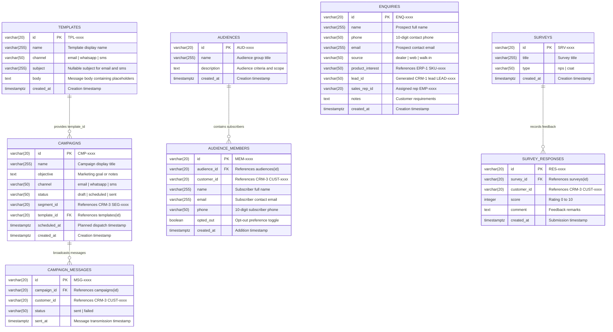

# CRM-4 Marketing & Engagement — ER Diagram, Data Dictionary & Seed Verification

> **Team**: CRM-4 Marketing & Engagement | **Service**: `services/crm4` (Port `5104`) | **Database**: `crm4_db`  
> **Frontend Module**: `frontend/src/modules/crm4` (`roles: ["admin", "sales"]`)  
> **Order-to-Cash Workflow**: Step 1 of 9 (Marketing Campaigns, Web Inquiries & Customer Feedback Surveys)  
> **Issue**: `[CRM4-R2] Data owner: ER diagram, data dictionary and seed verification`  
> **Owner / Assignee**: Data Owner (`@juitawde`)

---

## 1. Entity-Relationship Diagram (3NF)

### Logical Cross-Service Relationships
In accordance with the shared distributed architecture, CRM-4 does not maintain physical foreign key constraints across microservice database boundaries (`crm3_db`, `crm1_db`, `erp1_db`, `erp6_db`). Instead, it enforces strict contract alignment using Section 5 shared IDs:
- `CAMPAIGNS.segment_id` &rarr; Links via HTTP to CRM-3 dynamic customer segments (`SEG-0001`..`SEG-0004`).
- `CAMPAIGN_MESSAGES.customer_id` &rarr; Links to CRM-3 master customer directory (`CUST-0001`..`CUST-0008`).
- `AUDIENCE_MEMBERS.customer_id` &rarr; Links to CRM-3 master customer directory (`CUST-0001`..`CUST-0008`).
- `ENQUIRIES.product_interest` &rarr; Links via HTTP to ERP-1 product catalog (`SKU-0001`..`SKU-0015`).
- `ENQUIRIES.lead_id` &rarr; Stores lead identifiers generated in CRM-1 (`LEAD-0001`..`LEAD-xxxx`).
- `ENQUIRIES.sales_rep_id` &rarr; References default sales representative `EMP-0001` (from ERP-6).
- `SURVEY_RESPONSES.customer_id` &rarr; Links to CRM-3 master customer directory (`CUST-0001`..`CUST-0008`).

---

## 2. Third Normal Form (3NF) Architecture Justification

The `crm4_db` database strictly adheres to **Third Normal Form (3NF)**:

1. **First Normal Form (1NF)**:
   - Every column contains atomic scalar values. No comma-delimited strings, array fields, or untyped JSON blobs are stored.
   - Every table defines a distinct single-column surrogate primary key (`id`) backed by a dedicated PostgreSQL sequence (`campaign_seq`, `campaign_message_seq`, `audience_seq`, `audience_member_seq`, `enquiry_seq`, `template_seq`, `survey_seq`, `survey_response_seq`).
2. **Second Normal Form (2NF)**:
   - All tables possess a single-column primary key. Because there are no composite primary keys, partial functional dependencies are mathematically impossible; all non-key columns functionally depend on the whole primary key.
3. **Third Normal Form (3NF)**:
   - **No Transitive Dependencies**: Non-key columns depend only on the primary key, never on other non-key columns:
     - Message templates are normalized in `templates` rather than embedded in `campaigns`, preventing template body redundancy.
     - Audience members are isolated in `audience_members` with `ON DELETE CASCADE` from `audiences`, avoiding member snapshot anomalies.
     - Survey responses are stored in `survey_responses` with foreign key cascade from `surveys`, preventing denormalized aggregation within survey records.
     - Broadcast dispatches are stored as discrete rows in `campaign_messages`, allowing one campaign to broadcast to $N$ segment customers without mutating the parent campaign definition.

---

## 3. Data Dictionary

### Table 1: `templates`
*Pre-configured message formats supporting dynamic token replacement (`{{name}}`, `{{product}}`, `{{offer}}`).*

| Column | Type | Nullable | Constraints & Defaults | Meaning & Notes |
|---|---|---|---|---|
| `id` | `VARCHAR(20)` | **NO** | `PRIMARY KEY` | Entity ID formatted as `TPL-xxxx` via `template_seq`. |
| `name` | `VARCHAR(255)` | **NO** | — | Human-readable template display name. |
| `channel` | `VARCHAR(50)` | **NO** | `CHECK (channel IN ('email', 'whatsapp', 'sms'))` | Communication channel. |
| `subject` | `VARCHAR(255)` | YES | — | Email or SMS subject line (null for WhatsApp). |
| `body` | `TEXT` | **NO** | — | Message content containing `{{name}}`, `{{product}}`, `{{offer}}` tokens. |
| `created_at` | `TIMESTAMPTZ` | YES | `DEFAULT CURRENT_TIMESTAMP` | Record creation timestamp with timezone. |

---

### Table 2: `campaigns`
*Outbound marketing campaign definitions linked to customer segments and templates.*

| Column | Type | Nullable | Constraints & Defaults | Meaning & Notes |
|---|---|---|---|---|
| `id` | `VARCHAR(20)` | **NO** | `PRIMARY KEY` | Entity ID formatted as `CMP-xxxx` via `campaign_seq`. |
| `name` | `VARCHAR(255)` | **NO** | — | Campaign title. |
| `objective` | `TEXT` | YES | — | Business goal or internal notes. |
| `channel` | `VARCHAR(50)` | **NO** | `CHECK (channel IN ('email', 'whatsapp', 'sms'))` | Delivery channel. |
| `status` | `VARCHAR(50)` | **NO** | `DEFAULT 'draft'`, `CHECK (status IN ('draft', 'scheduled', 'sent'))` | Lifecycle status. |
| `segment_id` | `VARCHAR(20)` | **NO** | — | Target CRM-3 segment identifier (`SEG-0001`..`SEG-0004`). |
| `template_id` | `VARCHAR(20)` | **NO** | `REFERENCES templates(id) ON DELETE RESTRICT` | Foreign key referencing message template. |
| `scheduled_at`| `TIMESTAMPTZ` | YES | — | Target execution date and time. |
| `created_at` | `TIMESTAMPTZ` | YES | `DEFAULT CURRENT_TIMESTAMP` | Record creation timestamp with timezone. |

---

### Table 3: `campaign_messages`
*Simulated broadcast message dispatch log per recipient customer.*

| Column | Type | Nullable | Constraints & Defaults | Meaning & Notes |
|---|---|---|---|---|
| `id` | `VARCHAR(20)` | **NO** | `PRIMARY KEY` | Entity ID formatted as `MSG-xxxx` via `campaign_message_seq`. |
| `campaign_id` | `VARCHAR(20)` | **NO** | `REFERENCES campaigns(id) ON DELETE CASCADE` | Parent campaign identifier. |
| `customer_id` | `VARCHAR(20)` | **NO** | — | Target recipient customer (`CUST-0001`..`CUST-0008` in CRM-3). |
| `status` | `VARCHAR(50)` | **NO** | `DEFAULT 'sent'`, `CHECK (status IN ('sent', 'failed'))` | Delivery simulation status. |
| `sent_at` | `TIMESTAMPTZ` | YES | `DEFAULT CURRENT_TIMESTAMP` | Broadcast timestamp. |

---

### Table 4: `audiences`
*Curated static customer subscriber lists.*

| Column | Type | Nullable | Constraints & Defaults | Meaning & Notes |
|---|---|---|---|---|
| `id` | `VARCHAR(20)` | **NO** | `PRIMARY KEY` | Entity ID formatted as `AUD-xxxx` via `audience_seq`. |
| `name` | `VARCHAR(255)` | **NO** | — | Audience list name. |
| `description` | `TEXT` | YES | — | Scope and targeting criteria description. |
| `created_at` | `TIMESTAMPTZ` | YES | `DEFAULT CURRENT_TIMESTAMP` | Record creation timestamp with timezone. |

---

### Table 5: `audience_members`
*Individual customer records enrolled in an audience list.*

| Column | Type | Nullable | Constraints & Defaults | Meaning & Notes |
|---|---|---|---|---|
| `id` | `VARCHAR(20)` | **NO** | `PRIMARY KEY` | Entity ID formatted as `MEM-xxxx` via `audience_member_seq`. |
| `audience_id` | `VARCHAR(20)` | **NO** | `REFERENCES audiences(id) ON DELETE CASCADE` | Parent audience foreign key. |
| `customer_id` | `VARCHAR(20)` | YES | — | Linked CRM-3 customer ID (`CUST-xxxx`). |
| `name` | `VARCHAR(255)` | **NO** | — | Member full name. |
| `email` | `VARCHAR(255)` | **NO** | — | Contact email address. |
| `phone` | `VARCHAR(50)` | YES | — | 10-digit phone number. |
| `opted_out` | `BOOLEAN` | **NO** | `DEFAULT FALSE` | Reachability toggle (true = excluded from campaign counts). |
| `created_at` | `TIMESTAMPTZ` | YES | `DEFAULT CURRENT_TIMESTAMP` | Addition timestamp. |
| — | — | — | `UNIQUE (audience_id, customer_id)` | Prevents duplicate customer enrollment upon segment import. |

---

### Table 6: `enquiries`
*Public & dealer inbound prospect inquiries triggering CRM-1 sales leads.*

| Column | Type | Nullable | Constraints & Defaults | Meaning & Notes |
|---|---|---|---|---|
| `id` | `VARCHAR(20)` | **NO** | `PRIMARY KEY` | Entity ID formatted as `ENQ-xxxx` via `enquiry_seq`. |
| `name` | `VARCHAR(255)` | **NO** | — | Prospect full name. |
| `phone` | `VARCHAR(50)` | **NO** | — | 10-digit contact telephone number. |
| `email` | `VARCHAR(255)` | **NO** | — | Prospect contact email. |
| `source` | `VARCHAR(50)` | **NO** | `CHECK (source IN ('dealer', 'web', 'walk-in'))` | Inbound intake channel. |
| `product_interest` | `VARCHAR(50)` | **NO** | — | Interested SKU catalog item (`SKU-0001`..`SKU-0015` in ERP-1). |
| `lead_id` | `VARCHAR(50)` | YES | — | Generated sales lead identifier in CRM-1 (`LEAD-xxxx`). |
| `sales_rep_id` | `VARCHAR(20)` | YES | `DEFAULT 'EMP-0001'` | Assigned sales representative (from ERP-6). |
| `notes` | `TEXT` | YES | — | Prospect requirements or customer notes. |
| `created_at` | `TIMESTAMPTZ` | YES | `DEFAULT CURRENT_TIMESTAMP` | Inbound inquiry submission timestamp. |

---

### Table 7: `surveys`
*Feedback survey questionnaires classified by evaluation methodology.*

| Column | Type | Nullable | Constraints & Defaults | Meaning & Notes |
|---|---|---|---|---|
| `id` | `VARCHAR(20)` | **NO** | `PRIMARY KEY` | Entity ID formatted as `SRV-xxxx` via `survey_seq`. |
| `title` | `VARCHAR(255)` | **NO** | — | Survey title. |
| `type` | `VARCHAR(50)` | **NO** | `CHECK (type IN ('nps', 'csat'))` | Metric methodology (`nps` = 0-10, `csat` = 1-5). |
| `created_at` | `TIMESTAMPTZ` | YES | `DEFAULT CURRENT_TIMESTAMP` | Survey creation timestamp. |

---

### Table 8: `survey_responses`
*Individual customer ratings and qualitative feedback comments.*

| Column | Type | Nullable | Constraints & Defaults | Meaning & Notes |
|---|---|---|---|---|
| `id` | `VARCHAR(20)` | **NO** | `PRIMARY KEY` | Entity ID formatted as `RES-xxxx` via `survey_response_seq`. |
| `survey_id` | `VARCHAR(20)` | **NO** | `REFERENCES surveys(id) ON DELETE CASCADE` | Parent survey foreign key. |
| `customer_id` | `VARCHAR(20)` | **NO** | — | Responding customer (`CUST-0001`..`CUST-0008` in CRM-3). |
| `score` | `INTEGER` | **NO** | `CHECK (score >= 0 AND score <= 10)` | Numeric rating score. |
| `comment` | `TEXT` | YES | — | Customer commentary and feedback remarks. |
| `created_at` | `TIMESTAMPTZ` | YES | `DEFAULT CURRENT_TIMESTAMP` | Response submission timestamp. |

---

## 4. Indexing & Optimization Strategy

B-Tree indexes are established on all foreign key references and high-traffic query predicates:

| Index Name | Table | Columns | Optimization Goal |
|---|---|---|---|
| `idx_campaigns_status` | `campaigns` | `status` | Filter campaigns by `draft`, `scheduled`, or `sent` status. |
| `idx_campaigns_segment_id` | `campaigns` | `segment_id` | Fast segment-based campaign lookups. |
| `idx_campaign_messages_campaign_id` | `campaign_messages` | `campaign_id` | Rapid aggregation of message dispatch counts. |
| `idx_campaign_messages_customer_id` | `campaign_messages` | `customer_id` | Historical touchpoint lookup for customer 360 feed. |
| `idx_audience_members_audience_id` | `audience_members` | `audience_id` | Listing members for a specific audience. |
| `idx_audience_members_customer_id` | `audience_members` | `customer_id` | Fast duplicate detection during segment import. |
| `idx_enquiries_lead_id` | `enquiries` | `lead_id` | Tracing enquiry conversions to CRM-1 leads. |
| `idx_enquiries_product_interest` | `enquiries` | `product_interest`| Reporting demand interest by product SKU. |
| `idx_survey_responses_survey_id` | `survey_responses` | `survey_id` | Aggregating NPS promoter/passive/detractor scores. |
| `idx_survey_responses_customer_id` | `survey_responses` | `customer_id` | Customer feedback history retrieval. |

---

## 5. Section 5 Shared Seed Contract Compliance Audit

All seeded records strictly follow Section 5 of the monorepo architecture:

1. **Customers (`CUST-0001` through `CUST-0008`)**:
   - `campaign_messages`: Dispatches to `CUST-0001`..`CUST-0008`.
   - `audience_members`: Populated with `CUST-0001`..`CUST-0008`.
   - `survey_responses`: Populated with `CUST-0001`..`CUST-0008`.
2. **Products (`SKU-0001` through `SKU-0005`)**:
   - `enquiries`: `product_interest` references valid ERP-1 SKUs (`SKU-0001` Smart TV, `SKU-0002` Refrigerator, `SKU-0004` Microwave, `SKU-0005` AC).
3. **Employees / Sales Reps (`EMP-0001`)**:
   - `enquiries`: Assigned to sales representative `EMP-0001` (from ERP-6).
4. **Customer Segments (`SEG-0001` through `SEG-0004`)**:
   - `campaigns`: Mapped to `SEG-0001` (High Value Retail), `SEG-0002` (Corporate Accounts), `SEG-0003` (Dealers), and `SEG-0004` (Delhi NCR).
5. **NPS Hand Calculation Verification (`[CRM4-D3]`)**:
   - Seed survey `SRV-0001` contains 10 customer responses with scores: `[10, 9, 10, 8, 8, 5, 4, 10, 9, 9]`.
   - Promoters (9-10): 6 responses = $60.0\%$
   - Passives (7-8): 2 responses = $20.0\%$
   - Detractors (0-6): 2 responses = $20.0\%$
   - $\text{NPS} = 60.0\% - 20.0\% = +40$.
   - Average score: $(10+9+10+8+8+5+4+10+9+9) / 10 = 8.2 / 10$.
   - Hand calculation matches backend calculation and frontend visualization exactly.
6. **Sequence Synchronization**:
   - All 8 sequences are synced via `SELECT setval('...', max_id, true)` in `seed.sql`, preventing key collisions on subsequent inserts.
7. **Idempotency**:
   - All `INSERT` statements utilize `ON CONFLICT (id) DO UPDATE SET ...`, allowing `npm run reset` to execute repeatedly without throwing duplicate key errors.
