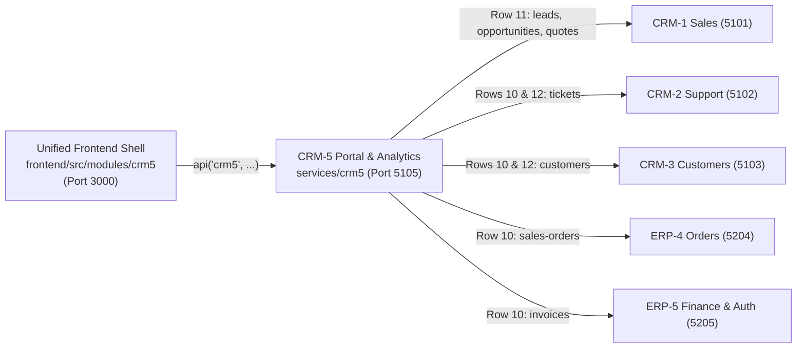

# CRM-5 Portal & Analytics — Customer Self-Service Portal, Dashboards, Forecasts & Reports

> **Team**: CRM-5 Portal & Analytics  
> **Backend Service**: `services/crm5` (Express on Port `5105`, Vite proxy `/svc/crm5`)  
> **Database**: PostgreSQL `crm5_db`  
> **Frontend Module**: `frontend/src/modules/crm5` (`id: 'crm5'`, Title: `Portal and Dashboards`, Roles: `["admin", "sales", "support", "warehouse", "finance", "hr"]`)  
> **Workflow Scope**: Executive Analytics Dashboards, Sales Pipeline Forecasting, Role-Based Reporting & Customer Self-Service Portal

---

## 1. What This Module Does

Team **CRM-5 (Portal & Analytics)** delivers two interconnected capabilities across the Electro App monorepo:

1. **Customer Self-Service Portal (`/crm5/portal`, `/crm5/portal/home`)**:
   - Allows lookup by customer identifier (`CUST-0001`..`CUST-0008`), displaying customer contact & GSTIN metadata alongside three consolidated tables: **My Orders** (`SO-xxxx`), **My Tickets** (`TKT-xxxx`), and **My Invoices** (`INV-xxxx`) with color-coded status badges.
   - Logs every portal lookup in `portal_visits` (`PV-xxxx`) for usage telemetry and auditing.
2. **Executive Sales & Pipeline Dashboard (`/crm5`, `/crm5/dashboard`)**:
   - Aggregates live CRM-1 sales pipeline data into 4 KPI cards (**Total Leads**, **Open Opportunities**, **Won Value** in ₹ INR, **Quotes Accepted**), an HTML/CSS stage distribution bar chart (`prospect`, `proposal`, `negotiation`, `won`, `lost`), and an interactive drill-down table.
   - Persists point-in-time KPI snapshots in `dashboard_snapshots` (`SNP-xxxx`).
3. **Sales Target & Weighted Pipeline Forecast (`/crm5/forecast`)**:
   - Computes probability-weighted pipeline revenue from CRM-1 opportunities (`prospect` 10%, `proposal` 30%, `negotiation` 60%).
   - Provides full CRUD for monthly INR revenue targets (`forecasts` table, `FCST-xxxx`) and a live realization progress bar against the current month's target.
4. **Role-Based Executive & Operational Reports (`/crm5/reports`)**:
   - Filters available reports by the authenticated user's role (`admin`, `sales`, `support`, `warehouse`, `finance`, `hr`), enforcing `403 Forbidden` on unauthorized report execution while allowing `admin` to preview other role views via `?role=`.

---

## 2. How to Run It

### Prerequisites
- Node.js `18+` (tested on Node `20+` / `26`) and npm `9+`
- PostgreSQL running locally (optional for mock/in-memory development; required for persistent `crm5_db` storage)
- Root `.env` copied from `.env.example` (defaults: `AUTH_REQUIRED=false`, `USE_MOCKS=true`, `PORT=5105`)

### Step 1: Install Dependencies
```bash
npm ci
```

### Step 2: Initialize `crm5_db` (Optional — Falls Back Gracefully if Offline)
```bash
createdb crm5_db
psql -d crm5_db -v ON_ERROR_STOP=1 -f services/crm5/db/schema.sql
psql -d crm5_db -v ON_ERROR_STOP=1 -f services/crm5/db/seed.sql
```
*(Or run `npm run reset` once `[ERP5-C4]` database orchestration is configured.)*

### Step 3: Start Backend & Frontend
```bash
# Option A: Start CRM-5 backend (port 5105) + unified frontend shell (port 3000)
npm --workspace=services/crm5 run dev
npm --workspace=frontend run dev

# Option B: Start all 11 monorepo services + frontend together
npm run dev
```

- **Frontend Module URL**: `http://localhost:3000/crm5/dashboard`
- **Backend Health Check**: `http://localhost:5105/api/health`

### Step 4: Run Tests & Verification Checks
```bash
npm run smoke
npm run build
npm --workspace=services/crm5 test
```

---

## 3. Registered Frontend Routes

Defined in `frontend/src/modules/crm5/index.jsx` (all routes accessible to `["admin", "sales", "support", "warehouse", "finance", "hr"]`):

| Full Path | Label in Sidebar | Component | Description |
|---|---|---|---|
| `/crm5` | *(Default landing)* | `DashboardPage.jsx` | Executive Sales & Pipeline Dashboard |
| `/crm5/dashboard` | `Dashboard` | `DashboardPage.jsx` | 4 KPI cards, CSS stage bar chart, stage drill-down table |
| `/crm5/portal` | `Customer Portal` | `PortalPage.jsx` | Customer ID lookup box + quick Section 5 demo chips |
| `/crm5/portal/home` | *(Hidden route)* | `PortalPage.jsx` | Customer profile banner + My Orders / Tickets / Invoices |
| `/crm5/reports` | `Reports` | `ReportsPage.jsx` | Role-gated report catalog, admin role preview, live result table |
| `/crm5/forecast` | `Forecast` | `ForecastPage.jsx` | Weighted pipeline card, target realization bar, monthly target CRUD |

> **Pending Tier 3 UI Extensions**: `/crm5/portal/orders/:id` & ticket creation form (`[CRM5-A3]`), dashboard date range filter & snapshot history (`[CRM5-B3]`), 6-month won-value trend & estimate (`[CRM5-C3]`), and browser CSV export + `@media print` styles (`[CRM5-D3]`).

---

## 4. Backend API Endpoint List (Port `5105`)

All routes except `/api/health` are protected by `requireAuth` (`services/_shared/auth.js`) and return `{ "data": ... }` on success or `{ "error": "..." }` on failure.

### System Health
| Method | Path | Auth | Description |
|---|---|---|---|
| `GET` | `/api/health` | Public | Returns service metadata (`team: "crm5"`, `port: 5105`, `status: "ok"`). |

### Customer Portal (`services/crm5/routes/portal.js`)
| Method | Path | Auth | Description |
|---|---|---|---|
| `GET` | `/api/portal/customers` | `requireAuth` | Lists registered customers for quick portal selection. |
| `GET` | `/api/portal/visits` | `requireAuth` | Returns up to 20 most recent customer portal visit logs (`PV-xxxx`). |
| `GET` | `/api/portal/:customerId/overview` | `requireAuth` | Aggregates customer profile, orders, tickets, invoices, and stats; logs visit in `portal_visits`; returns `404` for unknown ID. |
| `GET` | `/api/portal/:customerId` | `requireAuth` | Alias for `/api/portal/:customerId/overview`. |

### Executive Dashboards (`services/crm5/routes/dashboard.js`)
| Method | Path | Auth | Description |
|---|---|---|---|
| `GET` | `/api/dashboard/sales-summary` | `requireAuth` | Aggregates CRM-1 leads, opportunities by stage, won value in INR, and accepted quotes (`mocks/sales-summary.json` fallback). |
| `POST` | `/api/dashboard/snapshot` | `requireAuth` | Persists a point-in-time KPI metrics payload into `dashboard_snapshots` (`201 Created`, `SNP-xxxx`). |
| `GET` | `/api/dashboard/snapshots` | `requireAuth` | Lists saved historical KPI snapshots sorted newest first. |

### Sales Forecasts & Weighted Pipeline (`services/crm5/routes/forecasts.js`)
| Method | Path | Auth | Description |
|---|---|---|---|
| `GET` | `/api/forecast/weighted` | `requireAuth` | Calculates weighted pipeline (`prospect` 10%, `proposal` 30%, `negotiation` 60%) and realization % vs current month target. |
| `GET` | `/api/forecasts/weighted` | `requireAuth` | Alias for `/api/forecast/weighted`. |
| `GET` | `/api/forecasts` | `requireAuth` | Lists all monthly targets (`FCST-xxxx`) ordered by `month DESC`. |
| `POST` | `/api/forecasts` | `requireAuth` | Creates or upserts (`ON CONFLICT (month)`) a monthly target (`YYYY-MM`, non-negative `target_amount`). |
| `PUT` | `/api/forecasts/:id` | `requireAuth` | Updates `target_amount` and `notes` for an existing forecast (`404` if not found). |
| `DELETE` | `/api/forecasts/:id` | `requireAuth` | Deletes a forecast target by ID (`404` if not found). |

### Role-Based Reports (`services/crm5/routes/reports.js`)
| Method | Path | Auth | Description |
|---|---|---|---|
| `GET` | `/api/reports` | `requireAuth` | Lists report descriptors filtered by caller's role (or `?role=` / `x-user-role` preview; `admin` sees all). |
| `GET` | `/api/reports/:id/run` | `requireAuth` | Executes report and returns `{ columns, rows, generated_at }`; returns `403` if role not allowed, `404` if unknown. |

---

## 5. Cross-Team Contracts: Who We Call & Who Calls Us



### Which Other Teams CRM-5 Calls (Outbound Dependencies)
| Contract Row | Caller Issues | Target Team & Port | Target Endpoints | Upstream Status on `main` | Mock Fallback (`services/crm5/mocks/`) |
|---|---|---|---|---|---|
| **Row 10** | `CRM5-A1`, `A3` | **CRM-3** (`5103`) | `GET /api/customers/:id` | Merged (`services/crm3/routes/customers.js`) | `portal-customers.json` |
| **Row 10** | `CRM5-A1`, `A3` | **ERP-4** (`5204`) | `GET /api/sales-orders?customer_id=`, `GET /api/sales-orders/:id` | Merged (`services/erp4/routes/salesOrders.js`) | `portal-orders.json` |
| **Row 10** | `CRM5-A1`, `A3` | **CRM-2** (`5102`) | `GET /api/tickets?customer_id=`, `POST /api/tickets` | Merged (`services/crm2/routes/tickets.js`) | `portal-tickets.json` |
| **Row 10** | `CRM5-A1` | **ERP-5** (`5205`) | `GET /api/invoices?customer_id=` | Merged (`services/erp5/routes/invoices.js`) | `portal-invoices.json` |
| **Row 11** | `CRM5-B1`, `B3`, `D1` | **CRM-1** (`5101`) | `GET /api/leads` (`CRM1-A1`) | **Pending (Chase CRM-1)** | `sales-summary.json`, `reports.json` |
| **Row 11** | `CRM5-B1`, `C1`, `C3` | **CRM-1** (`5101`) | `GET /api/opportunities` (`CRM1-B1`) | **Pending (Chase CRM-1)** | `opportunities.json`, `sales-summary.json` |
| **Row 11** | `CRM5-B1` | **CRM-1** (`5101`) | `GET /api/quotes` (`CRM1-C1`) | Merged (`services/crm1/routes/quotes.js`) | `sales-summary.json` |
| **Row 12** | `CRM5-D1` | **CRM-2** (`5102`), **CRM-3** (`5103`) | `GET /api/tickets`, `GET /api/customers` | Merged | `reports.json` |
| **Row 29** | All CRM-5 APIs | **ERP-5** (`5205`) | Shared JWT authentication (`services/_shared/auth.js`) | Merged (`services/erp5/routes/auth.js`) | `AUTH_REQUIRED=false` in dev |

### Who Calls CRM-5 (Inbound Callers)
- **External Backend Services**: **None** (`Needed by: None` in Section 7). CRM-5 is the downstream executive aggregation and self-service portal layer; no other backend service calls port `5105`.
- **Frontend Consumers**: `frontend/src/modules/crm5/pages/*.jsx` calls CRM-5 exclusively via `api('crm5', '/api/...')` through the Vite `/svc/crm5` proxy.

---

## 6. Team Lead (`CRM5-R1`) Daily 10-Minute Standup Audit Checklist

Run these checks during daily morning standup before approving/chasing team work:

### 1. Folder Boundaries Audit (All Merged CRM-5 PRs)
Verify every CRM-5 PR modifies files **only** inside `services/crm5/`, `frontend/src/modules/crm5/`, and `docs/crm5/`:
```bash
git log --name-only --pretty=format:"%h %s" origin/main -- services/crm5 frontend/src/modules/crm5 docs/crm5
```
Also verify no shared files (`services/_shared/`, `frontend/src/api.js`, `frontend/src/App.jsx`, `.github/`) were altered and no `BrowserRouter`, raw `fetch()`, or `localhost` strings appear in `frontend/src/modules/crm5/`:
```bash
grep -rnE "BrowserRouter|localhost|fetch\(" frontend/src/modules/crm5/ || echo "Clean: no disallowed frontend patterns"
```

### 2. `index.jsx` Page Registration Audit
Verify `frontend/src/modules/crm5/index.jsx` registers every implemented page under `id: 'crm5'` and roles `['admin', 'sales', 'support', 'warehouse', 'finance', 'hr']`:
- [x] `''` and `'dashboard'` -> `DashboardPage`
- [x] `'portal'` and `'portal/home'` -> `PortalPage`
- [x] `'forecast'` -> `ForecastPage`
- [x] `'reports'` -> `ReportsPage`
- [ ] `'portal/orders/:id'` -> *(Pending merge of `#52 [CRM5-A3]`)*

### 3. Dependency & Integration Chase List (`Depends on`)
- **Chase CRM-1 (Member A & Member B)**: Merge `[CRM1-A1]` (Leads API, issue `#1`) and `[CRM1-B1]` (Opportunities API) so `GET /api/dashboard/sales-summary` and `GET /api/forecast/weighted` resolve live leads and opportunities when `USE_MOCKS=false`.
- **CRM-5 Internal Wave 3 Integration Follow-up**: Update `services/crm5/routes/portal.js` (currently calling `callService('crm5', ...)` mock endpoints) and `services/crm5/routes/reports.js` to call live upstream teams (`crm3`, `erp4`, `crm2`, `erp5`, `crm1`) before switching `USE_MOCKS=false`.

---

## 7. Related Documentation

- [CRM-5 5-Step Demo Script](./demo.md)
- [CRM-5 Issues Pack](./issues.md)
- CRM-5 ER Diagram & Data Dictionary (`docs/crm5/er-diagram.md`, delivered in `[CRM5-R2]`)
