# CRM-5 Portal & Analytics — ER Diagram, Data Dictionary & Seed Verification

> **Team**: CRM-5 Portal & Analytics | **Service**: `services/crm5` (Port `5105`) | **Database**: `crm5_db`  
> **Frontend Module**: `frontend/src/modules/crm5` (`roles: ["admin", "sales", "support", "warehouse", "finance", "hr"]`)  
> **Order-to-Cash Workflow**: Executive Analytics Dashboards & Customer Self-Service Portal  
> **Issue**: `[CRM5-R2]` Data owner: ER diagram, data dictionary and seed verification

---

## 1. Entity-Relationship Diagram (3NF)

Because `electro-app` follows a database-per-team microservice architecture, `crm5_db` stores only CRM-5-owned operational and analytical tables (`portal_visits`, `dashboard_snapshots`, `forecasts`, `reports`). Cross-team customer, sales, support, order, and invoice entities are retrieved over HTTP via `callService()` and referenced logically using Section 5 shared identifiers (shown with dashed lines).

```mermaid
erDiagram
    PORTAL_VISITS {
        varchar(20) id PK "PV-xxxx via portal_visit_seq"
        varchar(20) customer_id FK "Logical ref to CRM-3 customers(id) CUST-xxxx"
        timestamptz visited_at "UTC visit timestamp (NOT NULL)"
    }

    DASHBOARD_SNAPSHOTS {
        varchar(20) id PK "SNP-xxxx via snapshot_seq"
        timestamptz taken_at "Snapshot capture timestamp (NOT NULL)"
        jsonb metrics "Point-in-time KPI metrics payload (NOT NULL)"
    }

    FORECASTS {
        varchar(20) id PK "FCST-xxxx via forecast_seq"
        varchar(7) month UK "Target month YYYY-MM (UNIQUE, CHECK)"
        numeric(12_2) target_amount "Monthly revenue target in INR (>= 0)"
        text notes "Optional planning notes"
        timestamptz created_at "Record creation timestamp (NOT NULL)"
    }

    REPORTS {
        varchar(20) id PK "RPT-xxxx via report_seq"
        varchar(150) name UK "Report display name (UNIQUE, NOT NULL)"
        varchar(50) source "Upstream provider team e.g. CRM-1, CRM-2, CRM-3"
        text allowed_roles "Comma-separated role whitelist per CRM5-D1"
        timestamptz created_at "Record creation timestamp (NOT NULL)"
    }

    CRM3_CUSTOMERS_EXT {
        varchar(20) id PK "CUST-0001..CUST-0008 (owned by crm3_db)"
    }

    CRM1_PIPELINE_EXT {
        varchar(20) id PK "LEAD/OPP/QUO (owned by crm1_db)"
    }

    UPSTREAM_REPORT_SOURCES_EXT {
        varchar(50) source PK "CRM-1 / CRM-2 / CRM-3 APIs"
    }

    CRM3_CUSTOMERS_EXT ||..o{ PORTAL_VISITS : "customer_id (HTTP callService)"
    CRM1_PIPELINE_EXT ||..o{ DASHBOARD_SNAPSHOTS : "aggregates live KPIs"
    CRM1_PIPELINE_EXT ||..o{ FORECASTS : "compares weighted pipeline"
    UPSTREAM_REPORT_SOURCES_EXT ||..o{ REPORTS : "supplies live report rows"
```

---

## 2. Third Normal Form (3NF) Analysis

All tables in `services/crm5/db/schema.sql` are designed for **Third Normal Form (3NF)** within `crm5_db`:

1. **First Normal Form (1NF — Atomic Keys & Single-Valued Rows)**:
   - Every table defines an explicit single-column surrogate primary key (`id`) with a prefix and dedicated PostgreSQL sequence (`PV-xxxx` via `portal_visit_seq`, `SNP-xxxx` via `snapshot_seq`, `FCST-xxxx` via `forecast_seq`, `RPT-xxxx` via `report_seq`).
   - `dashboard_snapshots.metrics` (`JSONB`) stores an immutable, point-in-time historical KPI capture (per `[CRM5-B1]` `metrics JSON text`). Storing the frozen KPI snapshot as a single value prevents recomputing mutable upstream CRM-1 state for past dates.
   - `reports.allowed_roles` (`TEXT`) stores comma-separated role strings (`"sales,admin"`, `"support,admin"`, `"sales,support,admin"`) to match the exact `[CRM5-D1]` contract. If SQL-level per-role metadata or foreign-key enforcement is introduced in a future iteration, `allowed_roles` can be decomposed into a `report_roles (report_id, role)` junction table.
2. **Second Normal Form (2NF — Full Functional Dependency)**:
   - All four tables use single-column primary keys (`id`), so no partial key dependency on a composite primary key can exist.
3. **Third Normal Form (3NF — No Transitive Dependencies)**:
   - Every non-key column depends strictly on its primary key (and candidate unique keys `forecasts.month` and `reports.name`).
   - `portal_visits` stores only `(id, customer_id, visited_at)` and does **not** duplicate customer attributes (`name`, `email`, `gstin`, `city`) from `crm3_db`; those attributes are resolved dynamically via CRM-3 (`GET /api/customers/:id`) so customer updates never create update anomalies in `crm5_db`.
   - `forecasts` stores only monthly target definitions (`month`, `target_amount`, `notes`) and does **not** persist derived weighted pipeline totals or 3-month rolling estimates, avoiding stale derived-column anomalies.

---

## 3. Data Dictionary

### 3.1 Summary Dictionary (`crm5_db`)

| Table | Column | Type | Meaning |
|---|---|---|---|
| `portal_visits` | `id` | `VARCHAR(20)` | Primary key (`PV-0001`), auto-generated via `portal_visit_seq`. |
| `portal_visits` | `customer_id` | `VARCHAR(20)` | `NOT NULL`. Logical reference to CRM-3 customer ID (`CUST-0001`..`CUST-0008`). Indexed (`idx_portal_visits_customer_id`). |
| `portal_visits` | `visited_at` | `TIMESTAMPTZ` | `NOT NULL DEFAULT NOW()`. Timestamp when customer portal overview was accessed. Indexed (`idx_portal_visits_visited_at`). |
| `dashboard_snapshots` | `id` | `VARCHAR(20)` | Primary key (`SNP-0001`), auto-generated via `snapshot_seq`. |
| `dashboard_snapshots` | `taken_at` | `TIMESTAMPTZ` | `NOT NULL DEFAULT NOW()`. Timestamp when KPI snapshot was captured. Indexed (`idx_dashboard_snapshots_taken_at`). |
| `dashboard_snapshots` | `metrics` | `JSONB` | `NOT NULL`. Immutable JSON snapshot of `total_leads`, `open_opportunities`, `won_value`, `quotes_accepted`, and `opportunities_by_stage`. |
| `forecasts` | `id` | `VARCHAR(20)` | Primary key (`FCST-0001`), auto-generated via `forecast_seq`. |
| `forecasts` | `month` | `VARCHAR(7)` | `NOT NULL UNIQUE CHECK (month ~ '^\d{4}-(0[1-9]|1[0-2])$')`. Calendar month in `YYYY-MM` format. |
| `forecasts` | `target_amount` | `NUMERIC(12, 2)` | `NOT NULL CHECK (target_amount >= 0)`. Monthly sales revenue target in INR (2 decimal places). |
| `forecasts` | `notes` | `TEXT` | Nullable planning notes or campaign context for the target month. |
| `forecasts` | `created_at` | `TIMESTAMPTZ` | `NOT NULL DEFAULT NOW()`. Record creation timestamp. |
| `reports` | `id` | `VARCHAR(20)` | Primary key (`RPT-0001`), auto-generated via `report_seq`. |
| `reports` | `name` | `VARCHAR(150)` | `NOT NULL UNIQUE`. Report title (e.g., `Leads by Source`, `Tickets by Status`, `Customers by Type`). |
| `reports` | `source` | `VARCHAR(50)` | `NOT NULL`. Upstream service providing report rows (`CRM-1`, `CRM-2`, `CRM-3`). Indexed (`idx_reports_source`). |
| `reports` | `allowed_roles` | `TEXT` | `NOT NULL`. Comma-separated permitted roles (`sales,admin`, `support,admin`, `sales,support,admin`); `admin` sees all. |
| `reports` | `created_at` | `TIMESTAMPTZ` | `NOT NULL DEFAULT NOW()`. Report registration timestamp. |

### 3.2 Sequences & Indexes

| Object | Kind | Target | Purpose |
|---|---|---|---|
| `portal_visit_seq` | Sequence | `portal_visits.id` | Generates sequential `PV-xxxx` IDs; synced via `setval()` in `seed.sql`. |
| `snapshot_seq` | Sequence | `dashboard_snapshots.id` | Generates sequential `SNP-xxxx` IDs; synced via `setval()` in `seed.sql`. |
| `forecast_seq` | Sequence | `forecasts.id` | Generates sequential `FCST-xxxx` IDs; synced via `setval()` in `seed.sql`. |
| `report_seq` | Sequence | `reports.id` | Generates sequential `RPT-xxxx` IDs; synced via `setval()` in `seed.sql`. |
| `idx_dashboard_snapshots_taken_at` | B-Tree Index | `dashboard_snapshots(taken_at DESC)` | Speeds up `GET /api/dashboard/snapshots` descending sort. |
| `idx_portal_visits_customer_id` | B-Tree Index | `portal_visits(customer_id)` | Speeds up per-customer visit lookups. |
| `idx_portal_visits_visited_at` | B-Tree Index | `portal_visits(visited_at DESC)` | Speeds up `GET /api/portal/visits` recent activity query. |
| `idx_reports_source` | B-Tree Index | `reports(source)` | Speeds up filtering reports by upstream source team. |

---

## 4. Team Schema & Code Review Notes (`CRM5-R2`)

As Data Owner for CRM-5, all merged schema and seed contributions (`#285` `[CRM5-B2]`, `#286` `[CRM5-D2]`, `#287` `[CRM5-C2]`, `#288` `[CRM5-A2]`) were reviewed against the project conventions:

1. **Missing `reports` Table Added (`[CRM5-D1]`)**: PR `#286` (`[CRM5-D2]`) implemented report rendering from `mocks/reports.json` without creating the `reports` PostgreSQL table. Added `reports` + `report_seq` to `services/crm5/db/schema.sql` and seeded the 3 `[CRM5-D1]` reports (`RPT-0001`..`RPT-0003`) in `services/crm5/db/seed.sql`.
2. **Sequence Synchronization Bug Fixed in `seed.sql`**: Previously, `seed.sql` inserted explicit IDs (`SNP-0001`..`SNP-0005`, `FCST-0001`..`FCST-0005`, `PV-0001`..`PV-0005`) without advancing `snapshot_seq`, `forecast_seq`, or `portal_visit_seq`. Added `SELECT setval(...)` statements for all 4 sequences so subsequent `INSERT` statements start cleanly at `0006` (`0004` for `reports`) without primary-key collisions.
3. **Domain Constraints & Indexes**: Added `CHECK (month ~ '^\d{4}-(0[1-9]|1[0-2])$')` and `CHECK (target_amount >= 0)` on `forecasts`, plus `IF NOT EXISTS` indexes on sort/filter columns (`taken_at`, `customer_id`, `visited_at`, `source`).
4. **Re-runnability**: All DDL uses `CREATE SEQUENCE IF NOT EXISTS`, `CREATE TABLE IF NOT EXISTS`, and `CREATE INDEX IF NOT EXISTS`; all DML uses `ON CONFLICT ... DO NOTHING`.
5. **Driver Type Note (`pg` `NUMERIC(12, 2)`)**: Note for downstream CRM-5 route tests that `node-postgres` returns `NUMERIC(12, 2)` columns (`forecasts.target_amount`) as exact decimal strings (e.g., `'150000.00'`) rather than JS `Number` values.

---

## 5. Section 5 Shared Seed Contract & Reset Verification

### 5.1 Shared Seed ID Audit

| Artifact | Shared IDs Used | Contract Status | Notes |
|---|---|---|---|
| `db/seed.sql` (`portal_visits`) | `CUST-0001`..`CUST-0004` | **Compliant** | 5 visit rows (`PV-0001`..`PV-0005`) referencing valid Section 5 retail/corporate/dealer IDs (`CUST-0001`..`CUST-0008`). |
| `db/seed.sql` (`dashboard_snapshots`) | Aggregate metrics (`SNP-0001`..`SNP-0005`) | **Compliant** | Amounts in INR (`45000.00`..`209970.00`), aligned with `mocks/sales-summary.json`. |
| `db/seed.sql` (`forecasts`) | `FCST-0001`..`FCST-0005` | **Compliant** | `YYYY-MM` months (`2026-08`..`2026-12`), INR `NUMERIC(12,2)`. |
| `db/seed.sql` (`reports`) | `RPT-0001`..`RPT-0003` | **Compliant** | Matches `[CRM5-D1]` sources (`CRM-1`, `CRM-2`, `CRM-3`) and role strings. |
| `mocks/portal-orders.json` | `SO-0001..0005`, `CUST-0001..0004`, `QUO-0001..0005`, `EMP-0001..0003` | **IDs Compliant** | All cross-team IDs match Section 5. |
| `mocks/portal-tickets.json` | `TKT-0001..0005`, `CUST-0001..0004`, `EMP-0005..0007` | **IDs Compliant** | Service engineers strictly `EMP-0005`..`EMP-0007`. |
| `mocks/portal-invoices.json` | `INV-0001..0005`, `CUST-0001..0004`, `SO-0001..0005` | **IDs Compliant** | Invoice and sales-order IDs match Section 5. |
| `mocks/opportunities.json` | `OPP-0001..0005`, `LEAD-0001..0005`, `CUST-0001..0005`, `EMP-0001..0004` | **IDs Compliant** | Sales reps strictly `EMP-0001`..`EMP-0004`. |
| `mocks/portal-customers.json` & `mocks/reports.json` | `CUST-0001..0005`, `EMP-0001..0007`, `WH-01..03`, `TKT-0001..0005` | **IDs Compliant (Name Note)** | Cross-team IDs strictly follow Section 5; display names in mocks (e.g., `Rajesh Kumar` vs `Aarav Mehta` in `portal-customers.json`; `Aarav Sharma` vs `Rohan Kulkarni` and `WH-02 Bhiwandi` vs `Delhi` in `reports.json`) are mock placeholders superseded by CRM-3, ERP-6, and ERP-1 once `USE_MOCKS=false` integration runs. |

### 5.2 Database Reset & Idempotency Verification

- **`npm run reset`**: Root `scripts/db-setup.js` on `main` is currently a placeholder pending `[ERP5-C4]`; executing `npm run reset` exits with code `0`.
- **Direct PostgreSQL (`crm5_db`) Reset Check**: `services/crm5/db/schema.sql` and `services/crm5/db/seed.sql` execute cleanly on an empty PostgreSQL 18 `crm5_db` database, are idempotent when `seed.sql` is re-executed, and advance all 4 sequences past the seeded rows (`SNP-0006`, `FCST-0006`, `PV-0006`, `RPT-0004`).
