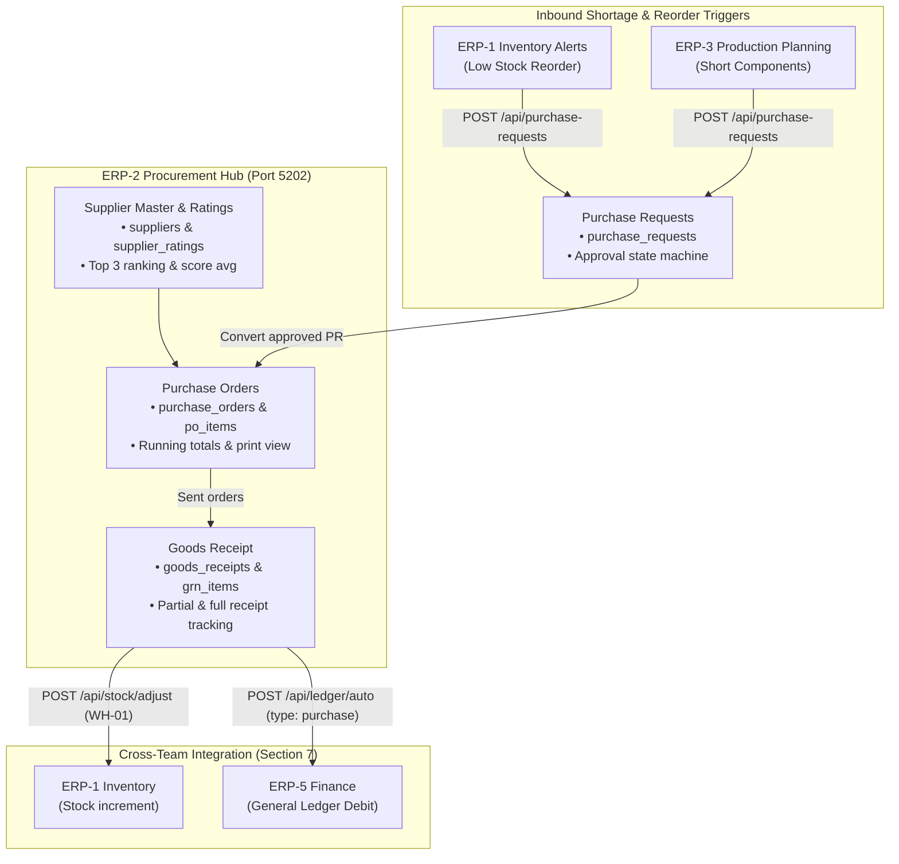

# ERP-2 Procurement & Suppliers — Module Specification & Architecture Guide

> **Module**: ERP-2 Procurement & Suppliers (Purchasing)  
> **Backend Service**: `services/erp2` (Express on Port `5202`)  
> **Database**: PostgreSQL `erp2_db`  
> **Frontend Module**: `frontend/src/modules/erp2` (Module ID: `erp2`, Title: `Purchasing`, Roles: `["admin", "warehouse", "finance"]`)  
> **Workflow Position**: Upstream supply chain engine (Supplier Master, Vendor Ratings, Purchase Requests, Purchase Orders, Goods Receipt Note / GRN)

---

## 1. Domain Overview & Responsibilities

Team **ERP-2 Procurement & Suppliers** is responsible for component and inventory procurement across the entire Electro App enterprise suite. The module manages the entire procure-to-pay lifecycle upstream of manufacturing and customer delivery:

1. **Suppliers Directory & Vendor Rating**:
   - Master catalog of verified part vendors (`SUP-0001` to `SUP-0006`).
   - Statutory compliance tracking (15-character GSTIN, payment terms: `advance`, `net15`, `net30`).
   - Dynamic vendor performance rating (delivery score 1–5, quality score 1–5) and top 3 supplier rankings.
2. **Purchase Requests (PR)**:
   - Automated ingestion of material shortage requests from **ERP-1** (low finished goods stock) and **ERP-3** (bill-of-materials shortage during production planning).
   - Approval workflow state machine (`pending` -> `approved` / `rejected` -> `converted`).
3. **Purchase Orders (PO)**:
   - Multi-item purchase order generation with running ₹ cost calculations.
   - Lifecycle state machine: `draft` -> `sent` -> `partially_received` -> `received` (or `cancelled`).
   - Strict editing validation (only `draft` orders can be edited or deleted).
   - Printable vendor purchase order document with CSS print stylesheet.
4. **Goods Receipt Note (GRN) & Downstream Side-Effects**:
   - Intake of physical shipments at warehouses (e.g. `WH-01` Mumbai).
   - Validation against over-receiving remaining quantities.
   - Cross-team inventory increment dispatched to **ERP-1** (`POST /api/stock/adjust`).
   - Cross-team financial ledger posting dispatched to **ERP-5** (`POST /api/ledger/auto`).

---

## 2. Architecture & System Flow



---

## 3. Cross-Team Integration Contracts (Section 7)

ERP-2 participates in rows 13, 14, 15, and 17 of the shared cross-team contract table:

| Contract Row | Source Issue | Target Issue | Method & Endpoint | Payload / Contract Fields | Purpose |
|---|---|---|---|---|---|
| **Row 13** | **ERP1-D3** | **ERP2-B1** | `POST /api/purchase-requests` | `{ sku, product_name, quantity, requested_by, reason }` | Automated reorder trigger when SKU drops below reorder point. |
| **Row 17** | **ERP3-A3** | **ERP2-B1** | `POST /api/purchase-requests` | `{ sku, product_name, quantity, requested_by, reason }` | Raw component replenishment request for work orders. |
| **Row 14** | **ERP2-D1** | **ERP1-B1** | `POST /api/stock/adjust` | `{ sku, warehouse_id: 'WH-01', delta, reason: '<GRN-ID>' }` | Increases physical stock count upon vendor delivery. |
| **Row 15** | **ERP2-D1** | **ERP5-D1** | `POST /api/ledger/auto` | `{ type: 'purchase', reference: '<GRN-ID>', amount: <total> }` | Posts commercial purchase entry to corporate accounts. |

---

## 4. Complete API Reference

All backend endpoints are served on port `5202` and prefixed with `/api`. Requests require JWT authentication (`requireAuth`) passed via `Authorization: Bearer <token>`.

### 4.1 Suppliers Master & Ratings API

#### `GET /api/suppliers`
Returns all suppliers matching search and city filters.
- **Query Parameters**:
  - `q`: Search substring across name, contact person, email, GSTIN, or ID.
  - `city`: Exact city filter (e.g. `Pune`, `Bengaluru`).
  - `active`: Boolean filter (`true` or `false`).
- **Response `200 OK`**:
```json
{
  "data": [
    {
      "id": "SUP-0001",
      "name": "Precision Display Panels Ltd",
      "contact_person": "Vikram Malhotra",
      "phone": "+91 98201 12345",
      "email": "orders@precisiondisplay.co.in",
      "city": "Pune",
      "gstin": "27AAACP1234A1Z5",
      "payment_terms": "net30",
      "rating": 4.80,
      "active": true
    }
  ]
}
```

#### `GET /api/suppliers/top`
Returns the 3 highest-rated suppliers sorted by `rating DESC, id ASC`.

#### `GET /api/suppliers/:id`
Retrieves detailed profile for a supplier by ID. Returns `404` if not found.

#### `POST /api/suppliers`
Registers a new component supplier.
- **Request Body**:
```json
{
  "name": "Delta Semiconductors LLP",
  "contact_person": "Anand Verma",
  "phone": "+91 98111 22334",
  "email": "sales@deltasemi.in",
  "city": "Noida",
  "gstin": "09AAACD1234E1Z9",
  "payment_terms": "net15",
  "active": true
}
```

#### `PATCH /api/suppliers/:id`
Partially updates an existing supplier's details.

#### `DELETE /api/suppliers/:id`
Soft-deactivates a supplier (`active = false`).

#### `GET /api/suppliers/:id/ratings`
Returns all recorded ratings for a supplier sorted by `created_at DESC`.

#### `POST /api/suppliers/:id/ratings`
Submits a performance evaluation and recalculates `suppliers.rating` as the average of all score metrics:
- **Request Body**:
```json
{
  "delivery_score": 5,
  "quality_score": 5,
  "comment": "Exceptional delivery speed with zero rejected panels."
}
```
- **Response `201 Created`**:
```json
{
  "data": {
    "id": "RAT-0007",
    "supplier_id": "SUP-0001",
    "delivery_score": 5,
    "quality_score": 5,
    "comment": "Exceptional delivery speed with zero rejected panels.",
    "new_average_rating": 4.85
  }
}
```

---

### 4.2 Purchase Requests API

#### `GET /api/purchase-requests`
Lists purchase requests with optional `?status=pending|approved|rejected|converted` filter.

#### `POST /api/purchase-requests`
External intake endpoint for cross-team requests. Only requires the 5 standard fields:
```json
{
  "sku": "SKU-0101",
  "product_name": "Display Panel 55 inch",
  "quantity": 100,
  "requested_by": "ERP-3",
  "reason": "Short components for Work Order WO-0002"
}
```

#### `PATCH /api/purchase-requests/:id/decision`
Approve or reject a pending request (`{ "status": "approved" | "rejected" }`). Enforces that only `pending` requests can be decided (returns `400 Bad Request` otherwise).

#### `POST /api/purchase-requests/:id/convert`
Converts an approved request into a draft purchase order with `{ "supplier_id": "SUP-0001" }`. Sets request status to `converted`. Returns `400` if request is not approved.

---

### 4.3 Purchase Orders API

#### `GET /api/purchase-orders`
Lists all POs with optional `?status=draft|sent|partially_received|received|cancelled`.

#### `GET /api/purchase-orders/:id`
Retrieves PO details including all line items (`po_items`).

#### `POST /api/purchase-orders`
Creates a new purchase order with multiple items in a single atomic transaction:
```json
{
  "supplier_id": "SUP-0001",
  "expected_date": "2026-11-25",
  "items": [
    { "sku": "SKU-0101", "product_name": "Display Panel 55 inch", "quantity": 100, "unit_cost": 12500 }
  ]
}
```

#### `PATCH /api/purchase-orders/:id/status`
Transitions PO status (`sent`, `cancelled`). Sending a PO stamps `sent_at = CURRENT_TIMESTAMP`. Editing or deleting non-draft POs is rejected with `400 Bad Request`.

---

### 4.4 Goods Receipt (GRN) API

#### `POST /api/goods-receipts`
Records intake of ordered goods, updates received quantities, triggers inventory adjustment in ERP-1, and posts purchase debit to ERP-5 ledger:
```json
{
  "po_id": "PO-0001",
  "received_by": "EMP-0009",
  "notes": "Delivered in good condition to Bay 3",
  "items": [
    { "sku": "SKU-0101", "received_qty": 100 }
  ]
}
```

#### `GET /api/receipts/pending`
Lists sent purchase orders that have not yet been fully received. Flags late POs where `expected_date < CURRENT_DATE`.

---

## 5. Running the Service & Testing

### Development Setup
```bash
# Start ERP-2 backend standalone on port 5202
npm --workspace=services/erp2 run dev

# Start unified frontend shell on port 3000
npm --workspace=frontend run dev
```

### Verification & Automated Testing
```bash
# Run unit and integration tests
node --test services/erp2/tests/suppliersRoutes.test.js

# Run smoke tests across repository
npm run smoke

# Verify frontend production build
npm run build
```
