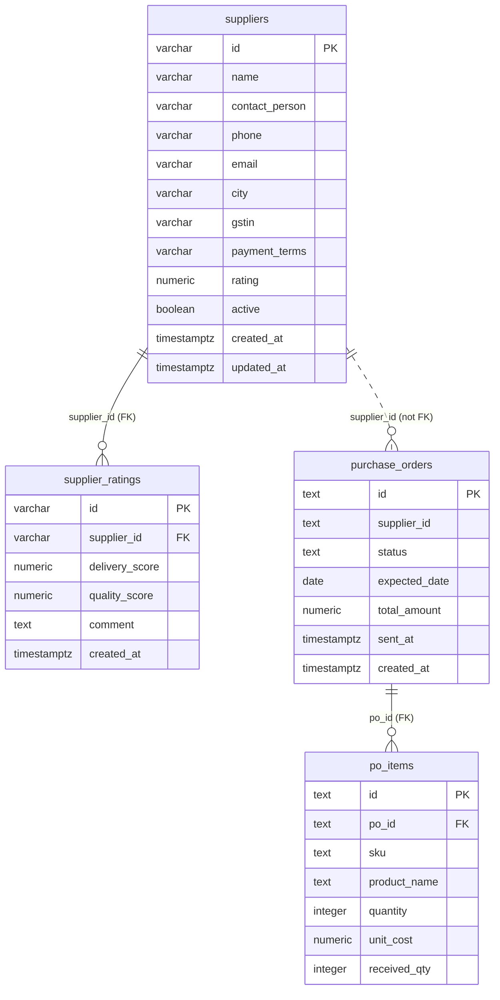

# ERP-2 data model and seed review

This is the first version, based on the ERP-2 schema on `main`. Update it when the purchase-request and goods-receipt schemas are merged. The diagram distinguishes enforced foreign keys from references that the database does not enforce.

## Data dictionary

| Table | Column | Type | Meaning |
|---|---|---|---|
| suppliers | id | varchar(32) | Supplier ID, primary key |
| suppliers | name | varchar(255) | Supplier name |
| suppliers | contact_person | varchar(255) | Contact name |
| suppliers | phone | varchar(50) | Contact telephone |
| suppliers | email | varchar(255) | Contact email |
| suppliers | city | varchar(100) | Supplier city |
| suppliers | gstin | varchar(15) | GST registration number |
| suppliers | payment_terms | varchar(20) | advance, net15 or net30 |
| suppliers | rating | numeric(3,2) | Stored aggregate rating, 0–5 |
| suppliers | active | boolean | Whether supplier is active |
| suppliers | created_at, updated_at | timestamptz | Creation and update times |
| supplier_ratings | id | varchar(32) | Rating ID, primary key |
| supplier_ratings | supplier_id | varchar(32) | Foreign key to supplier; delete cascades |
| supplier_ratings | delivery_score, quality_score | numeric(2,1) | Scores from 1 to 5 |
| supplier_ratings | comment | text | Rating comment |
| supplier_ratings | created_at | timestamptz | Rating creation time |
| purchase_orders | id | text | PO ID, primary key |
| purchase_orders | supplier_id | text | Supplier ID; no database foreign key |
| purchase_orders | status | text | draft, sent, partially_received, received or cancelled |
| purchase_orders | expected_date | date | Expected delivery date |
| purchase_orders | total_amount | numeric(14,2) | Stored order total in INR |
| purchase_orders | sent_at, created_at | timestamptz | Sent and creation times |
| po_items | id | text | PO item ID, primary key |
| po_items | po_id | text | Foreign key to PO; delete cascades |
| po_items | sku | text | ERP-1 product ID; no database foreign key |
| po_items | product_name | text | Product name stored on the order item |
| po_items | quantity | integer | Positive ordered quantity |
| po_items | unit_cost | numeric(12,2) | Positive unit cost in INR |
| po_items | received_qty | integer | Received quantity, from zero to ordered quantity |

## Schema and normalization review

- The schema creates four tables. It drops `purchase_requests`, `goods_receipts`, and `grn_items` but does not recreate them yet. ERP2-B1 and ERP2-D1 must be merged and the diagram updated before this is the final model.
- The tables have primary keys and the two foreign keys shown above. Purchase orders do not enforce a supplier foreign key; product SKUs refer to ERP-1 data rather than a local product table.
- `suppliers.rating` and `purchase_orders.total_amount` are stored derived values, and `po_items.product_name` copies product data. These are useful snapshots or aggregates, but strict 3NF would derive them or store product attributes in a product table. Keep these values consistent in the application.

## Seed verification

- The ERP-2 seed contains suppliers `SUP-0001`–`SUP-0006`, four orders, and five items using shared product IDs `SKU-0101`–`SKU-0105`. It contains no customer, employee, dealer, warehouse, or serial IDs to compare.
- The IDs match the component IDs in ERP-1's seed. The ERP-2 item name `TV panel` for `SKU-0101` differs from ERP-1's `55-inch Panel`; confirm whether this historical order-item name is intentional. The other names differ only in capitalization.
- Running `npm run reset` exits successfully, but `scripts/db-setup.js` currently only prints a placeholder message. It does not create databases or load either SQL file, so an actual reset and seed load remain unverified. Recheck against a disposable PostgreSQL database after the reset implementation and remaining schemas are merged.
