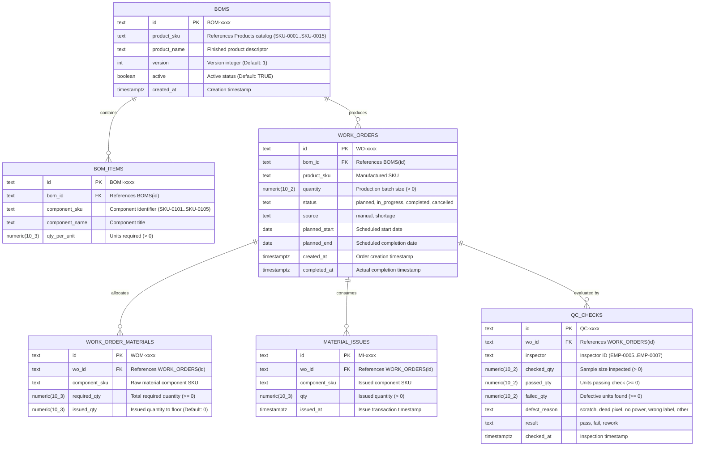

# Team ERP-3: Entity-Relationship Diagram & Data Dictionary

This document details the complete database architecture for **Team ERP-3 (Production & Quality Control)** in PostgreSQL (`erp3_db`), including the 3NF Entity-Relationship Diagram, comprehensive data dictionary, normalization verification, and Section 5 shared seed contract compliance.

---

## 1. Entity-Relationship Diagram (3NF)

---

## 2. Comprehensive Data Dictionary

### 2.1 Table: `boms`
The header table for Bill of Materials defining product recipes and revisions.

| Column | Type | Constraints | Default | Description |
|---|---|---|---|---|
| `id` | `TEXT` | `PRIMARY KEY` | `'BOM-' \|\| LPAD(nextval('boms_seq'), 4, '0')` | Unique BOM identifier (`BOM-0001`, `BOM-0002`, etc.) |
| `product_sku` | `TEXT` | `NOT NULL` | — | Finished product SKU from Section 5 catalog (e.g. `SKU-0001`, `SKU-0003`) |
| `product_name` | `TEXT` | `NOT NULL` | — | Human-readable product name (e.g. '55-Inch LED Smart TV') |
| `version` | `INT` | `NOT NULL` | `1` | Revision number of the bill of materials |
| `active` | `BOOLEAN` | `NOT NULL` | `TRUE` | Whether this BOM version is active for production |
| `created_at` | `TIMESTAMPTZ` | `NOT NULL` | `NOW()` | Timestamp when BOM was drafted |

*Constraints:*
- `UNIQUE (product_sku, version)` ensures version uniqueness per product.

---

### 2.2 Table: `bom_items`
Detailed component line items specifying raw materials required to assemble one unit of the BOM.

| Column | Type | Constraints | Default | Description |
|---|---|---|---|---|
| `id` | `TEXT` | `PRIMARY KEY` | `'BOMI-' \|\| LPAD(nextval('bom_items_seq'), 4, '0')` | Unique line item identifier (`BOMI-0001`, `BOMI-0002`, etc.) |
| `bom_id` | `TEXT` | `NOT NULL, REFERENCES boms(id) ON DELETE CASCADE` | — | Foreign key pointing to parent BOM header |
| `component_sku` | `TEXT` | `NOT NULL` | — | Raw material component SKU (`SKU-0101` to `SKU-0105`) |
| `component_name`| `TEXT` | `NOT NULL` | — | Component descriptor (e.g. 'Display Panel', 'Main Board') |
| `qty_per_unit` | `NUMERIC(10,3)` | `NOT NULL, CHECK (qty_per_unit > 0)` | — | Quantity of component required to produce 1 finished unit |

---

### 2.3 Table: `work_orders`
Manufacturing production orders executing the assembly of finished products.

| Column | Type | Constraints | Default | Description |
|---|---|---|---|---|
| `id` | `TEXT` | `PRIMARY KEY` | `'WO-' \|\| LPAD(nextval('work_orders_seq'), 4, '0')` | Unique work order ID (`WO-0001`, `WO-0002`, etc.) |
| `bom_id` | `TEXT` | `NOT NULL, REFERENCES boms(id) ON DELETE RESTRICT` | — | Bill of materials recipe used for production |
| `product_sku` | `TEXT` | `NOT NULL` | — | Finished product SKU being manufactured |
| `quantity` | `NUMERIC(10,2)` | `NOT NULL, CHECK (quantity > 0)` | — | Target manufacturing batch quantity |
| `status` | `TEXT` | `NOT NULL, CHECK (status IN ('planned', 'in_progress', 'completed', 'cancelled'))` | `'planned'` | Production order lifecycle status |
| `source` | `TEXT` | `NOT NULL, CHECK (source IN ('manual', 'shortage'))` | `'manual'` | Origin of order (`manual` line order or auto-`shortage`) |
| `planned_start` | `DATE` | `NULLABLE` | — | Scheduled manufacturing commencement date |
| `planned_end` | `DATE` | `NULLABLE` | — | Scheduled manufacturing completion date |
| `created_at` | `TIMESTAMPTZ` | `NOT NULL` | `NOW()` | Work order creation timestamp |
| `completed_at` | `TIMESTAMPTZ` | `NULLABLE` | — | Timestamp when work order achieved 'completed' status |

*Indexes:*
- `idx_work_orders_status ON work_orders(status)`
- `idx_work_orders_source ON work_orders(source)`
- `idx_work_orders_product_sku ON work_orders(product_sku)`

---

### 2.4 Table: `work_order_materials`
Component allocation snapshot instantiated from the active BOM upon work order creation.

| Column | Type | Constraints | Default | Description |
|---|---|---|---|---|
| `id` | `TEXT` | `PRIMARY KEY` | `'WOM-' \|\| LPAD(nextval('work_order_materials_seq'), 4, '0')` | Allocation line identifier (`WOM-0001`, `WOM-0002`, etc.) |
| `wo_id` | `TEXT` | `NOT NULL, REFERENCES work_orders(id) ON DELETE CASCADE` | — | Foreign key pointing to parent work order |
| `component_sku` | `TEXT` | `NOT NULL` | — | Required raw component SKU (`SKU-0101`..`SKU-0105`) |
| `required_qty` | `NUMERIC(10,3)` | `NOT NULL, CHECK (required_qty >= 0)` | — | Total quantity required (`quantity * qty_per_unit`) |
| `issued_qty` | `NUMERIC(10,3)` | `NOT NULL, CHECK (issued_qty >= 0)` | `0` | Cumulative quantity issued from warehouse WH-01 to line |

*Indexes:*
- `idx_wom_wo_id ON work_order_materials(wo_id)`
- `idx_wom_component_sku ON work_order_materials(component_sku)`

---

### 2.5 Table: `material_issues`
Immutable audit log recording raw material dispatches issued from warehouse to the assembly line.

| Column | Type | Constraints | Default | Description |
|---|---|---|---|---|
| `id` | `TEXT` | `PRIMARY KEY` | `'MI-' \|\| LPAD(nextval('material_issues_seq'), 4, '0')` | Issue record ID (`MI-0001`, `MI-0002`, etc.) |
| `wo_id` | `TEXT` | `NOT NULL, REFERENCES work_orders(id) ON DELETE CASCADE` | — | Target work order consuming the component |
| `component_sku` | `TEXT` | `NOT NULL` | — | Raw material component SKU issued |
| `qty` | `NUMERIC(10,3)` | `NOT NULL, CHECK (qty > 0)` | — | Dispatched quantity |
| `issued_at` | `TIMESTAMPTZ` | `NOT NULL` | `NOW()` | Timestamp of warehouse dispatch |

*Indexes:*
- `idx_material_issues_wo_id ON material_issues(wo_id)`
- `idx_material_issues_component_sku ON material_issues(component_sku)`

---

### 2.6 Table: `qc_checks`
Quality assurance inspection records evaluating batch lots against manufacturing tolerances.

| Column | Type | Constraints | Default | Description |
|---|---|---|---|---|
| `id` | `TEXT` | `PRIMARY KEY` | `'QC-' \|\| LPAD(nextval('qc_checks_seq'), 4, '0')` | Inspection check ID (`QC-0001`, `QC-0002`, etc.) |
| `wo_id` | `TEXT` | `NOT NULL, REFERENCES work_orders(id) ON DELETE CASCADE` | — | Target work order inspected |
| `inspector` | `TEXT` | `NOT NULL` | — | Shared Employee ID of QC engineer (`EMP-0005`..`EMP-0007`) |
| `checked_qty` | `NUMERIC(10,2)` | `NOT NULL, CHECK (checked_qty > 0)` | — | Total unit sample count inspected |
| `passed_qty` | `NUMERIC(10,2)` | `NOT NULL, CHECK (passed_qty >= 0)` | — | Units passing all quality standards |
| `failed_qty` | `NUMERIC(10,2)` | `NOT NULL, CHECK (failed_qty >= 0)` | — | Defective units detected |
| `defect_reason` | `TEXT` | `NULLABLE` | — | Reason for defect: `scratch`, `dead pixel`, `no power`, `wrong label`, `other` |
| `result` | `TEXT` | `NOT NULL, CHECK (result IN ('pass', 'fail', 'rework'))` | — | Automated outcome based on tolerance threshold |
| `checked_at` | `TIMESTAMPTZ` | `NOT NULL` | `NOW()` | Timestamp inspection was conducted |

*Integrity Constraints:*
- `CONSTRAINT chk_qc_qty_sum CHECK (passed_qty + failed_qty = checked_qty)` ensures mathematical integrity.
- Rule: `pass` if `failed_qty == 0`; `fail` if `failed_qty > 0.20 * checked_qty`; `rework` otherwise.

*Indexes:*
- `idx_qc_checks_wo_id ON qc_checks(wo_id)`
- `idx_qc_checks_result ON qc_checks(result)`

---

## 3. Third Normal Form (3NF) Justification

1. **First Normal Form (1NF)**:
   - All attributes contain atomic scalar values (no comma-delimited strings, nested JSON arrays, or repeating groups).
   - Every entity defines an explicit, unique primary key (`id`).
2. **Second Normal Form (2NF)**:
   - All tables utilize single-attribute primary keys (`id`), meaning every non-key column is fully functionally dependent on the entire primary key, eliminating partial functional dependencies.
3. **Third Normal Form (3NF)**:
   - There are zero transitive functional dependencies ($X \rightarrow Y \rightarrow Z$).
   - `work_orders` references `bom_id` and does not duplicate component recipes or component names from `bom_items`.
   - `qc_checks` references `wo_id` and does not redundantly store work order status, manufacturing dates, or product categories.
   - Component requirements are calculated and copied to `work_order_materials` as an independent point-in-time allocation to prevent retro-active changes if a BOM is subsequently updated.

---

## 4. Section 5 Shared Seed Contract Verification

Team ERP-3 seed data adheres strictly to the monorepo's shared integration contract:

| Entity | Shared Seed Range | ERP-3 Usage & Verification |
|---|---|---|
| **Finished Products** | `SKU-0001` .. `SKU-0015` | `SKU-0001` (55" LED TV), `SKU-0002` (43" LED TV), `SKU-0003` (65" OLED TV), `SKU-0004` (32" HD TV), `SKU-0005` (75" QLED TV) mapped across `BOM-0001` to `BOM-0005` and `WO-0001` to `WO-0005`. |
| **Component SKUs** | `SKU-0101` .. `SKU-0105` | `SKU-0101` (Display Panel), `SKU-0102` (Main Board), `SKU-0103` (Power Supply Unit), `SKU-0104` (Remote Control), `SKU-0105` (Packaging Box) used consistently across all 5 BOMs. |
| **QC Inspectors** | `EMP-0005` .. `EMP-0007` | Quality inspections logged exclusively by shared service engineers `EMP-0005`, `EMP-0006`, and `EMP-0007`. |
| **Warehouses** | `WH-01` .. `WH-03` | Raw materials issued from and finished goods posted to main manufacturing warehouse `WH-01`. |

### Idempotency & Clean Re-runnability
`services/erp3/db/seed.sql` and `services/erp3/db/schema.sql` are 100% idempotent:
- `DELETE FROM` statements execute in reverse dependency order (`material_issues` $\rightarrow$ `work_order_materials` $\rightarrow$ `qc_checks` $\rightarrow$ `work_orders` $\rightarrow$ `bom_items` $\rightarrow$ `boms`).
- Sequence counters (`boms_seq`, `bom_items_seq`, `work_orders_seq`, `qc_checks_seq`, `work_order_materials_seq`, `material_issues_seq`) are safely restarted to ensure deterministic primary keys.
- Executing `npm run reset` or re-running the SQL files against an empty or populated database runs cleanly with zero foreign key violations or duplicate key errors.
