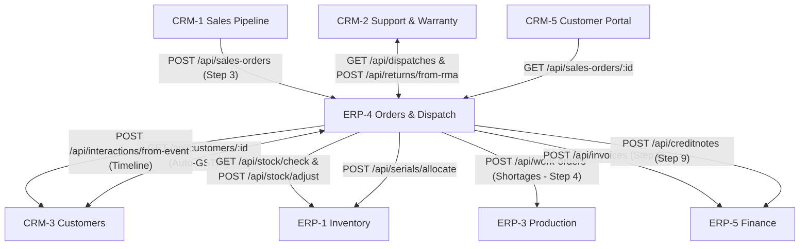

# ERP-4: Orders & Dispatch

> **Team**: ERP-4 Orders and Dispatch  
> **Backend Service**: `services/erp4` · Port **5204**  
> **Database**: `erp4_db` (PostgreSQL)  
> **Frontend Module**: `frontend/src/modules/erp4` (Mount path: `/erp4`)  
> **Roles**: `admin`, `sales`, `warehouse`  
> **Workflow**: Order-to-Cash Steps 3, 4, 5 & 9 (Sales Orders, Stock Reservation, Courier Dispatch, Returns & RMA)

---

## 1. What This Module Does

ERP-4 serves as the operational execution bridge between CRM Sales and ERP Warehouse Logistics:

1. **Sales Order Management** (`Member A - Kaushal`): Converts accepted customer quotes from CRM-1 into confirmed sales orders, computes 18% GST with INR totals, and enriches corporate customer GSTIN details from CRM-3.
2. **Stock Reservation & Shortage** (`Member B - Tejas`): Verifies real-time stock levels with ERP-1 (`/api/stock/check`), places hard reservations on warehouse items, and automatically dispatches production work orders to ERP-3 on stock shortages.
3. **Dispatch & Courier Logistics** (`Member C - Harsh`): Allocates serialized items (`TV55-2611-xxxx`), assigns courier tracking (BlueDart, Delhivery, DTDC), generates printable dispatch notes, deducts stock in ERP-1, and triggers commercial invoicing in ERP-5.
4. **Returns & RMA Restocking** (`Member D - Aaroh`): Processes customer returns initiated from CRM-2 support tickets, restocks verified serialized products back into ERP-1 inventory, and issues credit notes in ERP-5.

---

## 2. Cross-Team Contracts & Integrations

ERP-4 coordinates with 5 external microservices across CRM and ERP domains:



### Inbound Integrations (Who Calls ERP-4)

| Calling Service | Endpoint | HTTP Method | Purpose |
|---|---|---|---|
| **CRM-1** | `/api/sales-orders` | `POST` | Accepted quotes trigger sales order generation. Repeated `quote_id` returns HTTP 409 Conflict. |
| **CRM-2** | `/api/dispatches` | `GET` | Warranty sync service fetches shipped serial numbers, customer IDs, and ship dates. |
| **CRM-2** | `/api/returns/from-rma` | `POST` | Approved RMA handoff creates return record; idempotent on repeated `rma_id`. |
| **CRM-5** | `/api/sales-orders/:id` | `GET` | Customer self-service portal displays real-time order tracking steps. |

### Outbound Integrations (Who ERP-4 Calls)

| Target Service | Endpoint | HTTP Method | Mock Name | Purpose |
|---|---|---|---|---|
| **CRM-3** | `/api/customers/:id` | `GET` | `customer` | Auto-enriches customer legal name and 15-character GSTIN. |
| **CRM-3** | `/api/interactions/from-event`| `POST` | — | Logs order dispatch and delivery milestones on customer timeline. |
| **ERP-1** | `/api/stock/check` | `GET` | `stock-check` | Verifies product availability across warehouses (`WH-01` to `WH-03`). |
| **ERP-1** | `/api/serials/allocate` | `POST` | `serials-allocate` | Allocates individual serialized units for picking and dispatch. |
| **ERP-1** | `/api/stock/adjust` | `POST` | — | Decrements warehouse stock on shipment; increments on restocking. |
| **ERP-1** | `/api/serials/:serial/status` | `PATCH` | — | Updates serial lifecycle state (`sold`, `returned`, `in_stock`). |
| **ERP-3** | `/api/work-orders` | `POST` | `work-order` | Requests production run when reservation check reports a shortage. |
| **ERP-5** | `/api/invoices` | `POST` | `invoices` | Automatically issues commercial GST invoice when order is shipped. |
| **ERP-5** | `/api/creditnotes` | `POST` | — | Automatically generates credit note for authorized RMA returns. |

---

## 3. Team Member Ownership & Deliverables

| Member | Role Issue | Build Issues | Functional Domain |
|---|---|---|---|
| **Kaushal (Team Lead)** | `[ERP4-R1] #169` | `[ERP4-A1] #98`<br>`[ERP4-A2] #99`<br>`[ERP4-A3] #100` | Sales Orders tables & REST API, order listing & detail screens, confirmation/cancellation lifecycle, CRM-3 customer lookup. |
| **Tejas (Data Owner)** | `[ERP4-R2] #170` | `[ERP4-B1] #101`<br>`[ERP4-B2] #102`<br>`[ERP4-B3] #103` | 3NF ER diagram, data dictionary, stock reservation API, reservation UI panel, ERP-3 shortage production integration. |
| **Harsh (UI Owner)** | `[ERP4-R3] #171` | `[ERP4-C1] #104`<br>`[ERP4-C2] #105`<br>`[ERP4-C3] #106` | Screen wireframes, dispatch & courier API/screens, serial tracking, ERP-1 stock deduction, ERP-5 invoicing, dispatch note. |
| **Aaroh (QA Owner)** | `[ERP4-R4] #172` | `[ERP4-D1] #107`<br>`[ERP4-D2] #108`<br>`[ERP4-D3] #109` | Test matrix (`tests.md`), OpenAPI spec (`api.md`), returns API/screens, CRM-2 RMA ingestion, restock & ERP-5 credit notes. |

---

## 4. Complete REST Endpoints Reference

### Sales Orders Module
* `POST /api/sales-orders` — Create new sales order with line items; validates quote uniqueness (409).
* `GET /api/sales-orders` — List sales orders (supports `?customer_id=` and `?status=`).
* `GET /api/sales-orders/:id` — Retrieve sales order details with nested line items.
* `PATCH /api/sales-orders/:id/confirm` — Transition order status from `created` to `confirmed` (400 if illegal).
* `PATCH /api/sales-orders/:id/cancel` — Cancel order prior to dispatch; releases stock reservations (400 if illegal).

### Stock Reservations Module
* `POST /api/sales-orders/:id/reserve` — Query ERP-1 inventory, create reservation records, and flag shortages.
* `DELETE /api/sales-orders/:id/reservations` — Release all active reservations for an order.

### Dispatch & Logistics Module
* `POST /api/dispatches` — Create dispatch record with courier and tracking number; allocates serials from ERP-1.
* `GET /api/dispatches` — List all dispatches with serial numbers for CRM-2 warranty registration.
* `PATCH /api/dispatches/:id/status` — Advance dispatch status (`picked` -> `shipped` -> `delivered`); triggers stock deduction and invoicing.

### Returns & RMA Module
* `POST /api/returns` — Log return request for a dispatched serial number.
* `POST /api/returns/from-rma` — Create return directly from CRM-2 approved RMA (idempotent).
* `GET /api/returns` — List returns with status filtering.
* `PATCH /api/returns/:id/status` — Advance return status (`requested` -> `received` -> `restocked` / `scrapped`).
* `GET /api/returns/summary` — Aggregate return KPI metrics grouped by reason and status.

---

## 5. How to Run Locally

### Start Backend Service Only (Port 5204)
```bash
npm --workspace=services/erp4 run dev
```

### Health Check
```bash
curl http://localhost:5204/api/health
# Response: { "status": "ok", "team": "erp4", "name": "ERP-4 Orders & Dispatch", "port": 5204 }
```

### Start Monorepo (Frontend + All Services)
```bash
npm run dev
# Web application available at http://localhost:3000
# ERP-4 module route: http://localhost:3000/erp4
```

---

## 6. Daily Team Standup & Governance Rules

As Team Leader, verify the following checks during every standup:
1. **Strict Folder Boundaries**: No PR may touch files outside `services/erp4/`, `frontend/src/modules/erp4/`, or `docs/erp4/`.
2. **Shared Contract Adherence**: All customer IDs must use `CUST-0001`..`0008`, products `SKU-0001`..`0015`, employees `EMP-0001`..`0004`, and serials `TV55-2611-xxxx`.
3. **Module Registration**: Every frontend page must be registered in `frontend/src/modules/erp4/index.jsx` with allowed roles `admin`, `sales`, and `warehouse`.
4. **No Direct Localhost**: Frontend code must use `api('erp4', path)` and backend inter-service calls must use `callService()`.
