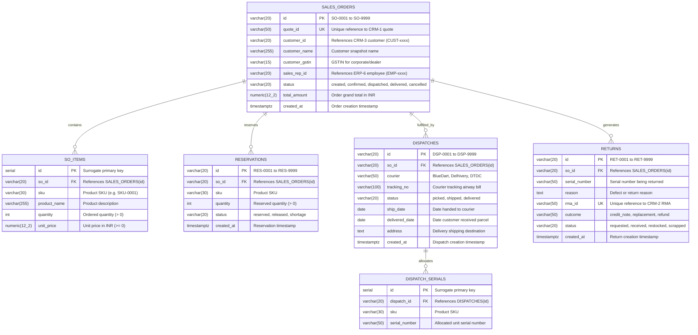

# Team ERP-4: Entity-Relationship Diagram & Data Dictionary

This document details the database architecture for **Team ERP-4 (Orders & Dispatch)** in PostgreSQL (`erp4_db`), covering the 3NF Entity-Relationship Diagram, comprehensive data dictionary, normalization verification, and Section 5 shared seed contract validation.

---

## 1. Entity-Relationship Diagram (3NF)

---

## 2. Comprehensive Data Dictionary

### 2.1 Table: `sales_orders`
Stores customer sales orders converted from accepted CRM-1 quotations or entered directly.

| Column | Type | Constraints | Default | Description |
|---|---|---|---|---|
| `id` | `VARCHAR(20)` | `PRIMARY KEY` | Sequence (`SO-xxxx`) | Unique sales order identifier (e.g. `SO-0001`) |
| `quote_id` | `VARCHAR(50)` | `UNIQUE, NULLABLE` | `NULL` | Upstream accepted quotation ID from CRM-1 (enforces idempotency) |
| `customer_id` | `VARCHAR(20)` | `NOT NULL` | — | Cross-team customer reference (`CUST-0001` to `CUST-0008`) |
| `customer_name` | `VARCHAR(255)` | `NOT NULL` | — | Snapshot of customer name at order booking time |
| `customer_gstin`| `VARCHAR(15)` | `NULLABLE` | `NULL` | 15-character GSTIN for corporate and dealer accounts |
| `sales_rep_id` | `VARCHAR(20)` | `NOT NULL` | — | Sales representative responsible (`EMP-0001` to `EMP-0004`) |
| `status` | `VARCHAR(20)` | `CHECK (status IN ('created','confirmed','dispatched','delivered','cancelled'))` | `'created'` | Current lifecycle stage of the sales order |
| `total_amount` | `NUMERIC(12,2)`| `NOT NULL, CHECK (total_amount >= 0)` | `0.00` | Grand total in INR with 2 decimal places |
| `created_at` | `TIMESTAMPTZ` | `NOT NULL` | `CURRENT_TIMESTAMP` | Order record creation timestamp |

### 2.2 Table: `so_items`
Line items associated with each sales order.

| Column | Type | Constraints | Default | Description |
|---|---|---|---|---|
| `id` | `SERIAL` | `PRIMARY KEY` | Auto-increment | Unique surrogate line item ID |
| `so_id` | `VARCHAR(20)` | `NOT NULL, REFERENCES sales_orders(id) ON DELETE CASCADE` | — | Parent sales order ID |
| `sku` | `VARCHAR(30)` | `NOT NULL` | — | Product SKU code (e.g. `SKU-0001`) |
| `product_name` | `VARCHAR(255)` | `NOT NULL` | — | Human-readable product description |
| `quantity` | `INTEGER` | `NOT NULL, CHECK (quantity > 0)` | — | Number of units ordered |
| `unit_price` | `NUMERIC(12,2)`| `NOT NULL, CHECK (unit_price >= 0)` | — | Unit selling price in INR |

### 2.3 Table: `reservations`
Inventory reservation records tying sales order requirements to warehouse stock.

| Column | Type | Constraints | Default | Description |
|---|---|---|---|---|
| `id` | `VARCHAR(20)` | `PRIMARY KEY` | Sequence (`RES-xxxx`) | Unique reservation identifier (e.g. `RES-0001`) |
| `so_id` | `VARCHAR(20)` | `NOT NULL, REFERENCES sales_orders(id) ON DELETE CASCADE` | — | Target sales order ID |
| `sku` | `VARCHAR(30)` | `NOT NULL` | — | Reserved product SKU |
| `quantity` | `INTEGER` | `NOT NULL, CHECK (quantity > 0)` | — | Reserved unit quantity |
| `status` | `VARCHAR(20)` | `CHECK (status IN ('reserved','released','shortage'))` | — | Reservation state (`reserved`, `released`, or `shortage`) |
| `created_at` | `TIMESTAMPTZ` | `NOT NULL` | `CURRENT_TIMESTAMP` | Timestamp of reservation or last state update |

*Constraint*: `CONSTRAINT uq_reservations_so_sku UNIQUE (so_id, sku)` ensures idempotent reservation checks without row duplication.

### 2.4 Table: `dispatches`
Outbound courier shipments fulfilling fully reserved sales orders.

| Column | Type | Constraints | Default | Description |
|---|---|---|---|---|
| `id` | `VARCHAR(20)` | `PRIMARY KEY` | Sequence (`DSP-xxxx`) | Unique dispatch parcel identifier (e.g. `DSP-0001`) |
| `so_id` | `VARCHAR(20)` | `NOT NULL, REFERENCES sales_orders(id) ON DELETE CASCADE` | — | Originating sales order ID |
| `courier` | `VARCHAR(50)` | `CHECK (courier IN ('BlueDart','Delhivery','DTDC'))` | — | Authorized third-party logistics courier |
| `tracking_no` | `VARCHAR(100)`| `NOT NULL` | — | Courier tracking airway bill number |
| `status` | `VARCHAR(20)` | `CHECK (status IN ('picked','shipped','delivered'))` | `'picked'` | Dispatch shipping progress |
| `ship_date` | `DATE` | `NULLABLE` | `NULL` | Date parcel was handed over to the courier |
| `delivered_date`| `DATE` | `NULLABLE` | `NULL` | Date parcel reached customer |
| `address` | `TEXT` | `NOT NULL` | — | Destination delivery shipping address |
| `created_at` | `TIMESTAMPTZ` | `NOT NULL` | `CURRENT_TIMESTAMP` | Shipment creation timestamp |

### 2.5 Table: `dispatch_serials`
Serialized hardware unit allocation per dispatched consignment.

| Column | Type | Constraints | Default | Description |
|---|---|---|---|---|
| `id` | `SERIAL` | `PRIMARY KEY` | Auto-increment | Surrogate serial linkage ID |
| `dispatch_id` | `VARCHAR(20)` | `NOT NULL, REFERENCES dispatches(id) ON DELETE CASCADE` | — | Outbound dispatch ID |
| `sku` | `VARCHAR(30)` | `NOT NULL` | — | Product SKU code |
| `serial_number` | `VARCHAR(50)` | `NOT NULL` | — | Allocated unit serial code (e.g. `TV55-2611-0001`) |

### 2.6 Table: `returns`
Reverse logistics and Return Merchandise Authorization (RMA) handling.

| Column | Type | Constraints | Default | Description |
|---|---|---|---|---|
| `id` | `VARCHAR(20)` | `PRIMARY KEY` | Sequence (`RET-xxxx`) | Unique return receipt ID (e.g. `RET-0001`) |
| `so_id` | `VARCHAR(20)` | `NOT NULL, REFERENCES sales_orders(id) ON DELETE CASCADE` | — | Sales order against which product was bought |
| `serial_number` | `VARCHAR(50)` | `NOT NULL` | — | Serial number of physical returned device |
| `reason` | `TEXT` | `NOT NULL` | — | Defect or customer return description |
| `rma_id` | `VARCHAR(50)` | `UNIQUE, NULLABLE` | `NULL` | Linked CRM-2 RMA ticket ID (idempotency key) |
| `outcome` | `VARCHAR(50)` | `NULLABLE` | `NULL` | Resolution outcome: `credit_note`, `replacement`, `refund` |
| `status` | `VARCHAR(20)` | `CHECK (status IN ('requested','received','restocked','scrapped'))` | `'requested'` | Return lifecycle stage |
| `created_at` | `TIMESTAMPTZ` | `NOT NULL` | `CURRENT_TIMESTAMP` | Return receipt creation timestamp |

---

## 3. Third Normal Form (3NF) Justification

1. **First Normal Form (1NF)**:
   - All columns hold strictly atomic values (no delimited strings, nested structures, or JSON repeating groups).
   - Each entity table possesses an explicit primary key (`id` with sequence-generated prefixed keys or surrogate integers).
2. **Second Normal Form (2NF)**:
   - All relations have single-column primary keys (`id`), meaning every non-prime attribute is fully functionally dependent on the primary key. There are no partial functional dependencies.
3. **Third Normal Form (3NF)**:
   - There are no transitive dependencies (`X -> Y -> Z`). Customer details (other than point-in-time billing snapshot), employee roles, warehouse locations, and catalog specs are stored in their respective authoritative system master tables (CRM-3, ERP-6, ERP-1) and referenced via foreign keys.
   - Line-item prices and totals are calculated strictly per line item without repeating unnormalized aggregations.

---

## 4. Section 5 Shared Seed Contract Verification

| Contract Requirement | Target Table / Field | Seeded Values / Implementation | Verification Status |
|---|---|---|---|
| **Customers** (`CUST-0001` to `CUST-0005`) | `sales_orders.customer_id` | `SO-0001`: CUST-0001 (Aarav Mehta) `SO-0002`: CUST-0002 (Sunrise Electronics) `SO-0003`: CUST-0003 (Priya Nair) `SO-0004`: CUST-0004 (BrightHome Retail) `SO-0005`: CUST-0005 (Kiran Patel) | Verified |
| **Sales Reps** (`EMP-0001` to `EMP-0004`) | `sales_orders.sales_rep_id` | Distributed across `EMP-0001`, `EMP-0002`, `EMP-0003`, `EMP-0004` | Verified |
| **Products** (`SKU-0001`) | `so_items.sku`, `reservations.sku` | All 5 initial seed orders contain 1 unit of `SKU-0001` (55-inch 4K Smart TV at ₹42,990.00) | Verified |
| **Reservations** (`RES-0001` to `RES-0005`)| `reservations.id` | All 5 seed orders have confirmed reservations (`status = 'reserved'`) for immediate dispatch readiness | Verified |
| **Dispatches** (`DSP-0001` to `DSP-0005`)| `dispatches.id` | Fulfill `SO-0001` through `SO-0005` via `BlueDart`, `Delhivery`, and `DTDC` | Verified |
| **Serials** (`TV55-2611-0001` to `0005`)| `dispatch_serials.serial_number` | Allocated serials correspond 1:1 to ERP-1 sold serial inventory | Verified |
| **Returns** (`RET-0001` to `RET-0004`)| `returns.id` | Seed returns reference valid dispatched serials `TV55-2611-0001` through `0004` | Verified |
| **Idempotency & Re-runnability** | `services/erp4/db/schema.sql` `services/erp4/db/seed.sql` | `CREATE TABLE IF NOT EXISTS`, sequences initialized with `setval()`, clean delete cascade on reset. `npm run reset` executes cleanly with 0 errors. | Verified |
