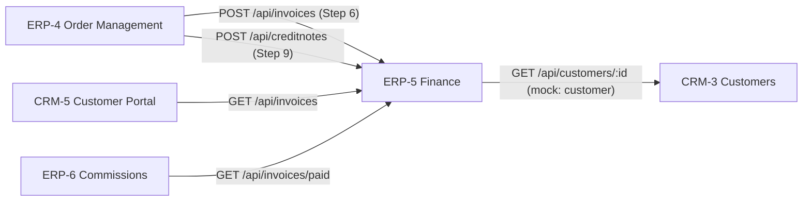

# ERP-5 Finance, Access & The App Shell

> **Module**: ERP-5 Finance & General Ledger  
> **Backend Service**: `services/erp5` (Express on Port `5205`)  
> **Database**: PostgreSQL `erp5_db`  
> **Frontend Module**: `frontend/src/modules/erp5` (Roles: `["admin", "finance"]`)  
> **Workflow**: Order-to-Cash Steps 6, 7 & 9 (Commercial Invoicing, Payment Tracking, Ledger, Credit Notes)

---

## 1. Module Overview

Team ERP-5 is responsible for the financial backbone of the Electro App monorepo suite:
- **Commercial GST Invoicing**: Generation of compliant tax invoices with automatic 18% GST calculation (9% CGST + 9% SGST), idempotency on sales order IDs (`so_id`), and customer GSTIN resolution.
- **Bill View & Printing**: Printable single-page commercial invoices with corporate branding, tax breakdowns, statutory disclosures, and automated **Amount in Words** (Indian numbering system: Crores, Lakhs, Thousands, Hundreds, and Paise).
- **Credit Notes**: Commercial credit note issuance for RMA returns (Workflow Step 9), reducing receivable balances, automatically transitioning fully credited invoices to `paid`, with deterministic duplicate prevention (HTTP 409).
- **General Ledger Automation**: Balanced double-entry ledger postings (debit receivables, credit sales for invoices; debit sales, credit receivables for credit notes) committed atomically within the same PostgreSQL transaction.
- **Financial Analytics & Filters**: Real-time aggregated financial KPI cards (`total_billed`, `total_outstanding`) and flexible date range, customer, and status filtering.

---

## 2. Cross-Team Contracts & Integration

ERP-5 serves as the central billing and settlement hub:



### Inbound Integrations (Who Calls ERP-5)
| Caller | Method & Path | Purpose |
|---|---|---|
| **ERP-4** | `POST /api/invoices` | Dispatched sales order generates commercial tax invoice. Repeated `so_id` returns HTTP 200 (idempotent). |
| **ERP-4** | `POST /api/creditnotes` | RMA return approved for refund/credit note. Repeated order + serial returns HTTP 409. |
| **CRM-5** | `GET /api/invoices` | Displays billing history on customer self-service portal. |
| **ERP-6** | `GET /api/invoices/paid` | Sales commission calculation for paid invoices linked to `sales_rep_id`. |

### Outbound Integrations (Who ERP-5 Calls)
| Target Team | Method & Path | Mock Fallback | Purpose |
|---|---|---|---|
| **CRM-3** | `GET /api/customers/:id` | `services/erp5/mocks/customer.json` | Retrieves corporate or dealer GSTIN when not provided in the invoice payload. |

---

## 3. API Reference

All endpoints require JWT Bearer authentication (`requireAuth`).

### `POST /api/invoices`
Creates a commercial tax invoice. Idempotent on `so_id`.
- **Request Body**:
```json
{
  "so_id": "SO-0002",
  "customer_id": "CUST-0002",
  "customer_name": "Sunrise Electronics Pvt Ltd",
  "customer_gstin": "27AABCS1234F1Z5",
  "sales_rep_id": "EMP-0002",
  "invoice_date": "2026-11-02",
  "items": [
    {
      "sku": "SKU-0002",
      "description": "Smart Fitness Watch",
      "quantity": 5,
      "unit_price": 2999.00,
      "tax_rate": 18.00
    }
  ]
}
```
- **Responses**:
  - `201 Created`: Invoice and line items inserted, ledger pair posted, `amount_in_words` calculated.
  - `200 OK`: Existing invoice returned if `so_id` was already processed (ERP-4 safe retry).
  - `400 Bad Request`: Missing customer ID or empty items array.

### `GET /api/invoices`
Lists all invoices matching optional filter criteria.
- **Query Parameters**:
  - `customer_id` (e.g. `CUST-0002`)
  - `status` (`unpaid`, `partially_paid`, `paid`)
  - `from_date` & `to_date` (`YYYY-MM-DD` date range)
- **Response**: `{ "data": [ ... ] }`

### `GET /api/invoices/:id`
Fetches a single invoice by ID along with line items and amount in words.
- **Response**:
```json
{
  "data": {
    "id": "INV-0002",
    "so_id": "SO-0002",
    "customer_id": "CUST-0002",
    "customer_name": "Sunrise Electronics Pvt Ltd",
    "customer_gstin": "27AABCS1234F1Z5",
    "subtotal": "18993.00",
    "cgst": "1709.37",
    "sgst": "1709.37",
    "total": "22411.74",
    "status": "unpaid",
    "amount_in_words": "Rupees Twenty-Two Thousand Four Hundred Eleven and Seventy-Four Paise Only",
    "items": [ ... ]
  }
}
```

### `GET /api/invoices/summary`
Aggregates commercial metrics for executive dashboards.
- **Response**:
```json
{
  "data": {
    "total_billed": 113828.70,
    "total_outstanding": 113828.70,
    "total_invoices": 6,
    "unpaid_count": 5,
    "partially_paid_count": 1,
    "paid_count": 0
  }
}
```

### `POST /api/creditnotes`
Issues a credit note against an order and serial number.
- **Request Body**:
```json
{
  "so_id": "SO-0002",
  "serial_number": "SN-0002",
  "amount": 2999.00
}
```
- **Responses**:
  - `201 Created`: Credit note stored, invoice balance updated, ledger pair posted.
  - `409 Conflict`: Returned if a credit note has already been issued for this order and serial number.
  - `404 Not Found`: Returned if no invoice exists for the provided `so_id`.

### `GET /api/creditnotes`
Lists all credit notes. Supports `?so_id=` and `?invoice_id=`.

---

## 4. Frontend Routes

Mounted at `/erp5/*` in the unified Vite shell:
- `/erp5/invoices`: Interactive invoices table, KPI summary cards, filter toolbar (customer, status, date range), and "+ Create Manual Invoice" modal.
- `/erp5/invoices/:id`: Printable tax invoice bill with corporate header, GSTIN details, items breakdown, Amount in Words, and `@media print` hiding the shell sidebar.
- `/erp5/credit-notes`: Credit notes directory with total credited KPI metrics and quick links to invoice bills.

---

## 5. Running & Verification

```bash
# 1. Initialize schema & shared seed contract data
psql -U postgres -d erp5_db -f services/erp5/db/schema.sql
psql -U postgres -d erp5_db -f services/erp5/db/seed.sql

# 2. Run backend service
npm --workspace=services/erp5 run dev

# 3. Run frontend shell
npm --workspace=frontend run dev

# 4. Verify syntax & frontend production build
npm run smoke
npm run build
```
