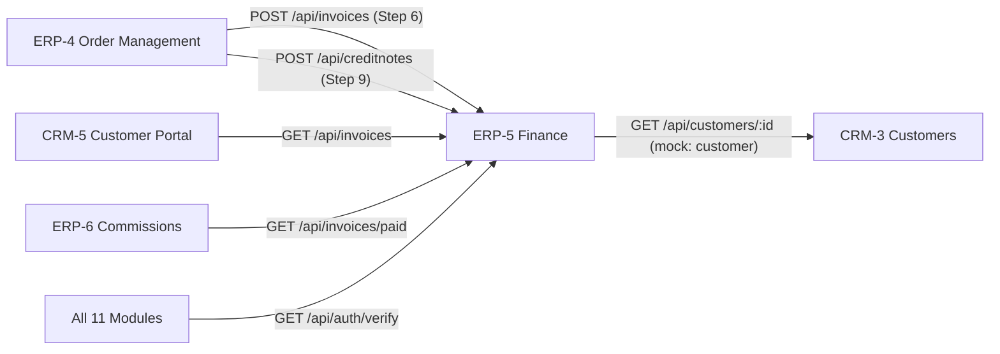

# ERP-5 Finance, Access & The App Shell

> **Team**: ERP-5 Finance & General Ledger  
> **Backend Service**: `services/erp5` · Port **5205**  
> **Database**: `erp5_db` (PostgreSQL)  
> **Frontend Module**: `frontend/src/modules/erp5`  
> **Roles**: `admin`, `finance`, `sales`, `support`, `warehouse`, `hr`  
> **Workflow**: Order-to-Cash Steps 6, 7 & 9 (Commercial Invoicing, Payment Tracking, Ledger, Credit Notes)

---

## 1. What This Module Does

ERP-5 owns two central domains for the whole application:

1. **Authentication & Access** — The single auth service (`POST /api/auth/login`) that all 11 teams rely on. It issues JWTs, manages demo users, verifies tokens, and provides role-based navigation.
2. **Commercial Finance & Billing** — GST tax invoices with 18% GST (9% CGST + 9% SGST), single-page printable bills with Indian numbering **Amount in Words**, credit notes for RMA returns (Workflow Step 9) with duplicate prevention (HTTP 409), and balanced double-entry ledger postings.

---

## 2. Cross-Team Contracts & Integration

ERP-5 serves as the central billing, auth, and settlement hub:



### Inbound Integrations (Who Calls ERP-5)
| Caller | Method & Path | Purpose |
|---|---|---|
| **All Teams** | `GET /api/auth/verify?token=` | Token verification across services. |
| **ERP-4** | `POST /api/invoices` | Dispatched sales order generates commercial tax invoice. Repeated `so_id` returns HTTP 200 (idempotent). |
| **ERP-4** | `POST /api/creditnotes` | RMA return approved for credit note. Repeated order + serial returns HTTP 409. |
| **CRM-5** | `GET /api/invoices` | Displays billing history on customer self-service portal. |
| **ERP-6** | `GET /api/invoices/paid` | Sales commission calculation for paid invoices linked to `sales_rep_id`. |

### Outbound Integrations (Who ERP-5 Calls)
| Target Team | Method & Path | Mock Fallback | Purpose |
|---|---|---|---|
| **CRM-3** | `GET /api/customers/:id` | `services/erp5/mocks/customer.json` | Retrieves corporate or dealer GSTIN when not provided in the invoice payload. |

---

## 3. Quick Start & Setup

### Option A — Local PostgreSQL
```bash
# 1. Install all monorepo dependencies
npm install

# 2. Setup database schema and seed
psql -U postgres -d erp5_db -f services/erp5/db/schema.sql
psql -U postgres -d erp5_db -f services/erp5/db/seed.sql

# 3. Start services
npm run dev
```

### Option B — Docker Compose
```bash
docker compose up -d
npm run db:setup
npm run dev
```

The app opens at **http://localhost:3000**.  
ERP-5 backend health check: **http://localhost:5205/api/health**

---

## 4. Demo Login Credentials

> All demo passwords are `demo123`.

| Email | Role | Employee ID |
|---|---|---|
| `admin@demo.com` | admin | EMP-0012 |
| `sales@demo.com` | sales | EMP-0001 |
| `finance@demo.com` | finance | EMP-0010 |
| `support@demo.com` | support | — |
| `warehouse@demo.com` | warehouse | — |
| `hr@demo.com` | hr | EMP-0008 |

---

## 5. API Reference

All endpoints (except login/verify) require JWT Bearer authentication (`requireAuth`).

### Authentication & Users
| Method | Path | Auth | Description |
|---|---|---|---|
| `POST` | `/api/auth/login` | None | Login with email + password → returns JWT |
| `GET` | `/api/auth/me` | Bearer JWT | Returns current user decoded token payload |
| `GET` | `/api/auth/verify?token=` | None | Verifies JWT token for external callers |
| `GET` | `/api/users` | admin | List all users in system |
| `POST` | `/api/users` | admin | Create new user with hashed password |

### Commercial Invoicing & Billing
| Method | Path | Auth | Description |
|---|---|---|---|
| `POST` | `/api/invoices` | Bearer JWT | Creates commercial tax invoice. Idempotent on `so_id`. Calculates 9% CGST + 9% SGST. |
| `GET` | `/api/invoices` | Bearer JWT | Lists invoices with filters (`?customer_id=`, `?status=`, `?from_date=`, `?to_date=`). |
| `GET` | `/api/invoices/:id` | Bearer JWT | Single invoice with items array and `amount_in_words`. |
| `GET` | `/api/invoices/summary` | Bearer JWT | Aggregates `total_billed`, `total_outstanding`, and invoice status counts. |

### Credit Notes (Workflow Step 9)
| Method | Path | Auth | Description |
|---|---|---|---|
| `POST` | `/api/creditnotes` | Bearer JWT | Issues credit note for returned serial. Duplicate prevention (409). Reduces invoice balance. |
| `GET` | `/api/creditnotes` | Bearer JWT | Lists credit notes with invoice details (`?so_id=`, `?invoice_id=`). |

---

## 6. Frontend Routes

Registered in `frontend/src/modules/erp5/index.jsx`:
- `/erp5/login`: Shared login form for all roles.
- `/erp5/users`: User management table + add-user form (admin role only).
- `/erp5/invoices`: Invoices dashboard with summary KPI cards, date/status filters, and "+ Create Manual Invoice" modal.
- `/erp5/invoices/:id`: Printable commercial tax invoice bill layout with Amount in Words and `@media print` single-page print styles.
- `/erp5/credit-notes`: Credit notes directory with total credited KPI metrics.

---

## 7. Verification & Tests

```bash
# PMO Syntax Smoke Test & Frontend Production Build
npm run smoke
npm run build

# Interactive 5-Step Demo Script Walkthrough
# Follow docs/erp5/demo.md
```

- [ERP-5 5-Step Demo Script](./demo.md)
- [ERP-5 Issues Pack](./issues.md)
