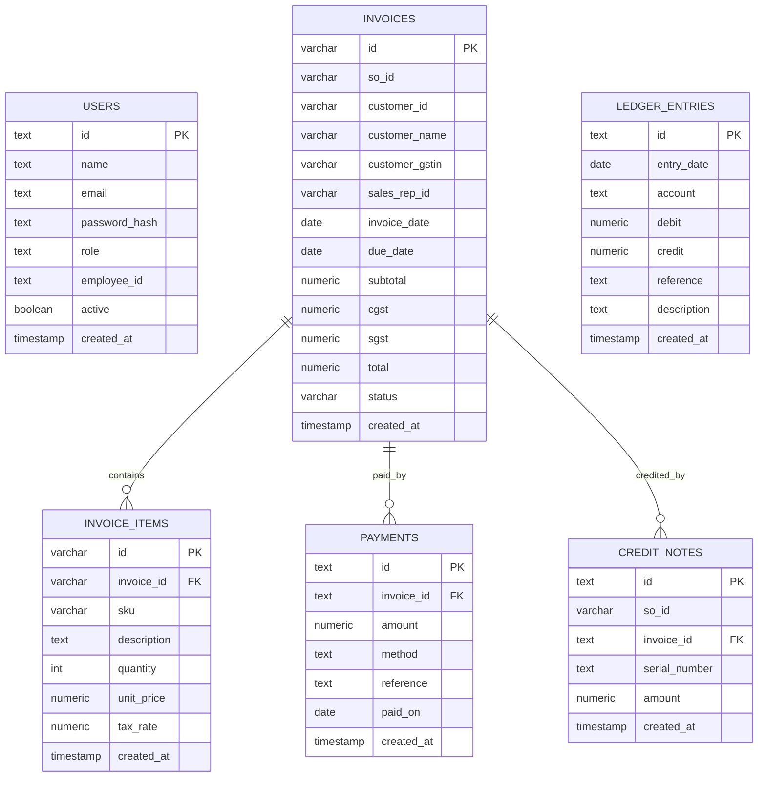

# ERP-5 ER Diagram (3NF)

## Data dictionary

| Table | Column | Type | Meaning |
|---|---|---|---|
| users | id | text | Primary key, e.g. USR-0001 |
| users | email | text | Unique login email |
| users | password_hash | text | Stored hash, never plain text |
| users | role | text | admin/sales/support/warehouse/finance/hr |
| invoices | id | varchar | Primary key, e.g. INV-0001 |
| invoices | so_id | varchar | Source sales order id (idempotency key) |
| invoices | customer_id, customer_name | varchar | Customer header and snapshot |
| invoices | customer_gstin | varchar | GST number for corporate/dealer |
| invoices | subtotal/cgst/sgst/total | numeric | Money in INR, 2 decimals; GST 18% split 9/9 |
| invoices | status | varchar | unpaid / partially_paid / paid |
| invoice_items | quantity/unit_price/tax_rate | number | Line-level quantity, rate, tax % |
| payments | id | text | Primary key, e.g. PAY-0001 |
| payments | method | text | upi / card / bank_transfer / cash |
| payments | paid_on | date | Date the money was received |
| credit_notes | id | text | Primary key, e.g. CN-0001 |
| credit_notes | serial_number | text | Returned product serial that triggered the credit |
| ledger_entries | account | text | sales / receivables / cash / purchases / salary_expense |
| ledger_entries | debit, credit | numeric | Balanced pair amounts for double entry |

## Seed verification checklist
- Customer, SKU, employee, dealer, and serial IDs follow the shared contract.
- `npm run reset` re-creates the databases and reloads schema plus seed data cleanly.
- Payment/credit-note/ledger tables are re-runnable with `CREATE TABLE IF NOT EXISTS`.
