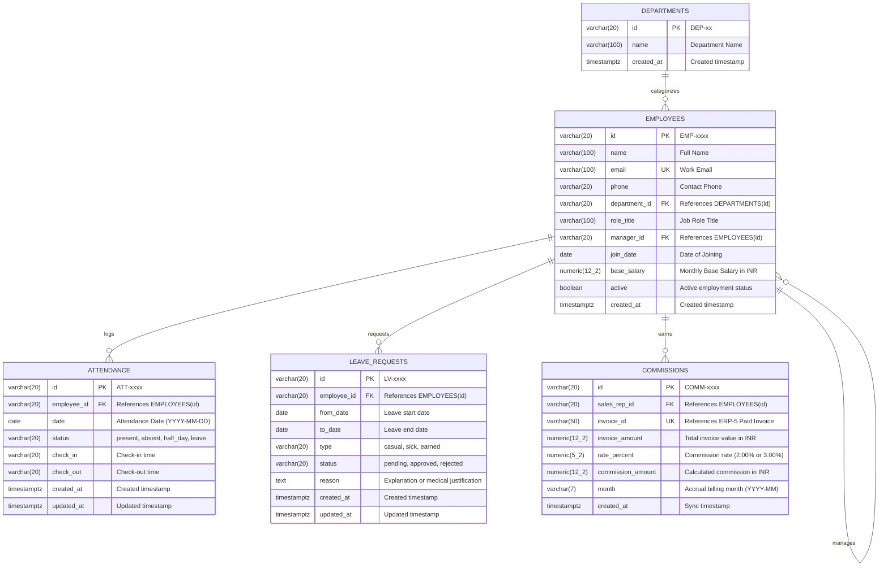

# Team ERP-6: Entity-Relationship Diagram & Data Dictionary

This document details the database architecture for **Team ERP-6 (HR & Workforce)** in PostgreSQL (`erp6_db`), including the 3NF Entity-Relationship Diagram, complete data dictionary, normalization verification, and Section 5 shared seed contract compliance.

---

## 1. Entity-Relationship Diagram (3NF)

---

## 2. Comprehensive Data Dictionary

### 2.1 Table: `departments`
Organizational functional units (Sales, Support, HR, Warehouse/Production, Finance).

| Column | Type | Constraints | Default | Description |
|---|---|---|---|---|
| `id` | `VARCHAR(20)` | `PRIMARY KEY` | `'DEP-' \|\| LPAD(nextval('department_seq')::TEXT, 2, '0')` | Canonical department identifier (`DEP-01` to `DEP-05`) |
| `name` | `VARCHAR(100)` | `NOT NULL` | — | Department title (e.g. 'Sales', 'Finance') |
| `created_at` | `TIMESTAMPTZ` | `NOT NULL` | `NOW()` | Timestamp when the department record was created |

### 2.2 Table: `employees`
Core employee directory holding master records for workforce, sales reps, and service engineers.

| Column | Type | Constraints | Default | Description |
|---|---|---|---|---|
| `id` | `VARCHAR(20)` | `PRIMARY KEY` | `'EMP-' \|\| LPAD(nextval('employee_seq')::TEXT, 4, '0')` | Canonical employee identifier (`EMP-0001` to `EMP-0012`) |
| `name` | `VARCHAR(100)` | `NOT NULL` | — | Full name of the employee |
| `email` | `VARCHAR(100)` | `NOT NULL, UNIQUE` | — | Corporate email address |
| `phone` | `VARCHAR(20)` | `NULL` | — | Contact telephone number |
| `department_id` | `VARCHAR(20)` | `FK -> departments(id) ON DELETE SET NULL` | — | Department association |
| `role_title` | `VARCHAR(100)` | `NOT NULL` | — | Role title (e.g. 'Sales Rep', 'Service Engineer', 'Admin') |
| `manager_id` | `VARCHAR(20)` | `FK -> employees(id) ON DELETE SET NULL` | `NULL` | Hierarchical reporting manager |
| `join_date` | `DATE` | `NOT NULL` | `CURRENT_DATE` | Date employee joined the company |
| `base_salary` | `NUMERIC(12,2)` | `NOT NULL` | `0.00` | Monthly base gross pay in INR |
| `active` | `BOOLEAN` | `NOT NULL` | `TRUE` | Employment status (false hides employee from default lists) |
| `created_at` | `TIMESTAMPTZ` | `NOT NULL` | `NOW()` | Record creation timestamp |

### 2.3 Table: `attendance`
Daily attendance tracking per employee.

| Column | Type | Constraints | Default | Description |
|---|---|---|---|---|
| `id` | `VARCHAR(20)` | `PRIMARY KEY` | `'ATT-' \|\| LPAD(nextval('attendance_seq')::TEXT, 4, '0')` | Unique attendance entry identifier |
| `employee_id` | `VARCHAR(20)` | `NOT NULL, FK -> employees(id) ON DELETE CASCADE` | — | Employee logged |
| `date` | `DATE` | `NOT NULL` | — | Date of attendance (YYYY-MM-DD) |
| `status` | `VARCHAR(20)` | `NOT NULL, CHECK (status IN ('present', 'absent', 'half_day', 'leave'))` | — | Daily attendance status |
| `check_in` | `VARCHAR(20)` | `NULL` | — | Check-in timestamp or time string |
| `check_out` | `VARCHAR(20)` | `NULL` | — | Check-out timestamp or time string |
| `created_at` | `TIMESTAMPTZ` | `NOT NULL` | `NOW()` | Record creation timestamp |
| `updated_at` | `TIMESTAMPTZ` | `NOT NULL` | `NOW()` | Last update timestamp |

> **Unique Constraint**: `CONSTRAINT uq_attendance_employee_date UNIQUE (employee_id, date)` ensures marking attendance twice on the same day updates rather than duplicating.

### 2.4 Table: `leave_requests`
Formal employee leave requests and approvals.

| Column | Type | Constraints | Default | Description |
|---|---|---|---|---|
| `id` | `VARCHAR(20)` | `PRIMARY KEY` | `'LV-' \|\| LPAD(nextval('leave_request_seq')::TEXT, 4, '0')` | Unique leave request identifier (`LV-0001` onwards) |
| `employee_id` | `VARCHAR(20)` | `NOT NULL, FK -> employees(id) ON DELETE CASCADE` | — | Employee requesting leave |
| `from_date` | `DATE` | `NOT NULL` | — | Inclusive leave start date |
| `to_date` | `DATE` | `NOT NULL` | — | Inclusive leave end date |
| `type` | `VARCHAR(20)` | `NOT NULL, CHECK (type IN ('casual', 'sick', 'earned'))` | — | Category of leave |
| `status` | `VARCHAR(20)` | `NOT NULL, DEFAULT 'pending', CHECK (status IN ('pending', 'approved', 'rejected'))` | `'pending'` | Current approval workflow status |
| `reason` | `TEXT` | `NULL` | — | Reason or justification notes |
| `created_at` | `TIMESTAMPTZ` | `NOT NULL` | `NOW()` | Submission timestamp |
| `updated_at` | `TIMESTAMPTZ` | `NOT NULL` | `NOW()` | Decision / update timestamp |

### 2.5 Table: `commissions`
Calculated commissions for sales representatives synchronized from paid ERP-5 invoices.

| Column | Type | Constraints | Default | Description |
|---|---|---|---|---|
| `id` | `VARCHAR(20)` | `PRIMARY KEY` | `'COMM-' \|\| LPAD(nextval('commission_seq')::TEXT, 4, '0')` | Unique commission record ID |
| `sales_rep_id` | `VARCHAR(20)` | `NOT NULL, FK -> employees(id) ON DELETE CASCADE` | — | Sales rep earning the commission (`EMP-0001` to `EMP-0004`) |
| `invoice_id` | `VARCHAR(50)` | `NOT NULL, UNIQUE` | — | Reference to paid ERP-5 commercial invoice |
| `invoice_amount` | `NUMERIC(12,2)` | `NOT NULL` | — | Gross invoice amount in INR |
| `rate_percent` | `NUMERIC(5,2)` | `NOT NULL` | — | Commission percentage rate applied (e.g. 2.00% or 3.00%) |
| `commission_amount`| `NUMERIC(12,2)`| `NOT NULL` | — | Final commission earned (`invoice_amount * rate_percent / 100`) |
| `month` | `VARCHAR(7)` | `NOT NULL` | — | Accounting month in `YYYY-MM` format |
| `created_at` | `TIMESTAMPTZ` | `NOT NULL` | `NOW()` | Timestamp when commission was synchronized |

---

## 3. Third Normal Form (3NF) Normalization Verification

The schema strictly adheres to Third Normal Form (3NF):

1. **First Normal Form (1NF)**:
   - All attributes contain atomic, scalar values.
   - Tables have explicit primary keys (`id`).
   - No repeating groups or multivalued columns exist.

2. **Second Normal Form (2NF)**:
   - Satisfies 1NF.
   - All non-key attributes are fully functionally dependent on the entire primary key (all tables use single-column primary keys, preventing partial key dependencies).

3. **Third Normal Form (3NF)**:
   - Satisfies 2NF.
   - No transitive dependencies exist between non-key attributes.
   - Department attributes (`name`) are isolated in `departments` rather than embedded in `employees`.
   - Employee reporting relationships use self-referential foreign keys (`manager_id -> employees(id)`).
   - Attendance and Leave requests reference `employees(id)` without redundantly storing employee biographical or organizational details.
   - Commission records store only the invoice link, percentage, calculated commission, and rep association, avoiding redundant copies of customer or line item details.

---

## 4. Section 5 Shared Seed Contract Verification

Team ERP-6 complies with the Section 5 Shared Seed Contract:

| Entity | Canonical Range / IDs | Seed Usage in `erp6_db` | Cross-Team Consumer |
|---|---|---|---|
| **Departments** | `DEP-01` to `DEP-05` | `DEP-01` (Sales), `DEP-02` (Support), `DEP-03` (HR), `DEP-04` (Warehouse & Production), `DEP-05` (Finance) | Internal to ERP-6 |
| **Sales Reps** | `EMP-0001` to `EMP-0004` | Rohan Kulkarni, Neha Sharma, Vikram Singh, Anjali Rao | CRM-1 (Quotes, Deals), ERP-4/5 (Sales Orders & Invoices) |
| **Service Engineers** | `EMP-0005` to `EMP-0007` | Imran Qureshi, Deepa Menon, Suresh Kumar | CRM-2 (Service Tickets, RMAs) |
| **Management & Staff** | `EMP-0008` to `EMP-0012` | Meera Joshi (HR), Arjun Das (WH), Kavita Shah (Finance), Manoj Pillai (Production), Rahul Verma (Admin) | ERP-2, ERP-3, ERP-5 (Auth / Approvals) |
| **Attendance Logs** | `ATT-0001` to `ATT-0010` | Daily records for `EMP-0001` through `EMP-0004` | ERP-6 Payroll & Summary |
| **Leave Requests** | `LV-0001` to `LV-0005` | Leave requests for `EMP-0001` through `EMP-0004` | ERP-6 Attendance & Balance |
| **Commissions** | `COMM-0001` to `COMM-0005` | Comm records for `EMP-0001` to `EMP-0004` matching `INV-0091` to `INV-0095` | ERP-6 Sales Performance Leaderboard |

---

## 5. Schema & Seed Execution Verification

The database scripts are completely idempotent:
- All tables created with `CREATE TABLE IF NOT EXISTS`.
- All sequences created with `CREATE SEQUENCE IF NOT EXISTS`.
- All seeds use `ON CONFLICT (...) DO UPDATE` to ensure safe re-runs.
- Sequence high-water marks are aligned via `SELECT setval('..._seq', GREATEST(..., MAX(...)))`.
- `npm run reset` loads clean with zero constraint violations.
